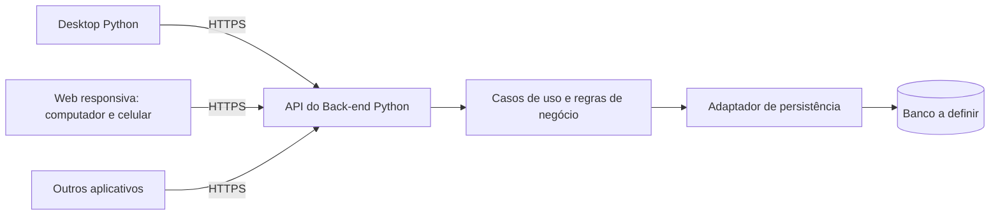
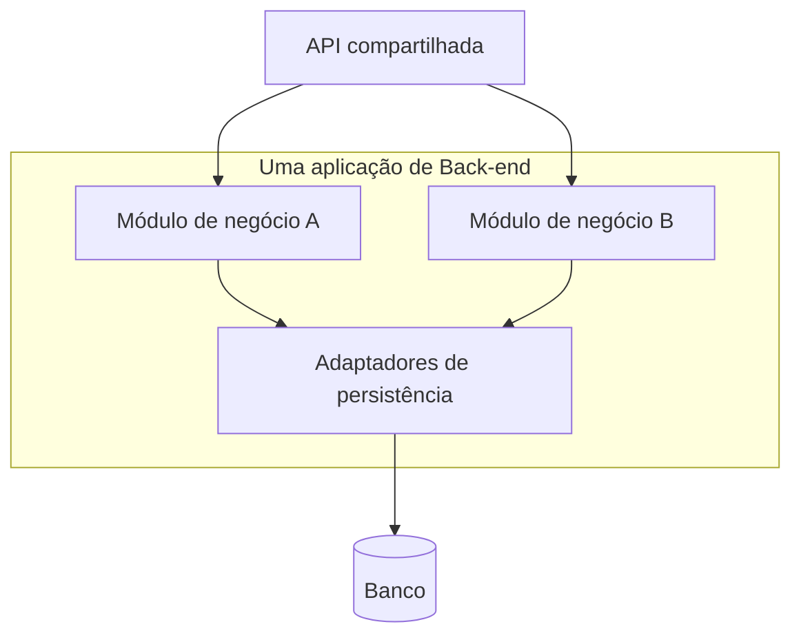
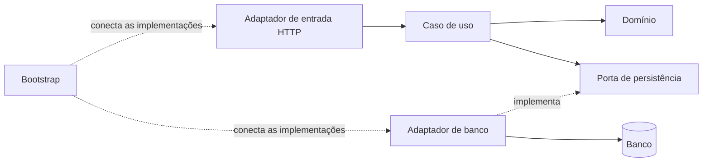
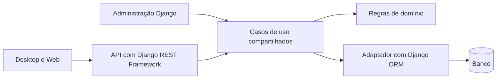
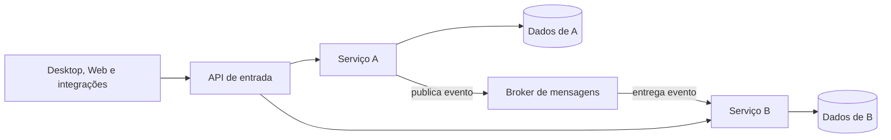
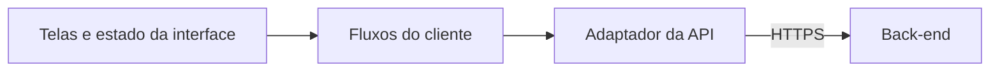
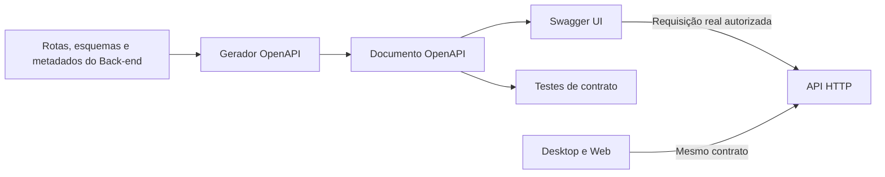

# ProntuarioEdu-Hospitalar

Projeto dividido em **Back-end Python**, **Desktop Python** e **Web responsiva**, cuja tecnologia permanece em aberto. O servidor deve atender os dois clientes e permitir integrar novos aplicativos sem duplicar regras de negócio.

**Estado atual:** estrutura de pastas e documentação. Ainda não há aplicação executável, dependências de aplicação ou testes implementados. A arquitetura descrita é uma proposta, pendente de aprovação na [ADR 0001](docs/adr/0001-arquitetura-inicial.md).

## 1. Visão geral: como as partes se comunicam

O Desktop e a Web são interfaces para o mesmo sistema. Ambos enviam requisições à API do Back-end, que verifica permissões, executa regras e acessa os dados. Um aplicativo integrado futuramente usa essa mesma fronteira pública.



Por exemplo, ao solicitar uma operação no prontuário, a interface coleta os dados; o servidor decide se o usuário pode executar a operação e se os dados respeitam as regras. A resposta pode ser apresentada de maneiras diferentes no Desktop e no celular, sem mudar a regra do servidor.

A proposta usa **REST**, uma forma de organizar operações HTTP, e **OpenAPI**, uma descrição dos caminhos, entradas, saídas e erros da API. Esses contratos permitem construir clientes independentes. Banco e credenciais do servidor não ficam acessíveis aos clientes.

## 2. Arquiteturas consideradas

Os termos descrevem decisões diferentes e podem ser combinados:

| Decisão | Pergunta que responde | Opções |
| --- | --- | --- |
| Distribuição | Quantas aplicações de servidor são implantadas separadamente? | Monólito ou microsserviços |
| Organização interna | Como separar regras e detalhes técnicos? | Módulos, camadas e arquitetura hexagonal |
| Framework | Quais ferramentas implementam HTTP e recursos da aplicação? | FastAPI ou Django + Django REST Framework, por exemplo |
| Comunicação | Como clientes e serviços trocam informações? | REST; eventos quando necessários |

### 2.1. Monólito modular: um servidor, responsabilidades separadas

O Back-end é implantado como uma aplicação, mas seu código é dividido em módulos com responsabilidades claras. Os módulos de negócio serão definidos a partir dos requisitos reais; criar uma pasta para cada módulo não basta, é preciso controlar suas dependências.



As letras representam módulos ainda não escolhidos. Cada módulo expõe operações claras; outro módulo não deve acessar seus detalhes internos sem um contrato definido.

**Quando usar:** início do projeto e equipe que precisa evoluir o produto com implantação simples. Facilita testes e operações que precisam de uma única transação. **Cuidado:** sem limites claros, os módulos se tornam dependentes uns dos outros e mudanças pequenas passam a afetar todo o sistema.

### 2.2. Arquitetura hexagonal: regras no centro, tecnologias nas bordas

A arquitetura hexagonal, também chamada de **portas e adaptadores**, organiza o código para que as regras de negócio não dependam de um framework HTTP, banco de dados ou interface gráfica. Ela pode ser usada dentro de um monólito ou de um microsserviço.

- **Domínio:** conceitos e regras do negócio, escritos em Python sem dependência de HTTP ou banco.
- **Aplicação:** casos de uso que coordenam uma operação e definem as portas necessárias.
- **Portas:** interfaces que descrevem capacidades, como carregar ou salvar dados, sem escolher sua implementação.
- **Adaptadores de entrada:** recebem requisições externas e chamam os casos de uso.
- **Adaptadores de saída:** implementam portas usando banco ou serviços externos.
- **Bootstrap:** conecta as implementações concretas ao iniciar a aplicação.



O diagrama mostra dependências: o caso de uso conhece a porta, e o adaptador implementa essa porta. Durante a execução, o caso de uso chama a implementação conectada pelo bootstrap. O domínio não precisa saber qual banco foi escolhido.

**Quando usar:** regras que precisam ser testadas e evoluir sem ficar presas à infraestrutura. **Cuidado:** criar interfaces e camadas para toda função gera trabalho sem benefício; usar portas nas fronteiras que realmente precisam de separação.

**Recomendação em avaliação:** combinar monólito modular e arquitetura hexagonal no Back-end. Um define a distribuição; o outro organiza as dependências internas.

### 2.3. Django modular com API REST: recursos integrados

Django oferece estrutura de aplicação, ORM para persistência, migrações e administração. Django REST Framework (DRF) acrescenta recursos para APIs. O projeto pode ser dividido em módulos Django e também manter domínio e casos de uso separados.



**Quando usar:** necessidade forte de cadastros, administração e recursos integrados. **Cuidado:** telas administrativas e API devem respeitar as mesmas regras; colocar regras apenas em uma view permite que outro caminho as ignore. O esquema mostra essa coordenação desejada, que precisa ser implementada.

**Alternativa de framework:** FastAPI pode implementar a API da proposta hexagonal, com foco nos contratos HTTP. Nesse caso, persistência, migrações e administração precisam de escolhas próprias. Django e FastAPI são candidatos, não dependências já instaladas; não é necessário adotar ambos.

### 2.4. Microsserviços e eventos: serviços independentes

O Back-end é dividido em serviços implantados separadamente. Cada serviço possui responsabilidades e dados sob seu controle. Serviços podem trocar requisições e publicar eventos, que descrevem algo que já aconteceu.



**Quando usar:** equipes independentes, requisitos comprovados de escala ou isolamento. **Cuidado:** eventos podem chegar com atraso ou repetidos, e operações entre serviços não compartilham automaticamente uma transação. É preciso tratar idempotência, falhas, compatibilidade de eventos, monitoramento e recuperação.

Microsserviços não exigem eventos em toda comunicação, e um monólito também pode usar filas para tarefas demoradas. A recomendação inicial é adiar a distribuição até haver uma necessidade concreta.

## 3. Arquitetura dos clientes

### Desktop Python

A apresentação cuida das telas. A aplicação do cliente coordena os fluxos do usuário. Um adaptador de API traduz essas ações em requisições ao servidor. O toolkit gráfico ainda será escolhido.



Validações locais ajudam a orientar o usuário, mas o servidor sempre verifica autorização e regras novamente. Funcionamento offline não está previsto como decisão aprovada: exigiria armazenamento protegido, sincronização, resolução de conflitos e tratamento da revogação de acesso.

### Web responsiva

A Web organiza telas e fluxos adequados a diferentes tamanhos de tela e consome os mesmos contratos do Back-end. A estrutura interna seguirá as convenções do framework escolhido. Responsividade também exige navegação por toque, formulários utilizáveis e acessibilidade, além de ajustar tamanhos.

Uma PWA pode ser avaliada futuramente. Compatibilidade com celular não significa que instalação ou uso offline já estejam disponíveis.

## 4. Como a estrutura de pastas corresponde à proposta

```text
backend/
  src/prontuario_backend/
    domain/                         Regras e conceitos do negócio
    application/                    Casos de uso e portas
    adapters/inbound/http/           Entrada pela API
    adapters/outbound/persistence/   Implementação do acesso aos dados
    adapters/outbound/integrations/  Comunicação com serviços externos
    bootstrap/                      Composição e configuração
  tests/{unit,integration,contract}/
desktop/
  src/prontuario_desktop/
    presentation/                   Telas e estado
    application/                    Coordenação dos fluxos locais
    adapters/api/                   Cliente da API
    bootstrap/                      Composição e configuração
  tests/{unit,integration}/
web/
  src/                              Organização a definir com o framework
  tests/
contracts/
  openapi/                          Contrato público da API
  examples/                         Exemplos com dados sintéticos
infra/
  development/                      Serviços para desenvolvimento
  deployment/                       Configuração de implantação
docs/
  adr/                              Decisões e respectivas aprovações
```

Os arquivos `.gitkeep` apenas preservam diretórios vazios no Git; não são implementações. Os módulos de negócio ainda serão definidos, sem transformar essas pastas técnicas em funcionalidades por si só.

| Documentação | Conteúdo |
| --- | --- |
| [Back-end](backend/README.md) | Responsabilidades das camadas do servidor |
| [Desktop](desktop/README.md) | Separação dos componentes do cliente Python |
| [Web](web/README.md) | Restrições da interface responsiva |
| [Contratos](contracts/README.md) | Fronteira pública entre clientes e servidor |
| [Infraestrutura](infra/README.md) | Desenvolvimento e implantação futuros |
| [Visão arquitetural](docs/architecture.md) | Dependências da proposta |
| [Alternativas](docs/architecture-options.md) | Opções e critérios de escolha |

## 5. Passos a seguir

A sequência abaixo é um plano de desenvolvimento. Ela não indica tarefas já concluídas nem oferece comandos executáveis antes da escolha das ferramentas.

| Etapa | O que fazer | Evidência para avançar |
| --- | --- | --- |
| 1. Definir o primeiro fluxo | Identificar usuários, permissões, dados necessários e um fluxo pequeno que atravesse cliente e servidor; usar dados sintéticos | Requisitos e critérios de aceitação revisados |
| 2. Validar a arquitetura | Revisar e aprovar a ADR inicial; decidir monólito ou serviços, framework Python, banco, autenticação, toolkit Desktop e necessidade de offline | ADR com decisão, justificativa e aprovação explícita do responsável; Web pode continuar em aberto até sua etapa |
| 3. Preparar o desenvolvimento | Fixar versões de Python e ferramentas, criar manifestos e lockfiles, configuração de exemplo sem segredos e comandos reproduzíveis | Instalação e verificações funcionando em ambiente limpo |
| 4. Definir o contrato | Especificar a primeira operação, respostas, erros, autenticação, paginação quando aplicável e compatibilidade; escolher a fonte de verdade do OpenAPI | Contrato revisado e exemplos que clientes e servidor compreendem |
| 5. Implementar domínio e aplicação | Escrever regras, caso de uso e portas para o primeiro fluxo, sem depender de HTTP ou banco | Testes unitários cobrindo sucesso, erro e limites das regras |
| 6. Conectar o servidor | Implementar adaptadores HTTP e persistência, migrações, configuração e autorização no servidor | Testes de integração e contrato; requisição funcional do primeiro fluxo |
| 7. Construir o Desktop | Escolher o toolkit, criar telas e o adaptador da API; tratar carregamento, erros e sessão | Fluxo real completo contra o servidor com dados de teste |
| 8. Construir a Web | Escolher tecnologia, registrar a decisão e implementar o mesmo fluxo com layout responsivo | Fluxo validado em computador e celular, com testes de acessibilidade e autorização |
| 9. Automatizar a revisão | Configurar CI com testes reais, revisão do Codex e proteções compatíveis com o acesso disponível; exigir ADR para alterações arquiteturais | Checks executados e comportamento de bloqueio verificado; não cadastrar checks inexistentes |
| 10. Preparar a operação | Definir implantação, logs sem dados sensíveis, auditoria, backups, recuperação e distribuição/atualização do Desktop | Implantação de teste e restauração de backup demonstradas antes de produção |

Mudanças em decisões aprovadas precisam de nova ADR ou revisão registrada. As quatro aprovações humanas e a revisão do Codex fazem parte da política solicitada; a documentação não comprova que as proteções estejam ativas no GitHub.

## 6. Como o Swagger será aplicado no Back-end

### OpenAPI e Swagger: funções diferentes

**OpenAPI** é a especificação do contrato HTTP: descreve endpoints, métodos, parâmetros, dados recebidos, respostas, erros e mecanismos de autenticação. **Swagger UI** é uma interface que apresenta esse documento e permite experimentar as operações. A interface usa a mesma API que Desktop, Web e outras integrações vão consumir.



A proposta é gerar o contrato a partir das definições do servidor e validar o resultado. O esquema mostra o planejamento, ainda não implementado. A escolha final da fonte de verdade será registrada na ADR do framework; não manteremos duas especificações editadas manualmente que possam divergir.

### Configuração conforme o framework escolhido

| Candidato | Como produzir o OpenAPI | Como apresentar o Swagger UI |
| --- | --- | --- |
| FastAPI | Usar modelos de entrada/saída, tipagem, metadados das rotas e descrições explícitas de respostas e segurança | Aproveitar o Swagger UI integrado; os caminhos padrão são `/docs` e `/openapi.json`, mas serão confirmados na configuração do projeto |
| Django + DRF | Adotar um gerador compatível, como `drf-spectacular`, com serializers e anotações dos endpoints; a dependência será avaliada antes da instalação | Configurar rotas para o schema e para o Swagger UI; por exemplo, `/api/schema/` e `/api/docs/`, ainda propostos |

Nenhum desses endpoints existe atualmente. O Swagger pertence ao **adaptador HTTP**, não ao domínio: entidades e regras de negócio não devem importar tipos do framework apenas para gerar documentação.

### Conteúdo que cada operação deve documentar

- Identificador estável da operação, descrição e agrupamento por responsabilidade.
- Método HTTP, caminho e versão pública da API; por exemplo, uma convenção `/api/v1` a ser aprovada.
- Campos obrigatórios e opcionais, tipos, formatos, limites e exemplos sintéticos.
- Respostas de sucesso e erros efetivamente implementados, incluindo falhas de validação, autenticação e autorização quando aplicáveis.
- Requisitos de autenticação e permissões, além de paginação, filtros e ordenação nas operações que precisarem desses recursos.

A documentação não cria uma regra: descrever um campo como obrigatório ou informar um esquema de segurança não substitui a validação e a autorização executadas no servidor. Os exemplos devem corresponder ao comportamento real, sem nomes de pacientes, prontuários reais, tokens ou senhas.

### Etapas de implementação e validação

1. Após aprovar o framework, instalar e fixar as dependências do gerador e da interface, quando necessárias.
2. Definir os esquemas HTTP do primeiro fluxo, mantendo-os separados dos modelos internos de persistência e do domínio.
3. Configurar a geração do documento e a interface. Em `contracts/openapi/`, guardar o artefato exportado ou as instruções de geração, conforme a política aprovada; não duplicar manualmente as definições.
4. Configurar o mecanismo de autenticação escolhido. A opção **Authorize** do Swagger UI deve usar esse mecanismo sem embutir credenciais nem segredos de cliente na página.
5. Validar o documento gerado e executar testes contra a implementação: exemplos e esquemas corretos, respostas coerentes, autenticação e autorização funcionando. Uma página de documentação carregada não comprova que a API funciona.
6. Incluir geração/validação do OpenAPI e testes de contrato na CI. Comparar mudanças de contrato para identificar incompatibilidades antes de atualizar clientes.
7. Definir exposição por ambiente: disponibilizar a interface em desenvolvimento; em produção, decidir entre acesso restrito ou desativação conforme os requisitos. Swagger UI e documento OpenAPI precisam de política consistente de acesso.

**Try it out executa operações reais.** Usar ambiente de desenvolvimento e dados sintéticos para experimentar endpoints de escrita; não tratar a interface como simulador. Se a Web ou a documentação estiver em outra origem, configurar CORS apenas para as origens necessárias; CORS não substitui autenticação.

A entrega estará validada quando o schema puder ser gerado de forma reproduzível, a interface o carregar, uma requisição autorizada funcionar no ambiente de teste e os testes verificarem que o contrato corresponde à API.

## 7. Executar e testar hoje

Ainda não há comandos de instalação, inicialização ou testes da aplicação. Depois das decisões e da implementação, esta seção deverá registrar os comandos efetivamente verificados para Back-end, Desktop e Web, incluindo os serviços necessários e como validar sua prontidão.
