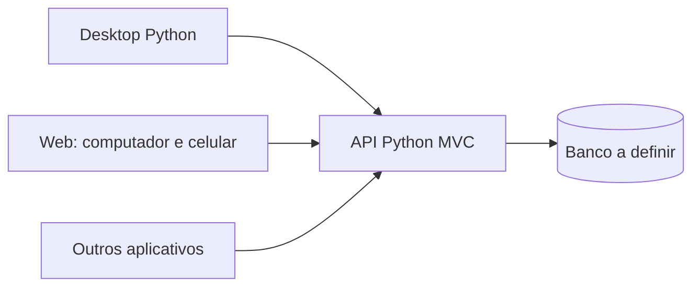
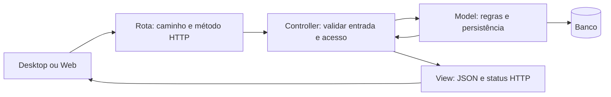
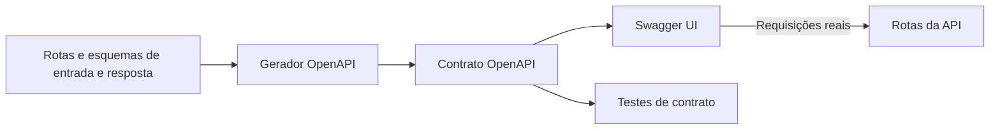

# ProntuarioEdu-Hospitalar

Projeto com **Back-end Python**, **Desktop Python** e **Web responsiva**, com tecnologia Web em aberto. O Back-end adota **MVC**, escolhido para facilitar o aprendizado e o trabalho de uma turma com conhecimento intermediário.

**Estado atual:** Back-end MVC inicial executável com FastAPI, Swagger, SQLAlchemy/SQLite e validação OAuth2/OIDC configurável. Desktop e Web ainda são estruturas documentais. O provedor de autenticação real, o toolkit Desktop e a tecnologia Web precisam de configuração/escolha. A decisão está na [ADR 0001](docs/adr/0001-arquitetura-inicial.md).

## Como o sistema funciona

Desktop, Web e futuros aplicativos usam a mesma API HTTPS. O servidor verifica acesso, aplica regras e acessa o banco. Os clientes cuidam da experiência do usuário e não acessam diretamente os dados do servidor.



A API seguirá contratos HTTP descritos por OpenAPI. Assim, os clientes conhecem entradas, respostas e erros sem depender do código interno do Back-end.

## MVC explicado de forma simples

MVC significa **Model, View e Controller**. Cada parte tem uma responsabilidade fácil de localizar.

| Parte | Pergunta que responde | Exemplo |
| --- | --- | --- |
| Model | Quais são os dados e suas regras? | Validar e salvar uma anotação |
| Controller | O que deve acontecer nesta requisição? | Verificar acesso e pedir a criação ao Model |
| View | Como apresentar o resultado? | Montar JSON com os campos públicos |

No nosso Back-end, **View é uma resposta da API**, não uma tela. Desktop e Web montam suas próprias telas a partir desse JSON. Rotas ligam URLs aos Controllers; configuração inicializa o servidor e o banco.



O Controller recebe a requisição e coordena; não concentra SQL ou todas as regras. O Model pode usar o ORM escolhido para persistir dados, mas não importa Controllers ou Views. A View recebe dados preparados pelo Controller e não consulta o banco. A autenticação identifica o usuário; a autorização verifica se ele pode executar aquela operação naquele registro.

MVC organiza o código; o servidor continua sendo uma aplicação única. Não vamos dividir o projeto em microsserviços nem exigir interfaces de repositório para cada operação. O objetivo é ter responsabilidades claras com poucas camadas.

### Qual framework usar?

FastAPI foi adotado para o ambiente inicial, com Swagger UI integrado. Django + Django REST Framework oferece ORM, migrações e administração. Django usa a nomenclatura MTV: sua view frequentemente exerce a coordenação que aqui chamamos de Controller. Se for escolhido, o mapeamento será documentado, usando as convenções do framework sem criar camadas duplicadas apenas pelo nome.

## Estrutura de pastas

```text
backend/
  src/prontuario_backend/
    models/                  Dados, regras e persistência
    controllers/             Coordenação e verificação de acesso
    views/                   Representação JSON e erros
    routes/                  URLs e métodos HTTP
    config/                  Inicialização, banco, segurança e Swagger
  tests/
    unit/                    Regras e funções isoladas
    integration/             API e banco de teste
    contract/                API em conformidade com OpenAPI
desktop/
  src/prontuario_desktop/
    presentation/            Telas e estado visual
    application/             Fluxos locais do usuário
    adapters/api/            Comunicação HTTP com o servidor
    bootstrap/               Inicialização do cliente
  tests/{unit,integration}/
web/
  src/                       Organização conforme o futuro framework
  tests/
contracts/
  openapi/                   Descrição pública da API
  examples/                  Exemplos sintéticos de entradas e respostas
infra/
  development/               Serviços para desenvolvimento
  deployment/                Implantação futura
docs/
  adr/                       Decisões e aprovações
```

A simplificação para MVC é do Back-end. O Desktop mantém sua estrutura de cliente: tela → fluxo local → cliente HTTP → servidor. A Web terá apresentação responsiva e comunicação com a API conforme as convenções da tecnologia escolhida. Não é necessário copiar a estrutura do servidor nos clientes. Offline e PWA não estão implementados e precisam de decisão própria.

Os arquivos `.gitkeep` preservam pastas vazias no Git. Os READMEs das subpastas explicam onde colocar cada responsabilidade; ainda não existem funcionalidades de aplicação.

| Documento | O que encontrar |
| --- | --- |
| [Back-end](backend/README.md) | MVC, divisão de competências e exemplo prático |
| [Desktop](desktop/README.md) | Telas, fluxos e consumo da API |
| [Web](web/README.md) | Interface responsiva e competências |
| [Contratos](contracts/README.md) | Compatibilidade entre servidor e clientes |
| [Infraestrutura](infra/README.md) | Ambiente e implantação |
| [Documentação](docs/README.md) | Divisão de responsabilidades da equipe |
| [Diagrama arquitetural](docs/architecture.md) | Fluxo completo |
| [Escolhas técnicas](docs/architecture-options.md) | O que foi escolhido e o que está pendente |

## Divisão de competências na turma

| Frente | Responsabilidade | Precisa combinar com |
| --- | --- | --- |
| Models | Dados, validações de negócio e persistência | Controllers e responsáveis pelos requisitos |
| Controllers | Entradas, coordenação e autorização | Models e Views |
| Views e rotas | Campos públicos, erros, caminhos e contrato | Controllers e equipes dos clientes |
| Desktop | Telas Python e consumo da API | Equipe da API |
| Web | Interface responsiva e acessibilidade | Equipe da API |
| Testes e infraestrutura | Validar funcionamento e reproduzir ambiente | Todas as frentes |

Uma pessoa pode atuar em mais de uma frente. Antes de dividir uma funcionalidade, combinar entrada, saída, erros e critérios de aceitação. Não colocar uma regra somente na tela: o servidor precisa verificá-la novamente.

## Exemplo prático do Back-end

Para uma anotação fictícia: a rota recebe o texto; o Controller verifica usuário e permissão; o Model rejeita texto vazio e grava; a View devolve os campos públicos em JSON. O autor vem da identidade autenticada, não de um valor enviado pelo cliente.

O [README do Back-end](backend/README.md#exemplo-prático-registrar-uma-anotação-de-demonstração) mostra o pseudocódigo separado por pasta e os testes necessários. É um exemplo didático, não uma funcionalidade clínica aprovada ou endpoint existente.

## Passos de desenvolvimento

1. **Definir um primeiro fluxo pequeno.** Registrar usuários, permissões, dados necessários e critérios de aceitação, usando dados sintéticos.
2. **Revisar as ferramentas.** FastAPI e SQLAlchemy/SQLite já compõem o ambiente inicial (ADR 0002). Configurar o provedor OAuth2/OIDC e definir toolkit Desktop; Web pode ser decidida em sua etapa.
3. **Preparar o ambiente.** Fixar versões, dependências e lockfiles; documentar configuração sem segredos e comandos verificados de instalação/testes.
4. **Combinar o contrato.** Definir caminho, método, entrada, respostas, erros e segurança da primeira operação; configurar a fonte de verdade do OpenAPI.
5. **Implementar o Model.** Criar dados, regras e persistência; testar as validações e transações relevantes.
6. **Implementar Controller, View e rota.** Autenticar, autorizar, chamar Model e montar resposta; tratar falhas sem expor detalhes internos.
7. **Testar o Back-end completo.** Cobrir sucesso, entrada inválida, acesso negado, ausência de gravação indevida e conformidade com o contrato.
8. **Criar o fluxo no Desktop.** Implementar comunicação, estados de carregamento/erro e tela; verificar o comportamento contra o servidor de teste.
9. **Escolher e desenvolver a Web.** Registrar a tecnologia; testar o mesmo fluxo em computador e celular, incluindo teclado, toque e acessibilidade.
10. **Automatizar e preparar a entrega.** Configurar testes reais na CI e revisão do Codex; definir implantação, auditoria, logs sem dados sensíveis, backups e recuperação. Verificar na prática as proteções de merge disponíveis.

Essas etapas são um plano, não tarefas concluídas. As quatro aprovações humanas e a revisão do Codex fazem parte da política solicitada; arquivos de documentação não comprovam que regras estejam ativas no GitHub.

## Swagger no Back-end

**OpenAPI** descreve o contrato da API. **Swagger UI** apresenta esse documento e permite experimentar requisições reais. As definições de rotas, entradas e respostas alimentam a documentação; o Controller continua verificando acesso e o Model continua validando regras.



| Framework candidato | Como será configurado |
| --- | --- |
| FastAPI | Esquemas tipados e metadados das rotas geram OpenAPI; caminhos padrão `/docs` e `/openapi.json` serão confirmados na configuração |
| Django + DRF | Avaliar gerador como `drf-spectacular`; serializers e metadados geram schema; rotas propostas `/api/schema/` e `/api/docs/` |

Os caminhos FastAPI `/docs` e `/openapi.json` já existem; os de Django são apenas referência. As configurações ficam em `config/`; rotas e esquemas HTTP descrevem entrada e resposta. Essa documentação não deve obrigar Models a conhecer Swagger.

### Como aplicar

1. Escolher o framework e fixar suas dependências.
2. Descrever entradas, campos públicos das respostas, status, erros e autenticação de cada operação.
3. Gerar uma única especificação a partir da fonte aprovada. Em `contracts/openapi/`, guardar a exportação ou instruções de geração; não manter uma cópia manual divergente.
4. Configurar a interface e o botão **Authorize** conforme a autenticação escolhida, sem embutir credenciais ou segredos.
5. Validar o schema e testar requisições reais contra a API de teste, incluindo rejeições por falta de acesso.
6. Incluir validação e comparação de contratos na CI para evitar quebrar clientes existentes.
7. Decidir se Swagger UI e schema terão acesso restrito ou serão desativados em produção. Usar exemplos sintéticos e revisar a exposição de dados.

**Try it out executa a operação de verdade.** Usar ambiente de desenvolvimento para escritas. Swagger não cria autenticação, regras ou testes automaticamente. Se houver origens diferentes, configurar CORS somente para as origens necessárias; isso não substitui autorização.

## Executar e testar hoje

O Back-end tem instruções verificadas de venv, instalação, execução local, testes e Docker no [guia do Back-end](backend/README.md#ambiente-de-desenvolvimento-implementado). Execute de `backend`: `python scripts/dev.py --setup`. A configuração inicial está registrada na [ADR 0002](docs/adr/0002-ambiente-desenvolvimento.md). Desktop e Web ainda não têm aplicação executável.
