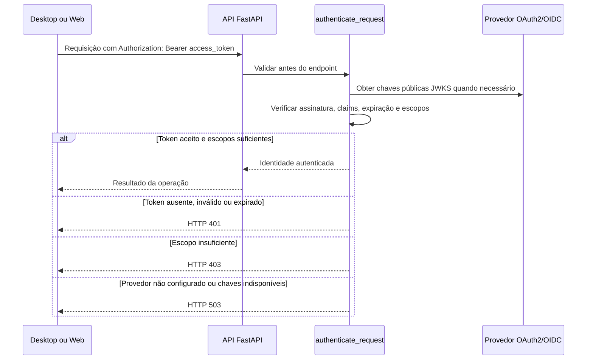

# Autenticação e consulta da validade do acesso

## O que executa antes de uma operação

A função [`authenticate_request`](src/prontuario_backend/config/auth.py) é uma dependência de segurança do FastAPI. Ela executa antes do corpo de cada endpoint que a declara com `Security`. Uma falha encerra a chamada antes da execução desse endpoint.

O fluxo é:



O cache guarda chaves públicas, não decisões de autenticação. O token é validado novamente em cada requisição. `/health` continua público e não usa essa dependência.

## Configurar o provedor real

O desenvolvimento pode usar o Keycloak escolhido pelo responsável e o [bootstrap do administrador da aplicação](ADMINISTRADOR.md), que configura o `.env` e o Swagger. Para outros ambientes/provedores, preencha no `.env`, sem versionar valores reais:

| Variável | Conteúdo |
| --- | --- |
| `OIDC_ISSUER` | Emissor exato esperado no claim `iss`, usando HTTPS |
| `OIDC_AUDIENCE` | Audiência da API; não usar automaticamente o client ID do aplicativo |
| `OIDC_JWKS_URL` | Endpoint HTTPS de chaves públicas do emissor |
| `OIDC_SSL_CA` | CA confiável opcional para verificar o HTTPS do JWKS local |
| `OIDC_AUTHORIZATION_URL` | Endpoint HTTPS de autorização do provedor |
| `OIDC_TOKEN_URL` | Endpoint HTTPS de emissão/renovação de tokens do provedor |
| `OIDC_SCOPE_CLAIM` | `scope` por padrão; selecionar `scp` quando esse for o claim do provedor |
| `OIDC_REFRESH_WINDOW_SECONDS` | Janela para recomendar renovação: 60 segundos por padrão; aceita de 0 a 3600 |
| `SWAGGER_CLIENT_ID` | Client ID público, opcional para abrir a documentação; necessário conforme o cliente registrado no provedor |

Registre no provedor o escopo **`identity:read`**, conceda-o aos clientes autorizados e configure sua inclusão no access token. As rotas `/api/v1/me` e `/api/v1/auth/session` exigem esse escopo. Tokens antes aceitos sem escopos agora recebem `403` nessas rotas.

O token aceito usa **RS256**, com `kid` não vazio no header, assinatura verificada pelas chaves configuradas, `iss`, `aud`, `sub` e `exp` obrigatórios. `sub` deve ser uma string não vazia, de até 255 caracteres; sua caixa e seus espaços são preservados. `exp`, e também `iat`/`nbf` quando presentes, devem ser datas numéricas. Não há tolerância extra de relógio; mantenha os relógios sincronizados.

O claim de escopos é uma string de valores separados por espaços. Papéis, corpo da requisição e claims alternativos não concedem acesso implicitamente. A URL JWKS vem da configuração do servidor; headers do token como `jku` não escolhem de onde obter as chaves.

Reinicie a API ou recrie seu contêiner após alterar as configurações. Configure Authorization Code com PKCE para os clientes públicos; veja o [roteiro do Swagger](README.md#preparar-o-botão-authorize-com-oauth2-e-pkce). Solicite `identity:read` ao autorizar o cliente. O backend recebe **access tokens**, não ID tokens.

## Solicitar o token pelo Swagger

No modo Keycloak, o [administrador da aplicação](ADMINISTRADOR.md) pode solicitar também `admin:access`. Esse escopo fica desmarcado por padrão. `GET /api/v1/admin/me` exige os dois escopos e verifica no banco o cadastro ativo, o perfil `ADMINISTRADOR` e `USUARIO_GERENCIAR`.

No modo Keycloak, o [administrador da aplicação](ADMINISTRADOR.md) pode solicitar também `admin:access`. Esse escopo fica desmarcado por padrão. `GET /api/v1/admin/me` exige os dois escopos e verifica no banco o cadastro ativo, o perfil `ADMINISTRADOR` e `USUARIO_GERENCIAR`.

O botão **Authorize** já está configurado para obter o token no provedor por **Authorization Code + PKCE S256**, com `identity:read` pré-selecionado e client ID lido de `SWAGGER_CLIENT_ID`.

1. Preencha as cinco variáveis `OIDC_*` de endereço/identificação e `SWAGGER_CLIENT_ID` com os valores do provedor e cliente reais. Os campos vazios de `.env.example` não geram um login funcional.
2. No provedor, registre o cliente como público, habilite Authorization Code com PKCE e conceda `identity:read` para a audiência da API.
3. Cadastre o retorno exato: origem pela qual você acessa `/docs`, seguida de `/docs/oauth2-redirect`. Localmente, pela porta padrão, é `http://127.0.0.1:8000/docs/oauth2-redirect`. No Codespace, use a origem HTTPS da porta encaminhada.
4. Configure o provedor para aceitar a troca do código pelo navegador na origem do Swagger. Essa permissão de CORS pertence ao provedor; não é resolvida alterando o CORS da API.
5. Reinicie a API, abra `/docs` e clique em **Authorize**. Confira o client ID e o escopo, clique em **Authorize** dentro da janela e conclua o login no provedor.
6. O provedor devolve um código ao callback. O Swagger envia `POST` para `OIDC_TOKEN_URL`, com `Content-Type: application/x-www-form-urlencoded` e os campos `grant_type=authorization_code`, `client_id`, `code`, `redirect_uri` e `code_verifier`. A autorização inclui o desafio PKCE S256 correspondente. Não é enviado client secret pelo fluxo configurado.
7. Com a autorização concluída, feche a janela **Available authorizations** e execute `/api/v1/me` ou `/api/v1/auth/session` com **Try it out → Execute**. O Swagger adiciona `Authorization: Bearer` ao chamar a API.

As URLs reais de autorização, emissão e renovação aparecem em `/openapi.json` conforme a configuração da instância da aplicação. O contrato não cria um endpoint local de emissão de tokens. Se o provedor exigir parâmetros próprios, como audiência na requisição de autorização, sua integração ainda deverá ser ajustada conforme o provedor escolhido.

O token fica no estado da página, com persistência desativada. O comando **Logout** do Swagger remove essa autorização da interface; não encerra nem revoga automaticamente a sessão no provedor. Ao expirar o access token, repita a autorização conforme o fluxo do provedor.

## Consultar se o acesso continua válido

Faça `GET /api/v1/auth/session`, enviando o access token no header `Authorization: Bearer`. No Swagger, use **Authorize**, selecione `identity:read` e execute a operação. No Postman, selecione **Bearer Token** e informe o token recebido do provedor real.

A resposta tem os campos:

| Campo | Significado |
| --- | --- |
| `authenticated` | `true` quando este access token foi aceito nesta consulta |
| `subject` | Identificador do usuário validado pelo emissor |
| `expires_at` | Expiração do token em UTC, no formato ISO 8601 |
| `expires_in_seconds` | Segundos restantes, arredondados para baixo |
| `refresh_required` | `true` quando o tempo restante está dentro da janela configurada |

A resposta usa `Cache-Control: no-store` e não retorna token, refresh token ou claims privados. A janela deve ser menor que a duração normal dos tokens do provedor; ajuste-a se os tokens tiverem duração inferior ao padrão de 60 segundos.

Essa consulta é opcional para a interface antecipar a renovação. Cada operação protegida continua executando sua própria validação, mesmo que a consulta anterior tenha sido bem-sucedida.

## Quando renovar ou pedir novo login

1. Com `200` e `refresh_required=false`, o aplicativo pode continuar usando o access token até a expiração.
2. Com `200` e `refresh_required=true`, o aplicativo deve renovar o acesso pelo fluxo autorizado do provedor. Envie o refresh token apenas ao endpoint de tokens do provedor, conforme o cadastro do cliente. Para um cliente público, não inclua um client secret.
3. Com `401`, o token está ausente, inválido ou expirado. Se o aplicativo possui um refresh token válido, pode tentar uma renovação e repetir a requisição uma vez com o novo access token. Se não possui refresh token ou o provedor recusa a renovação, inicie novo login. Evite ciclos de renovação/repetição.
4. Com `403`, o usuário autenticado não possui todos os escopos exigidos; renovar repetidamente não concede permissão.
5. Com `503`, a autenticação depende de configuração ou serviço indisponível. Mantenha a operação bloqueada e trate a indisponibilidade.

O backend não emite tokens, não cria usuários e não estende `exp`. A política de armazenamento de refresh tokens precisa respeitar o cliente escolhido: não gravar tokens em logs, URLs, no repositório ou no `.env` versionado. A implementação de clientes Desktop/Web e o fluxo real de renovação dependem do provedor e dos clientes ainda não definidos.

## Logout e revogação

`authenticated=true` significa que o access token foi aceito localmente pela API. Não comprova que a sessão do navegador ainda está aberta no provedor. Um JWT assinado pode continuar válido após logout ou revogação até expirar.

Se for necessário bloquear imediatamente após logout, será preciso acordar e integrar a introspecção, os eventos de logout ou outro mecanismo de revogação suportado pelo provedor escolhido. Essa consulta online não está implementada. O cache JWKS e a consulta `/auth/session` não substituem esse mecanismo.

## Proteger novos endpoints

Declare a dependência antes de executar a operação:

```python
from typing import Annotated

from fastapi import Security

from prontuario_backend.config.auth import AuthenticatedUser, authenticate_request
from prontuario_backend.views.auth import IdentityResponse


@router.get("/api/v1/me", response_model=IdentityResponse)
def identity(
    user: Annotated[
        AuthenticatedUser,
        Security(authenticate_request, scopes=["identity:read"]),
    ],
):
    return IdentityResponse(subject=user.subject)
```

O exemplo representa a rota já implementada; não crie uma segunda rota com o mesmo caminho. Para novas operações, defina os escopos específicos, cadastre-os em `API_SCOPES` e no provedor e declare-os em `Security`. Todos os escopos listados são exigidos.

Nas futuras operações sobre prontuários, a identidade validada também deve passar por `require_record_access` e pelas regras do negócio antes de acessar ou alterar dados. Um escopo OAuth2 não concede acesso automático a registros, organizações ou pacientes.

## Organização MVC e testes

- `config/auth.py`: valida o token e os escopos antes da execução.
- `controllers/auth.py`: calcula o tempo restante e a recomendação de renovação.
- `views/auth.py`: define os campos públicos das respostas.
- `routes/api.py`: liga as rotas à função de autenticação e aos Controllers.

De `backend`, com as dependências de desenvolvimento instaladas e sem `MYSQL_TEST_URL` no processo:

```bash
.venv/bin/python -m pytest -q tests/integration/test_authentication.py tests/contract/test_swagger.py
```

Os testes geram chaves temporárias somente em memória e simulam respostas JWKS do provedor. Validam assinatura, expiração, audiência, emissor, claims obrigatórios, escopos, rotação de chaves, renovação recomendada e bloqueio antes do endpoint. Não criam contas, pacientes ou dados na aplicação. A integração de login, refresh e logout com um provedor real continua exigindo validação própria.
