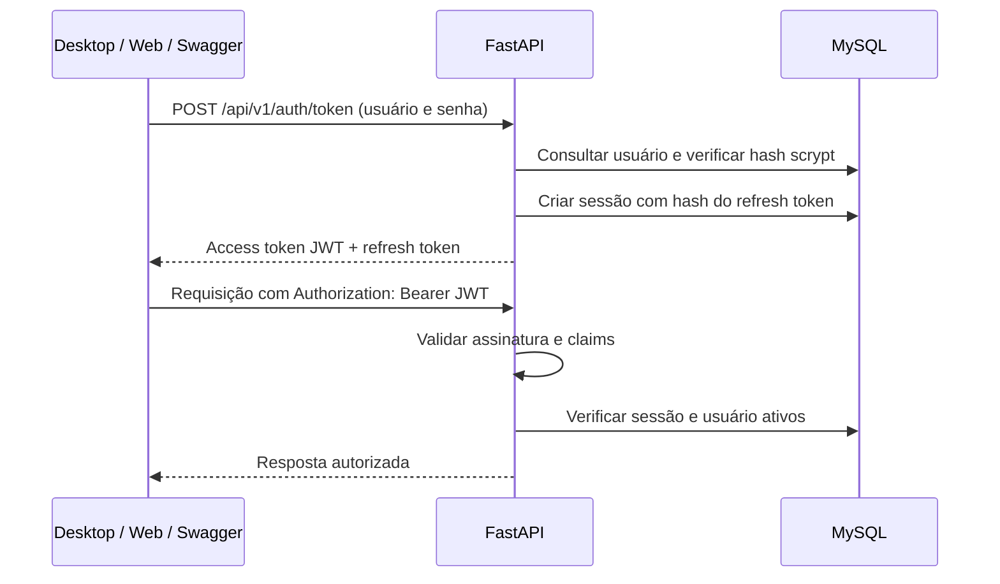

# Login local, JWT e sessões

A API autentica usuários do próprio MySQL. Não exige provedor OIDC. O fluxo usa os arquivos MVC já existentes: `config/auth.py` trata hash/JWT e a dependência de autenticação, `models/users.py` concentra SQL, `controllers/auth.py` coordena login e sessão, e Views/rotas definem os contratos.



## Configuração

1. Copie `.env.example` para `.env` se o arquivo ainda não existir. Configure `DATABASE_URL` para o MySQL autorizado.
2. Gere uma chave aleatória **localmente**:

```bash
python -c "import secrets; print(secrets.token_urlsafe(48))"
```

3. Guarde a saída em `AUTH_JWT_SECRET` no `.env` ignorado ou em um gerenciador de segredos. Não publique a chave no Git, chat ou logs. Em Linux/macOS, use `chmod 600 .env`. Essa chave assina tokens; é separada da senha dos usuários e da conexão MySQL. Todas as réplicas devem usar a mesma chave.
4. Inicie a API e o banco, e [crie o administrador explicitamente](ADMINISTRADOR.md). Login exige o schema de domínio, incluindo `cadastro__usuarios` e `cadastro__sessoes_usuario`; as migrations técnicas não criam essas tabelas.

| Variável | Padrão / finalidade |
| --- | --- |
| `AUTH_JWT_SECRET` | Obrigatória para login; segredo aleatório de pelo menos 32 bytes |
| `AUTH_JWT_ISSUER` | `prontuarioedu`, emissor esperado |
| `AUTH_JWT_AUDIENCE` | `prontuario-api`, audiência esperada |
| `AUTH_ACCESS_TOKEN_MINUTES` | `15`, aceita 1 a 60 |
| `AUTH_REFRESH_TOKEN_DAYS` | `7`, aceita 1 a 30; prazo fixo da sessão |
| `AUTH_REFRESH_WINDOW_SECONDS` | `60`, quando recomendar renovação |

Recrie/reinicie a API após mudar configuração. Sem chave, a documentação e a saúde continuam acessíveis em desenvolvimento; autenticação retorna `503`. Em produção a chave é obrigatória, assim como TLS para banco/Redis e HTTPS na entrada da API. Trocar a chave invalida os access tokens existentes.

## Solicitar o token pelo Swagger

Abra `/docs`, clique em **Authorize** e digite o usuário e a senha cadastrados. Selecione `identity:read`; para o administrador, selecione também `admin:access`. O Swagger chama **POST `/api/v1/auth/token`** na própria API com formulário `application/x-www-form-urlencoded`: `grant_type=password`, `username`, `password` e `scope` separados por espaços. Não há client ID, client secret ou redirecionamento de login.

O fluxo de senha é destinado aos clientes próprios deste projeto. A API não se apresenta como servidor OIDC, SSO ou autorização para aplicativos de terceiros. Integrações delegadas exigem decisão futura.

O token fica somente no estado da página, com persistência desativada. O botão Logout do Swagger limpa esse estado; para encerrar a sessão no servidor, execute a rota de logout antes de limpar a autorização.

## Contratos implementados

| Método e rota | Entrada / efeito |
| --- | --- |
| `POST /api/v1/auth/token` | Formulário de login; retorna `access_token`, `refresh_token`, `token_type=bearer`, `expires_in` e `scope` |
| `GET /api/v1/me` | Bearer com `identity:read`; retorna o ID do usuário |
| `GET /api/v1/auth/session` | Bearer; informa expiração e `refresh_required` |
| `POST /api/v1/auth/refresh` | JSON com `refresh_token` e `scope` opcional; retorna novos tokens |
| `POST /api/v1/auth/logout` | Bearer; revoga a sessão e responde 204 |
| `POST /api/v1/auth/password` | Bearer + JSON com `current_password` e `new_password`; troca senha, revoga todas as sessões e responde 204 |
| `GET /api/v1/admin/me` | Exige os dois escopos e concessões administrativas ativas |

As entradas recusam campos desconhecidos. O login aceita `username` de 1 a 150 caracteres, `password` de 1 a 128 e `scope` de até 512; os campos opcionais de cliente do Swagger devem ficar vazios. Formulário incompleto, repetido, UTF-8 inválido ou campo não suportado recebe 400; conteúdo JSON no login recebe 415. JSON inválido ou fora dos contratos de refresh/troca de senha recebe 422, sem devolver valores sensíveis. Credenciais com formato válido, mas incorretas, recebem 401. Consulte os [contratos HTTP](CONTRATOS.md) para limites e envelope de erro.

Cada renovação substitui o refresh token anterior; reutilizá-lo retorna `401`. A renovação não prolonga o prazo máximo da sessão. `scope` omitido na renovação solicita somente `identity:read`; solicite também `admin:access` quando necessário e autorizado. As permissões são calculadas pelo servidor, nunca concedidas por campos do cliente.

## Como validar acesso e sessão

`authenticate_request` executa antes do endpoint. Aceita apenas Bearer no header; tokens em query/body não autenticam. Verifica HS256, assinatura, emissor, audiência, expiração, emissão, tipo de token e IDs da sessão/usuário. O algoritmo é fixado pelo servidor. Depois de validar o JWT, consulta o MySQL para recusar sessão encerrada/expirada, usuário desativado ou bloqueado e concessão administrativa revogada.

Com a chave JWT configurada, credenciais ausentes ou inválidas recebem 401 antes de consultar SQL, inclusive durante indisponibilidade do banco. Um JWT válido ainda depende da sessão no MySQL: se não for possível consultá-la, `/api/v1/me` retorna 503. `/health` é público, verifica SQL e também retorna 503 quando o banco não responde; ele não revela usuários, tokens ou dados clínicos. Os cenários estão documentados na [etapa 4 do F01](docs/F01.md#etapa-4--resultado).

A senha usa scrypt com salt aleatório; o banco recebe somente o hash. O refresh token tem segredo aleatório e seu hash SHA-256 é persistido. Access e refresh tokens não são senhas: devem ser mantidos fora de logs, URLs, Git e armazenamento inseguro dos clientes. Logout e troca de senha bloqueiam também os JWTs já emitidos por meio da sessão.

Cinco falhas de login bloqueiam a conta por 15 minutos. O limitador HTTP continua ativo, com Redis no Compose e exigido em produção. Usuário inexistente, senha errada e conta indisponível recebem a mesma resposta. Não há endpoint público de cadastro, recuperação de senha ou MFA nesta etapa.

`/auth/session` retorna `authenticated`, `subject`, `expires_at` em UTC, `expires_in_seconds` e `refresh_required`. Token expirado ou sessão inválida recebe `401`; escopo insuficiente recebe `403`; configuração/banco indisponível recebe `503`. Tente uma renovação com refresh válido ou solicite novo login, evitando repetição infinita.

## Proteger novos endpoints

```python
@router.get("/api/v1/minha-operacao")
def operation(
    user: Annotated[
        AuthenticatedUser, Security(authenticate_request, scopes=["identity:read"])
    ],
):
    return {"subject": user.subject}
```

Importe `Annotated`, `Security`, `AuthenticatedUser` e `authenticate_request` como em `routes/api.py`. Para dados clínicos, aplique também `require_record_access` e as regras aprovadas do negócio; ser administrador não libera prontuários automaticamente.

Os testes cobrem assinatura/claims, login real com MySQL descartável, bloqueio por tentativas, refresh de uso único, logout, troca de senha, revogação e Swagger na origem do Codespace. Nenhuma credencial ou dado de teste é inserido no banco da aplicação.
