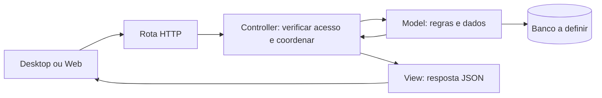

# Back-end Python com MVC

O Back-end usará MVC para facilitar a leitura e a divisão do trabalho de uma turma intermediária. Continua sendo um único servidor para Desktop, Web e futuras integrações. MVC organiza o código; não exige dividir o servidor em serviços.

## Quem faz o quê

| Pasta em `src/prontuario_backend/` | Competência | Exemplo |
| --- | --- | --- |
| `models/` | Dados, regras de negócio e persistência | Validar e salvar uma anotação |
| `controllers/` | Receber a operação, verificar acesso e coordenar | Solicitar ao Model a criação após autorizar o usuário |
| `views/` | Formatar respostas JSON e erros | Retornar apenas identificador e texto permitidos |
| `routes/` | Conectar URL/método ao Controller | Registrar `POST /api/v1/anotacoes` |
| `config/` | Inicialização, banco, autenticação e Swagger | Ler a URL do banco do ambiente |

Views do servidor são representações JSON. As telas ficam em Desktop e Web. Models não importam Controllers ou Views. Views recebem dados do Controller, sem consultar o banco. Controllers não devem virar um arquivo enorme com SQL e todas as regras.

## Fluxo de uma operação



## Exemplo prático: registrar uma anotação de demonstração

Exemplo fictício para ensinar a divisão; não é uma regra clínica aprovada nem uma API já disponível. Imagine que um usuário autorizado envia um texto para um registro e que texto vazio seja inválido.

1. A rota recebe `POST /api/v1/anotacoes` e encaminha ao Controller.
2. A autenticação identifica o usuário; o Controller valida formato, registro solicitado e permissão de escrita.
3. O Model verifica a regra do texto e grava na transação configurada.
4. O Controller entrega o resultado à View.
5. A View seleciona os campos públicos e retorna a resposta de sucesso documentada.

### Pseudocódigo por pasta

As funções abaixo são ilustrativas: tipos, dependências e tratamento completo de erros não foram implementados. Não são arquivos executáveis.

```python
# models/anotacao.py
class Anotacao:
    @classmethod
    def criar(cls, registro_id, autor_id, texto):
        if not texto.strip():
            raise TextoInvalido("O texto não pode ficar vazio")
        # O ORM e a transação serão definidos ao escolher o framework.
        return salvar_anotacao_em_transacao(
            registro_id=registro_id,
            autor_id=autor_id,
            texto=texto.strip(),
        )


# controllers/anotacoes.py
def criar_anotacao(requisicao):
    usuario = exigir_usuario_autenticado(requisicao)
    entrada = validar_entrada(requisicao.json)
    exigir_permissao_de_escrita(usuario, entrada.registro_id)
    anotacao = Anotacao.criar(
        registro_id=entrada.registro_id,
        autor_id=usuario.id,
        texto=entrada.texto,
    )
    return resposta_criada(anotacao)


# views/anotacoes.py
def resposta_criada(anotacao):
    return {"id": anotacao.id, "texto": anotacao.texto}, 201
```

`validar_entrada`, autenticação, autorização, persistência e as exceções são nomes conceituais. A implementação precisa limitar tamanho do texto, validar identificadores, tratar registro inexistente e garantir consistência entre autorização e gravação. A transação deve confirmar antes de responder sucesso e desfazer alterações em falhas. Erros conhecidos devem virar respostas documentadas, sem expor SQL ou rastros internos.

O autor vem da sessão validada, nunca de um campo confiado ao cliente. Os exemplos e os testes usam dados sintéticos. Auditoria, controle por registro, proteção de dados e política de concorrência devem ser definidos antes do uso real.

## Divisão de trabalho na turma

- Quem implementa Models cuida das regras, consultas e persistência com seus testes.
- Quem implementa Controllers cuida dos fluxos, entradas e acesso, combinando os métodos dos Models com a equipe.
- Quem implementa Views e rotas cuida do contrato JSON, erros e documentação OpenAPI.
- A equipe combina os formatos antes de trabalhar em paralelo e testa a operação completa no final.

Uma pessoa pode atuar em mais de uma frente. A separação orienta onde escrever; não exige uma pessoa para cada pasta. Evitar abstrações extras até surgir uma necessidade concreta.

## Swagger e testes

Rotas e esquemas de entrada/saída alimentam o OpenAPI, apresentado pelo Swagger UI. Views não devem serializar campos privados por padrão. Veja o [README principal](../README.md#swagger-no-back-end).

Em `tests/unit/`, validar texto vazio, coordenação e respostas. Em `tests/integration/`, verificar acesso negado sem gravação e persistência/transação no banco de teste. Em `tests/contract/`, verificar respostas e OpenAPI. Esses testes ainda não existem.

Framework, ORM, banco e mecanismo de autenticação continuam em aberto. Não há comandos de execução ou dependências instaladas.
