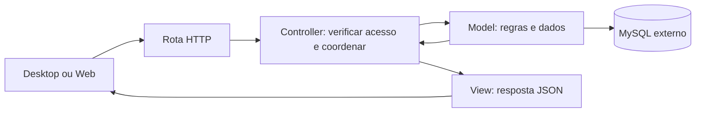

# Subir o backend com Docker e abrir o Swagger

Este é o roteiro principal de execução. Ao final, você terá **API, MySQL 8.4 e Redis** em contêineres, um administrador da aplicação e o Swagger acessível. Os comandos usam Bash em Linux, macOS, WSL2 ou no terminal do GitHub Codespaces.

O caminho abaixo escolhe explicitamente o MySQL de desenvolvimento em contêiner. O Compose base continua usando MySQL externo; se você já recebeu uma conexão do responsável, use a [alternativa com banco externo](#usar-mysql-externo) em vez de iniciar outro banco.

## 1. Preparar as ferramentas

No computador, instale [Git](https://git-scm.com/downloads), Python **3.12** e [Docker Desktop](https://docs.docker.com/desktop/) ou [Docker Engine com Compose](https://docs.docker.com/engine/install/). No Windows, use o terminal WSL2 com a integração do Docker Desktop habilitada. Mantenha o Docker em execução.

No GitHub Codespaces, primeiro conclua a [preparação do editor](../.devcontainer/README.md). Ela já instala as ferramentas e prepara o venv; não inicia os serviços.

Clone o repositório se ainda não tem um checkout, selecione a branch com a implementação desejada e entre em `backend`:
Para criar automaticamente **usuário comum e administrador de testes**, siga o
[manual breve de login no Docker](LOGIN_TEST.md). Esse modo opcional usa um banco
separado, senhas com hash scrypt e credenciais públicas exclusivas de testes.

## Documentos do banco de domínio

Os documentos recebidos foram [revisados para MySQL 8.4 e organizados em `docs/database`](docs/database/README.md). A pasta contém SQL de referência, modelo com dicionário das 64 tabelas, regras de negócio propostas e grafo dos 121 relacionamentos FK.

Essa documentação é separada das migrações técnicas já utilizadas pelo backend. Sua inclusão não importa o schema nem implementa os módulos de domínio. Consulte os limites e o plano de integração no guia antes de iniciar essa etapa.


O Back-end usará MVC para facilitar a leitura e a divisão do trabalho de uma turma intermediária. Continua sendo um único servidor para Desktop, Web e futuras integrações. MVC organiza o código; não exige dividir o servidor em serviços.

## Quem faz o quê

| Pasta em `src/prontuario_backend/` | Competência | Exemplo |
| --- | --- | --- |
| `models/` | Dados, regras de negócio e persistência | Validar e salvar uma anotação |
| `controllers/` | Receber a operação, verificar acesso e coordenar | Solicitar ao Model a criação após autorizar o usuário |
| `views/` | Formatar respostas JSON e erros | Retornar apenas identificador e texto permitidos |
| `routes/` | Conectar URL/método ao Controller | Registrar `POST /api/v1/anotacoes` |
| `config/` | Inicialização, banco, autenticação e Swagger | Ler a URL do banco do ambiente |

Views do servidor são representações JSON. As telas ficam em Desktop e Web. Models não importam Controllers ou Views. Views recebem dados do Controller, sem consultar o banco. Controllers não devem virar um arquivo enorme com SQL e todas as regras.

## Fluxo de uma operação



## Exemplo prático: registrar uma anotação de demonstração

Exemplo fictício para ensinar a divisão; não é uma regra clínica aprovada nem uma API já disponível. Imagine que um usuário autorizado envia um texto para um registro e que texto vazio seja inválido.

1. A rota recebe `POST /api/v1/anotacoes` e encaminha ao Controller.
2. A autenticação identifica o usuário; o Controller valida formato, registro solicitado e permissão de escrita.
3. O Model verifica a regra do texto e grava na transação configurada.
4. O Controller entrega o resultado à View.
5. A View seleciona os campos públicos e retorna a resposta de sucesso documentada.

### Pseudocódigo por pasta

As funções abaixo são ilustrativas: tipos, dependências e tratamento completo de erros não foram implementados. Não são arquivos executáveis.

```python
# models/anotacao.py
class Anotacao:
    @classmethod
    def criar(cls, registro_id, autor_id, texto):
        if not texto.strip():
            raise TextoInvalido("O texto não pode ficar vazio")
        # Pseudocódigo: a persistência real usa SQLAlchemy/MySQL.
        return salvar_anotacao_em_transacao(
            registro_id=registro_id,
            autor_id=autor_id,
            texto=texto.strip(),
        )


# controllers/anotacoes.py
def criar_anotacao(requisicao):
    usuario = exigir_usuario_autenticado(requisicao)
    entrada = validar_entrada(requisicao.json)
    exigir_permissao_de_escrita(usuario, entrada.registro_id)
    anotacao = Anotacao.criar(
        registro_id=entrada.registro_id,
        autor_id=usuario.id,
        texto=entrada.texto,
    )
    return resposta_criada(anotacao)


# views/anotacoes.py
def resposta_criada(anotacao):
    return {"id": anotacao.id, "texto": anotacao.texto}, 201
```

`validar_entrada`, autenticação, autorização, persistência e as exceções são nomes conceituais. A implementação precisa limitar tamanho do texto, validar identificadores, tratar registro inexistente e garantir consistência entre autorização e gravação. A transação deve confirmar antes de responder sucesso e desfazer alterações em falhas. Erros conhecidos devem virar respostas documentadas, sem expor SQL ou rastros internos.

O autor vem da sessão validada, nunca de um campo confiado ao cliente. Os exemplos e os testes usam dados sintéticos. Auditoria, controle por registro, proteção de dados e política de concorrência devem ser definidos antes do uso real.

## Divisão de trabalho na turma

- Quem implementa Models cuida das regras, consultas e persistência com seus testes.
- Quem implementa Controllers cuida dos fluxos, entradas e acesso, combinando os métodos dos Models com a equipe.
- Quem implementa Views e rotas cuida do contrato JSON, erros e documentação OpenAPI.
- A equipe combina os formatos antes de trabalhar em paralelo e testa a operação completa no final.

Uma pessoa pode atuar em mais de uma frente. A separação orienta onde escrever; não exige uma pessoa para cada pasta. Evitar abstrações extras até surgir uma necessidade concreta.

## Swagger e testes

Rotas e esquemas de entrada/saída alimentam o OpenAPI, apresentado pelo Swagger UI. Views não devem serializar campos privados por padrão. Veja o [README principal](../README.md#swagger-no-back-end).

### Pré-configuração implementada

O arquivo [`config/swagger.py`](src/prontuario_backend/config/swagger.py) centraliza título, versão, descrição, grupos de rotas e comportamento do Swagger. As rotas existentes já têm resumo, descrição, identificador da operação e schemas de respostas, inclusive erros. Não é necessário instalar um pacote Swagger separado: o FastAPI já gera o contrato.

| Endereço | Finalidade |
| --- | --- |
| `/docs` | Interface Swagger, disponível em desenvolvimento e testes |
| `/openapi.json` | Contrato para clientes, Postman e validação automatizada |
| `/api/v1/auth/token` | Emissão do JWT após login na própria API |

O Swagger usa a mesma origem do navegador para chamar a API. Assim, no Codespace, as requisições continuam no endereço HTTPS encaminhado pelo GitHub. Autorizações não são persistidas pelo Swagger no armazenamento do navegador. Em produção, a interface e o contrato ficam desabilitados.

O botão **Authorize** solicita o token em `POST /api/v1/auth/token` na própria API, usando usuário e senha. O Swagger envia o access token como Bearer nas operações protegidas. Veja o [passo a passo](AUTHENTICATION.md#solicitar-o-token-pelo-swagger).

### Usar o Swagger em desenvolvimento

1. Configure `.env`, `DATABASE_URL` e `AUTH_JWT_SECRET` conforme [autenticação](AUTHENTICATION.md#configuração).
2. Inicie a API e o MySQL autorizado; crie o [administrador](ADMINISTRADOR.md) explicitamente.
3. Abra a porta da API com `/docs`. Localmente: `http://127.0.0.1:8000/docs`. No Codespace, mantenha o hostname exato em `ALLOWED_HOSTS` e a porta privada.
4. Use **Authorize** com usuário/senha e `identity:read`. Para o administrador, marque também `admin:access`.
5. Execute `GET /api/v1/me`, `GET /api/v1/auth/session` ou `GET /api/v1/admin/me`. A autorização não fica persistida ao recarregar a página.
6. Para encerrar a sessão no servidor, execute `POST /api/v1/auth/logout` antes de limpar a autorização na interface; a resposta é 204 sem corpo. O botão Logout do modal do Swagger apenas limpa o token da página.

Não há client ID, client secret, callback ou realm. Sem token, as rotas protegidas respondem 401. `/health` continua público. Renovação e logout são rotas da própria API descritas no [guia de autenticação](AUTHENTICATION.md).

### Exemplo: configurar a documentação de um endpoint

O exemplo abaixo é um recorte da rota **já implementada** em [`routes/api.py`](src/prontuario_backend/routes/api.py). Ele mostra como documentar `GET /api/v1/me`; não precisa ser copiado para criar uma segunda rota.

```python
from typing import Annotated

from fastapi import Security

from prontuario_backend.config.auth import AuthenticatedUser, authenticate_request
from prontuario_backend.views.auth import IdentityResponse


@router.get(
    "/api/v1/me",
    response_model=IdentityResponse,
    tags=["Autenticação"],
    summary="Consultar a identidade autenticada",
    operation_id="get_current_identity",
    description="Valida o JWT e a sessão no MySQL. Exige Bearer e o escopo identity:read.",
    responses={
        status: ERROR_RESPONSES[status]
        for status in (401, 403, 405, 413, 429, 500, 503)
    },
)
def identity(
    user: Annotated[
        AuthenticatedUser, Security(authenticate_request, scopes=["identity:read"])
    ],
):
    return IdentityResponse(subject=user.subject)
```

Nesse arquivo, `router` é uma instância de `APIRouter` e `ERROR_RESPONSES` vem de `views/errors.py`. A dependência `authenticate_request` executa antes do corpo do endpoint e entrega somente uma identidade já validada.

| Configuração | Efeito no Swagger e na API |
| --- | --- |
| Caminho e método do decorator | Registram a operação que aparecerá na documentação |
| `response_model` | Define o contrato da resposta de sucesso e filtra os campos retornados |
| `tags` | Agrupa a operação; os grupos atuais são descritos em `config/swagger.py` |
| `summary` e `description` | Explicam o objetivo e os requisitos da chamada |
| `operation_id` | Identifica a operação no OpenAPI; deve ser único e estável para os clientes |
| `responses` | Documenta os erros com o schema compartilhado; não implementa seu tratamento |
| `Security(authenticate_request, scopes=["identity:read"])` | Valida o token antes do endpoint, exige o escopo e o documenta no OpenAPI |

Ao alterar um endpoint real, mantenha a implementação e esses metadados coerentes. Para entrada de dados futura, declare um Model Pydantic adequado ao contrato aprovado: o FastAPI incluirá seus campos no OpenAPI. Documentar um erro ou uma regra não substitui implementá-los e testá-los.

Para conferir esta pré-configuração sem banco, de `backend` e sem `MYSQL_TEST_URL` no ambiente:

```bash
git clone https://github.com/MarcosKern/ProntuarioEdu-Hospitalar.git
cd ProntuarioEdu-Hospitalar/backend
```

Se já abriu o projeto, apenas entre em `backend` a partir da raiz. **Todos os comandos restantes deste guia partem dessa pasta.**

Confira o Docker e o Compose (2.24 ou posterior):

```bash
docker info
docker compose version
```

Fora do Codespace, prepare o Python usado pelos scripts e testes:

```bash
python3 --version
python3 -m venv .venv
.venv/bin/python -m pip install -r requirements-dev.txt
.venv/bin/python -m pip check
```

Confirme que `python3 --version` é 3.12 antes de criar o venv. No Codespace, basta conferir `.venv/bin/python --version` e `.venv/bin/python -m pip check`; não reinstale em paralelo ao setup automático.

## 2. Preparar a configuração privada

```bash
.venv/bin/python scripts/mysql_dev.py
```

Esse comando cria `.env` se estiver ausente e gera `.env.mysql` com credenciais privadas para o MySQL. Se já existem, preserva as configurações. Não inicia contêineres nem acessa banco.

Crie a chave JWT no `.env` sem imprimi-la. O bloco abaixo preserva uma chave já configurada:

```bash
.venv/bin/python - <<'PY'
import secrets
from dotenv import dotenv_values, set_key

if not dotenv_values('.env').get('AUTH_JWT_SECRET'):
    set_key('.env', 'AUTH_JWT_SECRET', secrets.token_urlsafe(48))
print('Chave JWT pronta.')
PY
chmod 600 .env .env.mysql
```

Mantenha `APP_ENV=development` no `.env` para habilitar o Swagger. Não precisa preencher `DATABASE_URL` com servidor externo neste modo: o override fornece o destino interno `mysql:3306`. `AUTH_JWT_SECRET`, `ALLOWED_HOSTS` e CORS vêm de `.env`; as credenciais SQL vêm de `.env.mysql`. Nenhum desses arquivos deve ir para o Git. Este roteiro usa a porta HTTP 8000 (`BACKEND_PORT` ausente ou 8000 em `.env.mysql`). Se preservar outra porta de uma instalação existente, adapte as URLs e o hostname permitido.

### Ajuste adicional somente no Codespace

O navegador usa um hostname do GitHub. Gere a linha com o host exato da porta 8000:

```bash
.venv/bin/python - <<'PY'
import json
import os

name = os.environ['CODESPACE_NAME']
domain = os.environ.get('GITHUB_CODESPACES_PORT_FORWARDING_DOMAIN', 'app.github.dev')
print('ALLOWED_HOSTS=' + json.dumps(['localhost', '127.0.0.1', f'{name}-8000.{domain}']))
PY
```

Substitua a linha `ALLOWED_HOSTS` no `.env` pela linha gerada. Preserve outros hosts aprovados se houver. Não use `*`. Esse ajuste é do serviço Compose, não da configuração do editor.

## 3. Construir e iniciar os serviços

```bash
docker compose --env-file .env.mysql -f compose.yaml -f compose.mysql.yaml config --quiet
docker compose --env-file .env.mysql -f compose.yaml -f compose.mysql.yaml up --build -d --wait
docker compose --env-file .env.mysql -f compose.yaml -f compose.mysql.yaml ps
```

O primeiro comando valida sem imprimir segredos. O segundo constrói as imagens e espera a saúde dos serviços. `-d` mantém os contêineres em segundo plano; não precisa deixar o terminal aberto. O primeiro build pode demorar e exige acesso ao registry Docker, PyPI e repositórios Alpine.

O MySQL importa o SQL inicial **somente se seu volume estiver vazio**. Depois, a API aplica as migrations técnicas Alembic e inicia. Nenhum cadastro é inserido automaticamente. Se a migração falhar, a API não inicia; consulte os logs na seção de diagnóstico.

Confira a consulta SQL de saúde:

```bash
curl --fail --show-error http://127.0.0.1:8000/health
```

Resultado esperado: `{"status":"ok","database":"ok"}`. Isso confirma acesso SQL, mas ainda não comprova o login.

## 4. Criar o administrador da aplicação

```bash
docker compose --env-file .env.mysql -f compose.yaml -f compose.mysql.yaml exec backend python scripts/create_admin.py
```

Digite uma senha de **12 a 128 caracteres**, duas vezes no prompt. Ela não aparece no terminal. O usuário criado é **`admin` do ProntuarioEdu**, não o usuário técnico de conexão ao MySQL. Não existe senha padrão.

Repetir o comando preserva a senha e as permissões existentes; não redefine a conta. Para converter uma conta externa antiga, consulte [autenticação](docs/AUTENTICACAO.md#administrador-existente).

## 5. Abrir e usar o Swagger

No computador, abra **http://127.0.0.1:8000/docs**.

No Codespace, abra a aba **Ports**, encaminhe a porta **8000** e mantenha a visibilidade **Private**. Use **Open in Browser** e acrescente `/docs` ao endereço encaminhado. O login do GitHub no túnel é separado do login da aplicação. Não encaminhe a porta MySQL publicamente.

No Swagger, clique em **Authorize** e escolha **uma** alternativa:

- **OAuth2PasswordBearer:** informe `admin` e a senha criada, marque `identity:read` e `admin:access` e confirme. Deixe client ID/client secret vazios.
- **BearerToken:** se já tem um `access_token`, cole somente seu valor, sem o prefixo `Bearer`, e confirme. Não use o refresh token nesse campo.

Feche o modal e execute **GET `/api/v1/admin/me` → Try it out → Execute**. Espere HTTP **200**. O Swagger envia o header Bearer automaticamente; não há um campo de token em cada operação. Para trocar de alternativa, limpe a autorização anterior no modal.

| Endereço | Finalidade |
| --- | --- |
| `/health` | Saúde pública da API e do MySQL |
| `/docs` | Interface Swagger |
| `/openapi.json` | Contrato para clientes e Postman |
| `/api/v1/me` | Identidade autenticada, com escopo `identity:read` |
| `/api/v1/admin/me` | Identidade administrativa, com os dois escopos e concessão ativa |

**Try it out faz requisições reais.** Para encerrar a sessão no servidor, execute `POST /api/v1/auth/logout` antes de usar Logout no modal; espere 204. O Logout do modal apenas limpa o token da página. A autorização não persiste ao recarregar a página. O [contrato de autenticação](docs/AUTENTICACAO.md) explica renovação, senha e validade da sessão.

## 6. Parar, voltar e atualizar

Use sempre os mesmos arquivos Compose e o mesmo nome de projeto, caso tenha informado `--project-name`:

```bash
# Parar os serviços, preservando o banco no volume.
docker compose --env-file .env.mysql -f compose.yaml -f compose.mysql.yaml down
# Voltar sem reconstruir imagens.
docker compose --env-file .env.mysql -f compose.yaml -f compose.mysql.yaml up -d --wait
# Aplicar alterações de código, dependências ou configuração.
docker compose --env-file .env.mysql -f compose.yaml -f compose.mysql.yaml up --build -d --wait
```

Não use `down -v` para uma instalação com dados que precisa preservar. Alterar `.env.mysql` não troca a senha já armazenada no MySQL. Migrations futuras atualizam volumes existentes; reconstruir a imagem não reaplica o SQL inicial.

## Diagnosticar falhas

```bash
docker compose --env-file .env.mysql -f compose.yaml -f compose.mysql.yaml ps
docker compose --env-file .env.mysql -f compose.yaml -f compose.mysql.yaml logs --tail=100 backend mysql redis
```

| Sintoma | O que verificar |
| --- | --- |
| Docker indisponível | Docker Desktop/Engine ativo; log de criação do Codespace, se aplicável |
| Porta ocupada | Ajuste `MYSQL_PORT` ou `BACKEND_PORT` em `.env.mysql`; não pare serviços de outra pessoa. Adapte URL e hostname permitido se mudar a porta HTTP |
| Build retorna 403 ou falha de download | Acesso ao registry, PyPI ou domínio Alpine indicado no erro; liberação de rede. Não desative TLS |
| Erro de certificado no build | Bundle de CA do proxy; veja [build com proxy](#build-com-proxy) |
| MySQL/API não saudável | Logs, primeiro import do SQL, privilégios de migration e credenciais correspondentes ao volume |
| `400 Invalid host header` | Host exato em `ALLOWED_HOSTS` no `.env`; recrie a API após corrigir |
| Login retorna 503 | Chave JWT configurada, conexão SQL e tabelas de autenticação disponíveis |
| Chamada protegida retorna 401 | Login/token/sessão válidos; sem token, 401 é esperado |
| Chamada administrativa retorna 403 | Token com ambos os escopos e concessão administrativa ativa |

Antes de compartilhar logs, remova URLs de conexão, tokens e senhas.

### Build com proxy

Se sua rede exige CA corporativa, use um bundle confiável do host. Exemplo Linux:

```bash
docker build --secret id=proxy_ca,src=/etc/ssl/certs/ca-certificates.crt -t prontuario-backend-dev .
docker compose --env-file .env.mysql -f compose.yaml -f compose.mysql.yaml build mysql
docker compose --env-file .env.mysql -f compose.yaml -f compose.mysql.yaml up -d --no-build --wait
```

Adapte o caminho ao seu sistema. O segredo é usado só no build; não configura o certificado do MySQL. Não repita `up --build` nesse fluxo sem fornecer o segredo novamente. HTTP 403 exige corrigir a permissão de rede; a CA resolve confiança TLS, não autorização.

## Usar MySQL externo

Esta alternativa substitui os passos de preparação SQL e inicialização do modo local; não execute os dois stacks na mesma porta. Prepare `.env` conforme [conexão e TLS MySQL](docs/MYSQL.md), incluindo `DATABASE_URL`, chave JWT e hostname permitido. O operador deve instalar o schema de domínio autorizado antes do cadastro de usuários; Alembic sozinho não cria suas 64 tabelas.

Sem CA privada no contêiner:

```bash
docker compose config --quiet
docker compose up --build -d --wait
docker compose exec backend python scripts/create_admin.py
```

Se o servidor exigir CA fornecida pelo operador, use o [override TLS](docs/MYSQL.md#certificado-mysql-no-compose) em todos os comandos. Neste modo, `DATABASE_URL` do terminal tem precedência na interpolação; os demais campos da aplicação vêm do `.env` via `env_file`. Um segredo exportado no Codespace não é automaticamente encaminhado a todo campo do serviço.

Depois da subida, continue no [passo 5](#5-abrir-e-usar-o-swagger). Para logs, parada e atualização, use `docker compose` sem os arquivos do modo MySQL local, ou mantenha o override TLS se o tiver escolhido.

## Próximos passos

- [Desenvolver pelo Python e manter as dependências](docs/DESENVOLVIMENTO.md).
- [Executar testes em banco descartável](tests/README.md): o Compose de testes é para automação/diagnóstico, não outro roteiro de primeiro acesso.
- [Entender MVC e a organização do código](../docs/architecture.md).
- [Hospedar em servidor e preparar produção](../infra/README.md): o Compose deste guia é de desenvolvimento.
