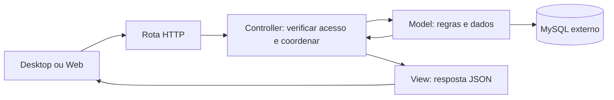

# Back-end Python com MVC

> **Banco padrão: MySQL externo.** Configure DATABASE_URL conforme o [guia MySQL](MYSQL.md) antes de executar. Não há banco local ou fallback.


O Back-end usará MVC para facilitar a leitura e a divisão do trabalho de uma turma intermediária. Continua sendo um único servidor para Desktop, Web e futuras integrações. MVC organiza o código; não exige dividir o servidor em serviços.

## Quem faz o quê

| Pasta em `src/prontuario_backend/` | Competência | Exemplo |
| --- | --- | --- |
| `models/` | Dados, regras de negócio e persistência | Validar e salvar uma anotação |
| `controllers/` | Receber a operação, verificar acesso e coordenar | Solicitar ao Model a criação após autorizar o usuário |
| `views/` | Formatar respostas JSON e erros | Retornar apenas identificador e texto permitidos |
| `routes/` | Conectar URL/método ao Controller | Registrar `POST /api/v1/anotacoes` |
| `config/` | Inicialização, banco, autenticação e Swagger | Ler a URL do banco do ambiente |

Views do servidor são representações JSON. As telas ficam em Desktop e Web. Models não importam Controllers ou Views. Views recebem dados do Controller, sem consultar o banco. Controllers não devem virar um arquivo enorme com SQL e todas as regras.

## Fluxo de uma operação



## Exemplo prático: registrar uma anotação de demonstração

Exemplo fictício para ensinar a divisão; não é uma regra clínica aprovada nem uma API já disponível. Imagine que um usuário autorizado envia um texto para um registro e que texto vazio seja inválido.

1. A rota recebe `POST /api/v1/anotacoes` e encaminha ao Controller.
2. A autenticação identifica o usuário; o Controller valida formato, registro solicitado e permissão de escrita.
3. O Model verifica a regra do texto e grava na transação configurada.
4. O Controller entrega o resultado à View.
5. A View seleciona os campos públicos e retorna a resposta de sucesso documentada.

### Pseudocódigo por pasta

As funções abaixo são ilustrativas: tipos, dependências e tratamento completo de erros não foram implementados. Não são arquivos executáveis.

```python
# models/anotacao.py
class Anotacao:
    @classmethod
    def criar(cls, registro_id, autor_id, texto):
        if not texto.strip():
            raise TextoInvalido("O texto não pode ficar vazio")
        # Pseudocódigo: a persistência real usa SQLAlchemy/MySQL.
        return salvar_anotacao_em_transacao(
            registro_id=registro_id,
            autor_id=autor_id,
            texto=texto.strip(),
        )


# controllers/anotacoes.py
def criar_anotacao(requisicao):
    usuario = exigir_usuario_autenticado(requisicao)
    entrada = validar_entrada(requisicao.json)
    exigir_permissao_de_escrita(usuario, entrada.registro_id)
    anotacao = Anotacao.criar(
        registro_id=entrada.registro_id,
        autor_id=usuario.id,
        texto=entrada.texto,
    )
    return resposta_criada(anotacao)


# views/anotacoes.py
def resposta_criada(anotacao):
    return {"id": anotacao.id, "texto": anotacao.texto}, 201
```

`validar_entrada`, autenticação, autorização, persistência e as exceções são nomes conceituais. A implementação precisa limitar tamanho do texto, validar identificadores, tratar registro inexistente e garantir consistência entre autorização e gravação. A transação deve confirmar antes de responder sucesso e desfazer alterações em falhas. Erros conhecidos devem virar respostas documentadas, sem expor SQL ou rastros internos.

O autor vem da sessão validada, nunca de um campo confiado ao cliente. Os exemplos e os testes usam dados sintéticos. Auditoria, controle por registro, proteção de dados e política de concorrência devem ser definidos antes do uso real.

## Divisão de trabalho na turma

- Quem implementa Models cuida das regras, consultas e persistência com seus testes.
- Quem implementa Controllers cuida dos fluxos, entradas e acesso, combinando os métodos dos Models com a equipe.
- Quem implementa Views e rotas cuida do contrato JSON, erros e documentação OpenAPI.
- A equipe combina os formatos antes de trabalhar em paralelo e testa a operação completa no final.

Uma pessoa pode atuar em mais de uma frente. A separação orienta onde escrever; não exige uma pessoa para cada pasta. Evitar abstrações extras até surgir uma necessidade concreta.

## Swagger e testes

Rotas e esquemas de entrada/saída alimentam o OpenAPI, apresentado pelo Swagger UI. Views não devem serializar campos privados por padrão. Veja o [README principal](../README.md#swagger-no-back-end).

Em `tests/unit/`, validar texto vazio, coordenação e respostas. Em `tests/integration/`, verificar acesso negado sem gravação e persistência/transação no banco de teste. Em `tests/contract/`, verificar respostas e OpenAPI. A seção de ambiente descreve os testes iniciais implementados; os testes do exemplo clínico continuam futuros.

As instruções abaixo descrevem o ambiente inicial implementado com FastAPI, SQLAlchemy e MySQL. O provedor real de autenticação ainda precisa ser configurado.

## Configurar o ambiente de desenvolvimento

Siga os passos na ordem. Todos os comandos abaixo partem da pasta `backend`, dentro de um checkout que contenha a implementação atual. Não executar comandos de instalação dentro de `src`.

### 1. Conferir pré-requisitos

- Python **3.12** com pip e venv para execução local e testes.
- Acesso de rede a **MySQL 8.4 externo**, com banco de desenvolvimento dedicado e credenciais fornecidas pelo responsável.
- Docker Engine ou Docker Desktop em execução e Docker Compose **2.24 ou posterior** para o caminho com contêineres. Confira `docker version`, `docker compose version` e `docker info`. Consulte a [instalação oficial](https://docs.docker.com/engine/install/) ou [Docker Desktop](https://docs.docker.com/desktop/).
- A instalação de pacotes necessita acesso ao PyPI; o build necessita acesso ao registry Docker. Redes corporativas podem exigir proxy e CA confiável.

Python local é opcional para executar somente Compose; os comandos de teste e backup deste guia usam o venv. Não é necessário instalar MySQL localmente. Desktop e Web ainda não possuem aplicação ou comandos de execução.

### 2. Criar a configuração privada

Em Linux/macOS, da raiz do repositório:

```bash
cd backend
# Não sobrescreve configuração existente.
[ -f .env ] || cp .env.example .env
```

No PowerShell:

```powershell
Set-Location backend
if (!(Test-Path .env)) { Copy-Item .env.example .env }
```

Edite `.env` privadamente. Configure `DATABASE_URL` para o MySQL externo e, quando exigido pelo operador, `MYSQL_SSL_CA`. Siga o [guia de conexão MySQL](MYSQL.md#preparar-a-conexão) para formato, senha codificada, TLS, acesso de rede e permissões. Não cole credenciais em comandos públicos, no Git ou no chat.

`APP_ENV=development` habilita Swagger. `ALLOWED_HOSTS` e `CORS_ORIGINS` usam arrays JSON; o padrão aceita acesso local e nenhuma origem Web adicional. O `.env` é carregado automaticamente pela aplicação e pelo Alembic. Variáveis já exportadas no terminal têm precedência: remova valores antigos que apontem para outro banco.

A API consegue iniciar sem provedor OIDC em desenvolvimento, mas nenhuma autenticação real funciona até preencher os cinco campos `OIDC_*`. Sem token, `/api/v1/me` retorna 401; com token e provedor ausente, retorna 503. Não há contas ou credenciais padrão. Consulte [segurança e operação](SECURITY.md).

### 3. Escolher um modo de execução

Não execute os dois modos na mesma porta ao mesmo tempo. Ambos usam o MySQL externo e aplicam `alembic upgrade head` antes de iniciar a API. As migrações precisam de autorização e privilégios DDL/CREATE TRIGGER no banco de desenvolvimento; a conta de runtime em produção deve ser separada. Nenhum cadastro é inserido automaticamente.

#### Modo A — Python local

Linux/macOS, de `backend` (confirme que `python3 --version` é 3.12):

```bash
python3 --version
python3 -m venv .venv
source .venv/bin/activate
python -m pip install -r requirements-dev.txt
python -m pip check
python scripts/dev.py
```

PowerShell, de `backend`, sem precisar ativar o venv:

```powershell
py -3.12 -m venv .venv
.\.venv\Scripts\python.exe -m pip install -r requirements-dev.txt
.\.venv\Scripts\python.exe -m pip check
.\.venv\Scripts\python.exe scripts/dev.py
```

Como alternativa à criação/instalação manual, `python3 scripts/dev.py --setup` (Windows: `py -3.12 scripts/dev.py --setup`) cria o venv se necessário, instala os requisitos, aplica migrações e inicia a API. Esse comando também exige `.env` previamente configurado.

O servidor ocupa o terminal. Use outro terminal para verificações e testes; Ctrl+C encerra a execução. Para trocar a porta, use `python scripts/dev.py --port 8001`. O script sempre executa a partir de `backend`, mesmo que seja chamado por caminho completo.

Sem `REDIS_URL`, o limite de requisições é em memória e por processo, permitido somente para desenvolvimento/testes. Para testar o limite distribuído no modo local, configure uma instância Redis acessível pela máquina. O Redis do Compose fica privado e não está publicado para o Python local.

#### Modo B — Docker Compose

De `backend`, com `.env` configurado:

```bash
docker compose config --quiet
docker compose up --build -d --wait
docker compose ps
```

O Compose inicia **API e Redis**, não MySQL. A API fica na porta local 8000, com reload do código montado em modo leitura. O volume é de código; não existe volume de banco neste projeto. `BACKEND_PORT=8001` em `.env` altera somente a porta publicada pelo Compose.

Comandos de acompanhamento e encerramento:

```bash
docker compose logs -f backend
# Ctrl+C sai da visualização dos logs; os serviços continuam ativos.
docker compose down
```

Não publique a saída completa de `docker compose config`, pois ela pode conter credenciais interpoladas. O `--quiet` valida sem exibi-las. Alterações em requisitos ou Dockerfile exigem novo build; alterações de `.env` exigem recriar os serviços (`docker compose up -d --force-recreate --wait`).

Para MySQL com CA própria, use o [override TLS](MYSQL.md#certificado-mysql-no-compose). Para proxy corporativo, consulte [build com proxy](#build-com-proxy). Esses certificados têm funções diferentes.

### 4. Conferir o funcionamento

No segundo terminal, com o venv ativo e a porta padrão:

```bash
python -c "import urllib.request; print(urllib.request.urlopen('http://127.0.0.1:8000/health', timeout=5).read().decode())"
```

Resultado esperado: `{"status":"ok","database":"ok"}`. Isso confirma uma consulta SQL real, não apenas uma porta aberta. Se mudou a porta, adapte o comando. O cliente local deve usar `localhost` ou `127.0.0.1`, conforme `ALLOWED_HOSTS`. O servidor de desenvolvimento usa HTTP local; HTTPS depende do gateway/certificado da implantação.

| Caminho | Resultado esperado em desenvolvimento |
| --- | --- |
| `/health` | 200 com saúde da API e acesso SQL |
| `/docs` | Swagger UI; seus assets também precisam de acesso ao CDN no navegador |
| `/openapi.json` | Especificação das rotas existentes |
| `/api/v1/me` sem token | 401; não é falha de instalação |
| `/metrics` | Métricas de desenvolvimento; não é endpoint público de produção |

A API ainda não possui o endpoint de anotação do pseudocódigo acima. Nenhum prontuário ou usuário de demonstração é carregado. `/health` não comprova um login OIDC completo; isso precisa ser validado com o provedor real.

### 5. Executar testes e verificações

Use **outro terminal**, entre em `backend` e ative o mesmo venv (ou utilize o caminho explícito do Python no Windows):

```bash
python -m ruff check src tests scripts
python -m pip check
python -m pytest -q
python -m pip_audit -r requirements.txt
python -m pip_audit -r requirements-dev.txt
```

O comando acima roda testes sem banco e pula explicitamente os que exigem `MYSQL_TEST_URL` ausente. Para testar MySQL, configure essa variável no ambiente do terminal apontando para **outro banco descartável**, mais `MYSQL_TEST_ALLOW_RESET` igual ao nome exato desse banco, cujo nome comece com `prontuario_test`. Veja [testes](tests/README.md). Não use o banco de desenvolvimento ou produção: os testes apagam tabelas técnicas entre os casos.

`MYSQL_TEST_URL` deve estar **exportada no processo**; colocá-la somente em `.env` não basta para a suíte atual. A limpeza é recusada se o alvo coincidir com o banco da aplicação ou faltar a confirmação. A CI já fornece a variável e inicia seu próprio MySQL descartável. Ruff e pytest devem ser executados de `backend`, como na CI.

### Build com proxy

Em Linux, quando houver proxy corporativo e o bundle abaixo incluir sua CA confiável:

```bash
docker build --secret id=proxy_ca,src=/etc/ssl/certs/ca-certificates.crt -t prontuario-backend-dev .
docker compose up -d --no-build --wait
```

O caminho é específico do host; adapte para um bundle confiável existente no seu sistema. O Dockerfile mantém TLS habilitado e usa o certificado apenas no build. Isso não instala a CA para o MySQL ou OIDC em runtime. Não remova `--no-build` da segunda linha nesse fluxo: um novo build pelo Compose não receberia o segredo automaticamente.

### Problemas frequentes

| Sintoma | Verificação |
| --- | --- |
| `Configuração inválida` | `DATABASE_URL` preenchida com prefixo `mysql+pymysql://`; arrays JSON válidos; variáveis antigas exportadas; diretório de execução |
| Falha nas migrações | Rede/firewall, hostname externo, TLS e privilégios de migração/trigger; consultar o DBA sem expor URL ou senha |
| Erro de CA no Docker | Arquivo montado no contêiner e caminho interno correto em `MYSQL_SSL_CA`; a CA do build não substitui essa montagem |
| 400 ao acessar a API | Host solicitado não está em `ALLOWED_HOSTS`; não liberar wildcard como solução |
| Porta ocupada | Parar a execução anterior ou usar a opção de porta correspondente ao modo escolhido |
| 401/503 em `/api/v1/me` | Conferir token/provedor; não criar bypass de autenticação |
| Compose não saudável | Consultar logs da API e Redis; `/health` exige banco acessível e startup exige migrações concluídas |

Não use este Compose com reload como implantação de produção. Retenção, backups, usuário de banco mínimo e configuração OIDC real estão detalhados em [SECURITY.md](SECURITY.md) e [MYSQL.md](MYSQL.md).

## Dependências de execução e desenvolvimento

`requirements.in` declara as dependências diretas da API, migrações e backup. `requirements.txt` fixa a resolução de runtime (27 pacotes nesta versão) e é o único lock instalado na imagem. Alembic permanece nele porque o startup de desenvolvimento executa migrações.

`requirements-dev.in` acrescenta testes, lint, auditoria e manutenção dos locks; `requirements-dev.txt` fixa o conjunto completo de desenvolvimento. O script `dev.py --setup` e a CI instalam esse arquivo. Ferramentas de desenvolvimento e suas transitivas não são necessárias na imagem da API.

Com Python 3.12 e venv dev ativo, após alterar intencionalmente os arquivos `.in`, regenere nesta ordem:

```bash
python -m piptools compile --strip-extras --no-emit-index-url --no-emit-trusted-host --output-file requirements.txt requirements.in
python -m piptools compile --allow-unsafe --strip-extras --no-emit-index-url --no-emit-trusted-host --output-file requirements-dev.txt requirements-dev.in
python -m pip install -r requirements-dev.txt
python -m pip check
```

Não substituir os locks por `pip freeze`, que misturaria novamente os ambientes. Revisar alterações e auditar os dois locks. Os locks foram resolvidos e validados em Linux/Python 3.12; para outras plataformas, conferir também as dependências condicionais e os testes. Dependabot propõe atualizações semanais; nenhuma atualização deve ser mesclada sem a CI e as aprovações exigidas.

Os timeouts de conexão, leitura, escrita e espera do pool MySQL são configuráveis em `.env` por MYSQL_CONNECT_TIMEOUT (5s), MYSQL_READ_TIMEOUT (10s), MYSQL_WRITE_TIMEOUT (10s) e MYSQL_POOL_TIMEOUT (5s). Os valores devem estar entre 0 e 120 segundos, sem incluir zero. Uma falha não repete automaticamente uma operação de escrita.

## GitHub Codespaces

Para ambiente de editor, Docker e extensões padronizados, siga o [guia Codespaces](../.devcontainer/README.md).
