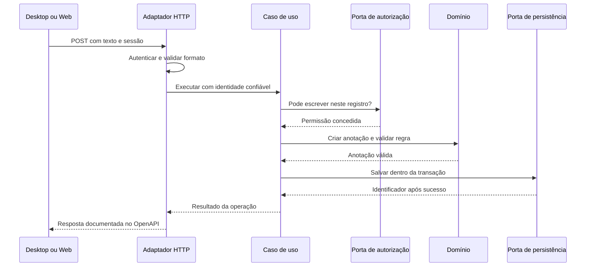

# Back-end Python

Proposta: monólito modular com arquitetura hexagonal. Framework e persistência dependem da ADR inicial.

- `src/prontuario_backend/domain`: entidades, objetos de valor e regras de negócio; sem imports de HTTP, banco ou interfaces gráficas.
- `src/prontuario_backend/application`: casos de uso e portas de entrada/saída; depende do domínio.
- `src/prontuario_backend/adapters/inbound/http`: tradução de requisições da API para casos de uso.
- `src/prontuario_backend/adapters/outbound/persistence`: implementação das portas de persistência.
- `src/prontuario_backend/adapters/outbound/integrations`: implementação das portas de serviços externos.
- `src/prontuario_backend/bootstrap`: configuração e composição de dependências.
- `tests/unit`, `tests/integration`, `tests/contract`: locais reservados para as respectivas verificações.

Somente o back-end acessa o banco. Autorização e regras de negócio são verificadas no servidor. Novos módulos de domínio devem ser definidos pelos requisitos, sem antecipar funcionalidades clínicas.

Ainda não há aplicação executável, dependências ou testes implementados.

## Como dividir uma funcionalidade

A proposta separa responsabilidades técnicas e permite criar, dentro delas, subpacotes por capacidade de negócio quando os requisitos forem definidos. Evite uma pasta genérica de serviços contendo regras, SQL e HTTP misturados.

| Necessidade | Local responsável | Limite |
| --- | --- | --- |
| Regra válida para qualquer cliente | `domain/` | Não conhece HTTP, ORM ou telas |
| Coordenar uma operação e sua autorização contextual | `application/` | Usa domínio e portas; não importa adaptadores |
| Receber JSON, autenticar e responder HTTP | `adapters/inbound/http/` | Não executa SQL nem substitui regras da aplicação |
| Consultar/gravar e realizar transações | `adapters/outbound/persistence/` | Implementa portas e converte modelos de banco |
| Consumir outro serviço | `adapters/outbound/integrations/` | Isola SDK, timeout e falhas externas |
| Escolher e conectar implementações | `bootstrap/` | Não contém regras de negócio |

Dependências de código apontam para dentro: adaptadores → aplicação → domínio. A aplicação define as portas de que precisa; os adaptadores implementam essas interfaces. Durante a execução, uma chamada feita por uma porta chega à implementação conectada pelo bootstrap.

## Exemplo prático: registrar uma anotação de demonstração

**Exemplo didático, não requisito clínico aprovado e não endpoint implementado.** Considere uma operação fictícia para adicionar um texto a um registro. Para mostrar as competências, suponha que texto vazio seja inválido e que apenas usuários autorizados possam escrever nesse registro.



### Onde cada parte seria escrita

Os nomes a seguir são uma sugestão para entender a separação; esses arquivos Python **não foram criados**.

| Arquivo futuro | Competência no exemplo |
| --- | --- |
| `domain/anotacoes.py` | Construir uma anotação válida e rejeitar texto vazio |
| `application/registrar_anotacao.py` | Coordenar a autorização, a criação e a gravação |
| `application/ports.py` | Declarar interfaces de autorização, repositório e unidade de trabalho |
| `adapters/inbound/http/anotacoes.py` | Traduzir JSON para a entrada do caso de uso e resultado para HTTP |
| `adapters/outbound/persistence/anotacoes.py` | Implementar consultas, gravação e unidade de trabalho no banco escolhido |
| `bootstrap/` | Conectar políticas, repositórios e caso de uso à rota |

### Lógica ilustrativa, independente de framework

O pseudocódigo Python abaixo destaca apenas a ordem das responsabilidades. Tipos, classes de erro, portas, transações, limites do texto e estratégia de auditoria precisam ser implementados e aprovados antes de virar código de produção.

```python
# domain/anotacoes.py
class Anotacao:
    def __init__(self, registro_id, autor_id, texto):
        if not texto.strip():
            raise TextoVazio()
        self.registro_id = registro_id
        self.autor_id = autor_id
        self.texto = texto.strip()


# application/registrar_anotacao.py
class RegistrarAnotacao:
    def __init__(self, unidade_de_trabalho):
        self.unidade_de_trabalho = unidade_de_trabalho

    def executar(self, identidade, registro_id, texto):
        # A porta abre um contexto transacional. A implementação é externa.
        with self.unidade_de_trabalho() as uow:
            uow.autorizacao.exigir_escrita(identidade, registro_id)
            anotacao = Anotacao(registro_id, identidade.usuario_id, texto)
            identificador = uow.anotacoes.salvar(anotacao)
            uow.commit()
        return identificador
```

A unidade de trabalho é uma porta: o adaptador concreto deve realizar rollback em falhas e delimitar corretamente a transação. O exemplo coloca a autorização contextual e a gravação na mesma operação; a consistência diante de permissões alteradas concorrentemente também precisa ser definida no adaptador e na política. O identificador só deve ser retornado como sucesso após o commit.

A identidade vem do mecanismo de autenticação validado no servidor, nunca de um `autor_id` confiado ao JSON do cliente. O HTTP converte erros conhecidos para o contrato aprovado — por exemplo, sessão inválida, acesso negado ou entrada inválida — sem expor exceções SQL. O limite máximo e o formato do texto também devem ser especificados e validados. Nenhuma verificação da tela substitui isso.

### Como validar esse fluxo

1. Em `tests/unit/`, verificar texto vazio e construção válida da entidade.
2. Testar o caso de uso com portas falsas: identidade sem permissão não salva; entrada inválida não salva; sucesso grava e confirma a transação.
3. Em `tests/integration/`, testar a implementação real de persistência, commit/rollback e escopo de acesso aos registros com banco isolado.
4. Em `tests/contract/`, verificar o endpoint implementado contra OpenAPI, incluindo respostas de autenticação, autorização e validação.
5. No Desktop e na Web, apresentar carregamento, confirmação ou erro, sem reenviar escritas automaticamente nem duplicar as regras do servidor.

Esses testes são orientações futuras, não testes existentes ou executados. Consulte os READMEs das subpastas para os limites de cada camada.
