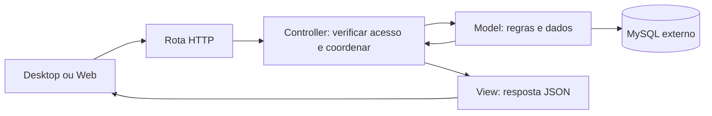

# Back-end Python com MVC

Para iniciar com o usuário **`admin` do ProntuarioEdu**, perfil `ADMINISTRADOR` e login na própria API, consulte [primeiro administrador](ADMINISTRADOR.md). O cadastro é explícito e a senha fica somente como hash no MySQL.

O [acompanhamento do card F01](docs/F01.md) registra as seis etapas concluídas, as confirmações e as evidências de MVC, MySQL, transações, [contratos HTTP](CONTRATOS.md), autenticação e Swagger. A conferência final aprovou 198 testes e as auditorias dos locks Python; o novo build e scan da imagem continuam pendentes pelo bloqueio de acesso ao repositório Alpine. Consulte o relatório para os limites da validação.

> **Banco padrão: MySQL externo.** No Compose base, configure DATABASE_URL conforme o [guia MySQL](MYSQL.md) antes de executar. Não há fallback automático para banco local.

Para desenvolvimento com o SQL recebido já inicializado em um serviço MySQL próprio, use o [modo opcional MySQL em contêiner](docker/mysql/README.md). O guia inclui preparação das credenciais, inicialização do schema, conexão do cliente e acesso à API no Codespace.

Para **testes com conexão fixa**, execute de `backend` `python3 scripts/test_env.py`. O script sobe [`compose.test.yaml`](compose.test.yaml), aguarda os serviços e exibe as variáveis de conexão no terminal. Veja o [guia do Compose de testes](docker/mysql/TESTING.md).

## Documentos do banco de domínio

Os documentos recebidos foram [revisados para MySQL 8.4 e organizados em `docs/database`](docs/database/README.md). A pasta contém SQL de referência, modelo com dicionário das 64 tabelas, regras de negócio propostas e grafo dos 121 relacionamentos FK.

Essa documentação é separada das migrações técnicas já utilizadas pelo backend. Sua inclusão não importa o schema nem implementa os módulos de domínio. Consulte os limites e o plano de integração no guia antes de iniciar essa etapa.


O Back-end usará MVC para facilitar a leitura e a divisão do trabalho de uma turma intermediária. Continua sendo um único servidor para Desktop, Web e futuras integrações. MVC organiza o código; não exige dividir o servidor em serviços.

## Quem faz o quê

| Pasta em `src/prontuario_backend/` | Competência | Exemplo |
| --- | --- | --- |
| `models/` | Dados, regras de negócio e persistência | Validar e salvar uma anotação |
| `controllers/` | Receber a operação, verificar acesso e coordenar | Solicitar ao Model a criação após autorizar o usuário |
| `views/` | Formatar respostas JSON e erros | Retornar apenas identificador e texto permitidos |
| `routes/` | Conectar URL/método ao Controller | Registrar `POST /api/v1/anotacoes` |
| `config/` | Inicialização, banco, autenticação e Swagger | Ler a URL do banco do ambiente |

Views do servidor são representações JSON. As telas ficam em Desktop e Web. Models não importam Controllers ou Views. Views recebem dados do Controller, sem consultar o banco. Controllers não devem virar um arquivo enorme com SQL e todas as regras.

## Fluxo de uma operação



## Exemplo prático: registrar uma anotação de demonstração

Exemplo fictício para ensinar a divisão; não é uma regra clínica aprovada nem uma API já disponível. Imagine que um usuário autorizado envia um texto para um registro e que texto vazio seja inválido.

1. A rota recebe `POST /api/v1/anotacoes` e encaminha ao Controller.
2. A autenticação identifica o usuário; o Controller valida formato, registro solicitado e permissão de escrita.
3. O Model verifica a regra do texto e grava na transação configurada.
4. O Controller entrega o resultado à View.
5. A View seleciona os campos públicos e retorna a resposta de sucesso documentada.

### Pseudocódigo por pasta

As funções abaixo são ilustrativas: tipos, dependências e tratamento completo de erros não foram implementados. Não são arquivos executáveis.

```python
# models/anotacao.py
class Anotacao:
    @classmethod
    def criar(cls, registro_id, autor_id, texto):
        if not texto.strip():
            raise TextoInvalido("O texto não pode ficar vazio")
        # Pseudocódigo: a persistência real usa SQLAlchemy/MySQL.
        return salvar_anotacao_em_transacao(
            registro_id=registro_id,
            autor_id=autor_id,
            texto=texto.strip(),
        )


# controllers/anotacoes.py
def criar_anotacao(requisicao):
    usuario = exigir_usuario_autenticado(requisicao)
    entrada = validar_entrada(requisicao.json)
    exigir_permissao_de_escrita(usuario, entrada.registro_id)
    anotacao = Anotacao.criar(
        registro_id=entrada.registro_id,
        autor_id=usuario.id,
        texto=entrada.texto,
    )
    return resposta_criada(anotacao)


# views/anotacoes.py
def resposta_criada(anotacao):
    return {"id": anotacao.id, "texto": anotacao.texto}, 201
```

`validar_entrada`, autenticação, autorização, persistência e as exceções são nomes conceituais. A implementação precisa limitar tamanho do texto, validar identificadores, tratar registro inexistente e garantir consistência entre autorização e gravação. A transação deve confirmar antes de responder sucesso e desfazer alterações em falhas. Erros conhecidos devem virar respostas documentadas, sem expor SQL ou rastros internos.

O autor vem da sessão validada, nunca de um campo confiado ao cliente. Os exemplos e os testes usam dados sintéticos. Auditoria, controle por registro, proteção de dados e política de concorrência devem ser definidos antes do uso real.

## Divisão de trabalho na turma

- Quem implementa Models cuida das regras, consultas e persistência com seus testes.
- Quem implementa Controllers cuida dos fluxos, entradas e acesso, combinando os métodos dos Models com a equipe.
- Quem implementa Views e rotas cuida do contrato JSON, erros e documentação OpenAPI.
- A equipe combina os formatos antes de trabalhar em paralelo e testa a operação completa no final.

Uma pessoa pode atuar em mais de uma frente. A separação orienta onde escrever; não exige uma pessoa para cada pasta. Evitar abstrações extras até surgir uma necessidade concreta.

## Swagger e testes

Rotas e esquemas de entrada/saída alimentam o OpenAPI, apresentado pelo Swagger UI. Views não devem serializar campos privados por padrão. Veja o [README principal](../README.md#swagger-no-back-end).

### Pré-configuração implementada

O arquivo [`config/swagger.py`](src/prontuario_backend/config/swagger.py) centraliza título, versão, descrição, grupos de rotas e comportamento do Swagger. As rotas existentes já têm resumo, descrição, identificador da operação e schemas de respostas, inclusive erros. Não é necessário instalar um pacote Swagger separado: o FastAPI já gera o contrato.

| Endereço | Finalidade |
| --- | --- |
| `/docs` | Interface Swagger, disponível em desenvolvimento e testes |
| `/openapi.json` | Contrato para clientes, Postman e validação automatizada |
| `/api/v1/auth/token` | Emissão do JWT após login na própria API |

O Swagger usa a mesma origem do navegador para chamar a API. Assim, no Codespace, as requisições continuam no endereço HTTPS encaminhado pelo GitHub. Autorizações não são persistidas pelo Swagger no armazenamento do navegador. Em produção, a interface e o contrato ficam desabilitados.

O botão **Authorize** solicita o token em `POST /api/v1/auth/token` na própria API, usando usuário e senha. O Swagger envia o access token como Bearer nas operações protegidas. Veja o [passo a passo](AUTHENTICATION.md#solicitar-o-token-pelo-swagger).

### Usar o Swagger em desenvolvimento

1. Configure `.env`, `DATABASE_URL` e `AUTH_JWT_SECRET` conforme [autenticação](AUTHENTICATION.md#configuração).
2. Inicie a API e o MySQL autorizado; crie o [administrador](ADMINISTRADOR.md) explicitamente.
3. Abra a porta da API com `/docs`. Localmente: `http://127.0.0.1:8000/docs`. No Codespace, mantenha o hostname exato em `ALLOWED_HOSTS` e a porta privada.
4. Use **Authorize** com usuário/senha e `identity:read`. Para o administrador, marque também `admin:access`.
5. Execute `GET /api/v1/me`, `GET /api/v1/auth/session` ou `GET /api/v1/admin/me`. A autorização não fica persistida ao recarregar a página.
6. Para encerrar a sessão no servidor, execute `POST /api/v1/auth/logout` antes de limpar a autorização na interface; a resposta é 204 sem corpo. O botão Logout do modal do Swagger apenas limpa o token da página.

Não há client ID, client secret, callback ou realm. Sem token, as rotas protegidas respondem 401. `/health` continua público. Renovação e logout são rotas da própria API descritas no [guia de autenticação](AUTHENTICATION.md).

### Exemplo: configurar a documentação de um endpoint

O exemplo abaixo é um recorte da rota **já implementada** em [`routes/api.py`](src/prontuario_backend/routes/api.py). Ele mostra como documentar `GET /api/v1/me`; não precisa ser copiado para criar uma segunda rota.

```python
from typing import Annotated

from fastapi import Security

from prontuario_backend.config.auth import AuthenticatedUser, authenticate_request
from prontuario_backend.views.auth import IdentityResponse


@router.get(
    "/api/v1/me",
    response_model=IdentityResponse,
    tags=["Autenticação"],
    summary="Consultar a identidade autenticada",
    operation_id="get_current_identity",
    description="Valida o JWT e a sessão no MySQL. Exige Bearer e o escopo identity:read.",
    responses={
        status: ERROR_RESPONSES[status]
        for status in (401, 403, 405, 413, 429, 500, 503)
    },
)
def identity(
    user: Annotated[
        AuthenticatedUser, Security(authenticate_request, scopes=["identity:read"])
    ],
):
    return IdentityResponse(subject=user.subject)
```

Nesse arquivo, `router` é uma instância de `APIRouter` e `ERROR_RESPONSES` vem de `views/errors.py`. A dependência `authenticate_request` executa antes do corpo do endpoint e entrega somente uma identidade já validada.

| Configuração | Efeito no Swagger e na API |
| --- | --- |
| Caminho e método do decorator | Registram a operação que aparecerá na documentação |
| `response_model` | Define o contrato da resposta de sucesso e filtra os campos retornados |
| `tags` | Agrupa a operação; os grupos atuais são descritos em `config/swagger.py` |
| `summary` e `description` | Explicam o objetivo e os requisitos da chamada |
| `operation_id` | Identifica a operação no OpenAPI; deve ser único e estável para os clientes |
| `responses` | Documenta os erros com o schema compartilhado; não implementa seu tratamento |
| `Security(authenticate_request, scopes=["identity:read"])` | Valida o token antes do endpoint, exige o escopo e o documenta no OpenAPI |

Ao alterar um endpoint real, mantenha a implementação e esses metadados coerentes. Para entrada de dados futura, declare um Model Pydantic adequado ao contrato aprovado: o FastAPI incluirá seus campos no OpenAPI. Documentar um erro ou uma regra não substitui implementá-los e testá-los.

Para conferir esta pré-configuração sem banco, de `backend` e sem `MYSQL_TEST_URL` no ambiente:

```bash
env MYSQL_TEST_URL= MYSQL_TEST_ALLOW_RESET= .venv/bin/python -m pytest -q \
  tests/contract/test_swagger.py tests/contract/test_openapi.py \
  tests/integration/test_security.py::test_production_hides_docs_and_metrics
```

Os testes verificam o hostname do Codespace, a URL local de tokens, escopos, respostas e referências do contrato. O teste de produção confere que a documentação responde 404. O comando acima usa sintaxe Linux/Codespaces; no PowerShell, remova as variáveis de teste do processo e use o Python de `.venv\Scripts`.

Em `tests/unit/`, validar texto vazio, coordenação e respostas. Em `tests/integration/`, verificar acesso negado sem gravação e persistência/transação no banco de teste. Em `tests/contract/`, verificar respostas e OpenAPI. A seção de ambiente descreve os testes iniciais implementados; os testes do exemplo clínico continuam futuros.

As instruções abaixo descrevem o ambiente inicial implementado com FastAPI, SQLAlchemy e MySQL. O login local exige a chave JWT e o cadastro explícito no schema MySQL.

## Configurar o ambiente de desenvolvimento

Siga os passos na ordem. Todos os comandos abaixo partem da pasta `backend`, dentro de um checkout que contenha a implementação atual. Não executar comandos de instalação dentro de `src`.

### 1. Conferir pré-requisitos

- Python **3.12** com pip e venv para execução local e testes.
- Acesso de rede a **MySQL 8.4 externo**, com banco de desenvolvimento dedicado e credenciais fornecidas pelo responsável.
- Docker Engine ou Docker Desktop em execução e Docker Compose **2.24 ou posterior** para o caminho com contêineres. Confira `docker version`, `docker compose version` e `docker info`. Consulte a [instalação oficial](https://docs.docker.com/engine/install/) ou [Docker Desktop](https://docs.docker.com/desktop/).
- A instalação de pacotes necessita acesso ao PyPI; o build utiliza registry Docker, PyPI e repositórios oficiais Alpine. Redes corporativas podem exigir proxy e CA confiável.

Python local é opcional para executar somente Compose; os comandos de teste e backup deste guia usam o venv. Não é necessário instalar MySQL localmente. Desktop e Web ainda não possuem aplicação ou comandos de execução.

### 2. Criar a configuração privada

Em Linux/macOS, da raiz do repositório:

```bash
cd backend
# Não sobrescreve configuração existente.
[ -f .env ] || cp .env.example .env
chmod 600 .env
```

No PowerShell:

```powershell
Set-Location backend
if (!(Test-Path .env)) { Copy-Item .env.example .env }
```

Edite `.env` privadamente. Configure `DATABASE_URL` para o MySQL externo e, quando exigido pelo operador, `MYSQL_SSL_CA`. Siga o [guia de conexão MySQL](MYSQL.md#preparar-a-conexão) para formato, senha codificada, TLS, acesso de rede e permissões. Não cole credenciais em comandos públicos, no Git ou no chat.

`APP_ENV=development` habilita Swagger. `ALLOWED_HOSTS` e `CORS_ORIGINS` usam arrays JSON; o padrão aceita acesso local e nenhuma origem Web adicional. O `.env` é carregado automaticamente pela aplicação e pelo Alembic. Variáveis já exportadas no terminal têm precedência: remova valores antigos que apontem para outro banco.

Configure `AUTH_JWT_SECRET` conforme [autenticação](AUTHENTICATION.md#configuração). Sem essa chave, a API inicia em desenvolvimento, mas o login responde 503. Sem Bearer, `/api/v1/me` responde 401. O administrador deve ser criado explicitamente e não possui senha padrão. Consulte [segurança e operação](SECURITY.md).

### 3. Escolher um modo de execução

Não execute os dois modos na mesma porta ao mesmo tempo. Ambos usam o MySQL externo e aplicam `alembic upgrade head` antes de iniciar a API. As migrações precisam de autorização e privilégios DDL/CREATE TRIGGER no banco de desenvolvimento; a conta de runtime em produção deve ser separada. Nenhum cadastro é inserido automaticamente.

#### Modo A — Python local

Linux/macOS, de `backend` (confirme que `python3 --version` é 3.12):

```bash
python3 --version
python3 -m venv .venv
source .venv/bin/activate
python -m pip install -r requirements-dev.txt
python -m pip check
python scripts/dev.py
```

PowerShell, de `backend`, sem precisar ativar o venv:

```powershell
py -3.12 -m venv .venv
.\.venv\Scripts\python.exe -m pip install -r requirements-dev.txt
.\.venv\Scripts\python.exe -m pip check
.\.venv\Scripts\python.exe scripts/dev.py
```

Como alternativa à criação/instalação manual, `python3 scripts/dev.py --setup` (Windows: `py -3.12 scripts/dev.py --setup`) cria o venv se necessário, instala os requisitos, aplica migrações e inicia a API. Esse comando também exige `.env` previamente configurado.

O script aplica migrations antes de iniciar Uvicorn: uma falha nessa etapa impede a abertura da API. Depois de iniciada, a API responde 503 em `/health` se perder acesso SQL.

O servidor ocupa o terminal. Use outro terminal para verificações e testes; Ctrl+C encerra a execução. Para trocar a porta, use `python scripts/dev.py --port 8001`. O script sempre executa a partir de `backend`, mesmo que seja chamado por caminho completo.

Sem `REDIS_URL`, o limite de requisições é em memória e por processo, permitido somente para desenvolvimento/testes. Para testar o limite distribuído no modo local, configure uma instância Redis acessível pela máquina. O Redis do Compose fica privado e não está publicado para o Python local.

#### Modo B — Docker Compose

De `backend`, com `.env` configurado:

```bash
docker compose config --quiet
docker compose up --build -d --wait
docker compose ps
```

O Compose inicia **API e Redis**, não MySQL. A API fica na porta local 8000, com reload do código montado em modo leitura. Neste Compose base, os volumes são de código; o volume de banco pertence somente ao modo MySQL opcional. `BACKEND_PORT=8001` em `.env` altera somente a porta publicada pelo Compose.

Comandos de acompanhamento e encerramento:

```bash
docker compose logs -f backend
# Ctrl+C sai da visualização dos logs; os serviços continuam ativos.
docker compose down
```

Não publique a saída completa de `docker compose config`, pois ela pode conter credenciais interpoladas. O `--quiet` valida sem exibi-las. Alterações em requisitos ou Dockerfile exigem novo build; alterações de `.env` exigem recriar os serviços (`docker compose up -d --force-recreate --wait`).

Para MySQL com CA própria, use o [override TLS](MYSQL.md#certificado-mysql-no-compose). Para proxy corporativo, consulte [build com proxy](#build-com-proxy). Esses certificados têm funções diferentes.

### 4. Conferir o funcionamento

No segundo terminal, com o venv ativo e a porta padrão:

```bash
python -c "import urllib.request; print(urllib.request.urlopen('http://127.0.0.1:8000/health', timeout=5).read().decode())"
```

Resultado esperado: `{"status":"ok","database":"ok"}`. Isso confirma uma consulta SQL real, não apenas uma porta aberta. Se mudou a porta, adapte o comando. O cliente local deve usar `localhost` ou `127.0.0.1`, conforme `ALLOWED_HOSTS`. O servidor de desenvolvimento usa HTTP local; HTTPS depende do gateway/certificado da implantação.

| Caminho | Resultado esperado em desenvolvimento |
| --- | --- |
| `/health` | 200 com saúde da API e acesso SQL |
| `/docs` | Swagger UI; seus assets também precisam de acesso ao CDN no navegador |
| `/openapi.json` | Especificação das rotas existentes |
| `/api/v1/me` sem token | 401; não é falha de instalação |
| `/metrics` | Métricas de desenvolvimento; não é endpoint público de produção |

A API ainda não possui o endpoint de anotação do pseudocódigo acima. Nenhum prontuário ou usuário de demonstração é carregado. `/health` não comprova login; valide usuário/senha e uma chamada protegida pelo Swagger.

### Criar o administrador e entrar

A saúde SQL não cria usuários nem comprova que o schema de domínio está instalado. Para login local, configure `AUTH_JWT_SECRET` e tenha `cadastro__usuarios` e as demais tabelas de autenticação disponíveis. MySQL externo exige a instalação inicial autorizada pelo responsável; o modo opcional inicializa esse DDL em volume vazio.

No mesmo ambiente escolhido acima, execute um dos comandos:

| Execução da API | Comando, de `backend` |
| --- | --- |
| Python local | `.venv/bin/python scripts/create_admin.py` |
| Compose base / MySQL externo | `docker compose exec backend python scripts/create_admin.py` |
| Compose com MySQL opcional | `docker compose --env-file .env.mysql -f compose.yaml -f compose.mysql.yaml exec backend python scripts/create_admin.py` |

Digite a senha no prompt e depois use **Authorize** em `/docs`. Preserve o mesmo nome de projeto Compose se tiver usado `--project-name`. Para converter uma conta externa já existente, consulte [ADMINISTRADOR.md](ADMINISTRADOR.md); repetir o cadastro local não redefine senha nem permissões.

A tabela completa de rotas está em [autenticação](AUTHENTICATION.md#contratos-implementados). Para importar/exportar o OpenAPI no Postman ou revisar contratos, siga [contracts/openapi](../contracts/openapi/README.md).

### 5. Executar testes e verificações

Use **outro terminal**, entre em `backend` e ative o mesmo venv (ou utilize o caminho explícito do Python no Windows):

```bash
python -m ruff check src tests scripts
python -m pip check
python -m pytest -q
python -m pip_audit -r requirements.txt
python -m pip_audit -r requirements-dev.txt
```

O comando acima roda testes sem banco e pula explicitamente os que exigem `MYSQL_TEST_URL` ausente. Para testar MySQL, configure essa variável no ambiente do terminal apontando para **outro banco descartável**, mais `MYSQL_TEST_ALLOW_RESET` igual ao nome exato desse banco, cujo nome comece com `prontuario_test`. Veja [testes](tests/README.md). Não use o banco de desenvolvimento ou produção: os testes apagam tabelas técnicas entre os casos.

`MYSQL_TEST_URL` deve estar **exportada no processo**; colocá-la somente em `.env` não basta para a suíte atual. A limpeza é recusada se o alvo coincidir com o banco da aplicação ou faltar a confirmação. A CI já fornece a variável e inicia seu próprio MySQL descartável. Ruff e pytest devem ser executados de `backend`, como na CI.

### Build com proxy

Em Linux, quando houver proxy corporativo e o bundle abaixo incluir sua CA confiável:

```bash
docker build --secret id=proxy_ca,src=/etc/ssl/certs/ca-certificates.crt -t prontuario-backend-dev .
docker compose up -d --no-build --wait
```

O caminho é específico do host; adapte para um bundle confiável existente no seu sistema. O Dockerfile mantém TLS habilitado e usa o certificado apenas no build. Isso não instala a CA para o MySQL em runtime. Não remova `--no-build` da segunda linha nesse fluxo: um novo build pelo Compose não receberia o segredo automaticamente.

### Problemas frequentes

| Sintoma | Verificação |
| --- | --- |
| `Configuração inválida` | `DATABASE_URL` com driver `mysql+pymysql`, servidor, database e porta válida; arrays JSON válidos; variáveis antigas exportadas; diretório de execução |
| Falha nas migrações | Rede/firewall, hostname externo, TLS e privilégios de migração/trigger; consultar o DBA sem expor URL ou senha |
| Erro de CA no Docker | Arquivo montado no contêiner e caminho interno correto em `MYSQL_SSL_CA`; a CA do build não substitui essa montagem |
| 400 ao acessar a API | Host solicitado não está em `ALLOWED_HOSTS`; não liberar wildcard como solução |
| Porta ocupada | Parar a execução anterior ou usar a opção de porta correspondente ao modo escolhido |
| 401/503 em `/api/v1/me` | Conferir token, sessão e chave JWT; não criar bypass de autenticação |
| Compose não saudável | Consultar logs da API e Redis; `/health` exige banco acessível e startup exige migrações concluídas |

Não use este Compose com reload como implantação de produção. Retenção, backups, usuário de banco mínimo e configuração segura do login estão detalhados em [SECURITY.md](SECURITY.md) e [MYSQL.md](MYSQL.md).

## Dependências de execução e desenvolvimento

`requirements.in` declara as dependências diretas da API, migrações e backup. `requirements.txt` fixa a resolução de runtime e é o único lock instalado na imagem. Alembic permanece nele porque o startup de desenvolvimento executa migrações.

`requirements-dev.in` acrescenta testes, lint, auditoria e manutenção dos locks; `requirements-dev.txt` fixa o conjunto completo de desenvolvimento. O script `dev.py --setup` e a CI instalam esse arquivo. Ferramentas de desenvolvimento e suas transitivas não são necessárias na imagem da API.

Com Python 3.12 e venv dev ativo, após alterar intencionalmente os arquivos `.in`, regenere nesta ordem:

```bash
python -m piptools compile --strip-extras --no-emit-index-url --no-emit-trusted-host --output-file requirements.txt requirements.in
python -m piptools compile --allow-unsafe --strip-extras --no-emit-index-url --no-emit-trusted-host --output-file requirements-dev.txt requirements-dev.in
python -m pip install -r requirements-dev.txt
python -m pip check
```

Não substituir os locks por `pip freeze`, que misturaria novamente os ambientes. Revisar alterações e auditar os dois locks. Os locks foram resolvidos e validados em Linux/Python 3.12; para outras plataformas, conferir também as dependências condicionais e os testes. Dependabot propõe atualizações semanais; nenhuma atualização deve ser mesclada sem a CI e as aprovações exigidas.

Os timeouts de conexão, leitura, escrita e espera do pool MySQL são configuráveis em `.env` por MYSQL_CONNECT_TIMEOUT (5s), MYSQL_READ_TIMEOUT (10s), MYSQL_WRITE_TIMEOUT (10s) e MYSQL_POOL_TIMEOUT (5s). Os valores devem estar entre 0 e 120 segundos, sem incluir zero. Uma falha não repete automaticamente uma operação de escrita.

## GitHub Codespaces

### Rodar o contêiner de desenvolvimento e acessar a API

Este passo a passo usa o Docker Compose do Back-end **dentro do Codespace**. Primeiro, crie ou reconstrua o Codespace conforme o [guia de configuração](../.devcontainer/README.md#passo-a-passo-para-executar-a-configuração-no-github). O contêiner do Codespace fornece o editor e as ferramentas; o Compose cria os serviços da API e do Redis nesse ambiente.

Este roteiro usa o Compose base com MySQL externo. O [modo MySQL opcional](docker/mysql/README.md) é a ação separada que inicializa o SQL de domínio em volume vazio; a configuração do editor não faz essa importação. **Ao subir a API, o Compose aplica as migrações Alembic existentes no MySQL configurado. Execute essa etapa somente quando houver um banco de desenvolvimento autorizado.**

#### 1. Abrir o terminal e conferir o Docker

No editor do Codespace, clique em **Terminal → New Terminal**. A partir da raiz do repositório, entre na pasta do Back-end:

```bash
cd backend
docker info
docker compose version
```

O primeiro comando Docker deve mostrar informações do servidor, e o segundo deve mostrar Compose 2.24 ou posterior. Se o Docker estiver indisponível, confira o log de criação e reconstrua o Codespace pelo guia; não prossiga supondo que a instalação terminou. Todos os comandos seguintes partem de `backend`.

Se você quer apenas construir a imagem por enquanto, sem conectar ao banco, pode executar:

```bash
docker build -t prontuario-backend-dev .
```

Esse comando instala as dependências e prepara a imagem, mas não inicia a API, o Redis ou migrações. Para executar os serviços, continue somente depois de configurar a conexão descrita a seguir.

#### 2. Preparar a configuração privada do Back-end

O Codespace normalmente já criou `backend/.env`. Caso o arquivo ainda não exista:

```bash
[ -f .env ] || cp .env.example .env
chmod 600 .env
```

Abra esse arquivo no editor e mantenha `APP_ENV=development` para disponibilizar o Swagger. Configure `DATABASE_URL` com o MySQL externo de desenvolvimento conforme o [guia MySQL](MYSQL.md#preparar-a-conexão). A conexão precisa funcionar de dentro do contêiner; `localhost` não representa o servidor externo. Não é necessário instalar MySQL Server no Codespace.

Você pode fornecer `DATABASE_URL` por segredo do GitHub Codespaces em vez de gravá-la no `.env`. Nesse caso, a variável recebida pelo terminal tem precedência na interpolação do Compose. O serviço usa esse valor explicitamente. Para os demais campos deste roteiro, edite o `.env`: o Compose carrega esse arquivo no serviço, mas não encaminha automaticamente todas as variáveis do terminal.

Não versione `.env`, certificados privados ou credenciais. Sem chave JWT, conta e token válidos, as rotas protegidas continuam bloqueadas.

#### 3. Autorizar o endereço encaminhado do Codespace

O navegador acessará um hostname do GitHub, diferente de `localhost`. Para descobrir o hostname exato da porta 8000, execute no terminal do Codespace:

```bash
.venv/bin/python - <<'PY'
import json
import os

name = os.environ["CODESPACE_NAME"]
domain = os.environ.get("GITHUB_CODESPACES_PORT_FORWARDING_DOMAIN", "app.github.dev")
host = f"{name}-8000.{domain}"
print("ALLOWED_HOSTS=" + json.dumps(["localhost", "127.0.0.1", host]))
PY
```

Copie a linha gerada e substitua a linha `ALLOWED_HOSTS` no `.env`, mantendo uma única definição. Ela contém apenas os hosts permitidos, sem senha. Mantenha a porta publicada em 8000 neste roteiro (`BACKEND_PORT=8000`, se a variável estiver definida) e preserve outras entradas de host aprovadas que já sejam necessárias.

O wrapper `.devcontainer/start.py` acrescenta o hostname apenas quando executa a API pelo Python local. Ele não configura o serviço Compose; por isso esse ajuste precisa ser feito no `.env` neste modo. Não use `*` em `ALLOWED_HOSTS`. Para abrir o Swagger no mesmo endereço da API, não é necessário alterar `CORS_ORIGINS`.

#### 4. Construir e iniciar os serviços

Com o banco autorizado, acessível e configurado, valide e inicie:

```bash
docker compose config --quiet
docker compose up --build -d --wait
docker compose ps
```

O `config --quiet` valida a configuração sem imprimir seus valores. O `up` constrói a imagem, inicia o Redis e aplica as migrações antes de iniciar o Uvicorn. A API executa na porta 8000 dentro do contêiner e é publicada em `127.0.0.1:8000` no Codespace. O `--wait` só conclui com sucesso quando os serviços atendem aos respectivos health checks; o da API consulta o MySQL.

Se o MySQL exigir uma CA fornecida pelo operador, configure `MYSQL_SSL_CA_HOST` com o caminho absoluto do arquivo **no Codespace** e use o [override TLS](MYSQL.md#certificado-mysql-no-compose):

```bash
docker compose -f compose.yaml -f compose.tls.yaml config --quiet
docker compose -f compose.yaml -f compose.tls.yaml up --build -d --wait
docker compose -f compose.yaml -f compose.tls.yaml ps
```

Nesse modo, use os mesmos dois `-f` também nos comandos de logs, recriação e encerramento apresentados adiante. O override monta a CA somente para leitura e fornece ao serviço o caminho interno correto. Se o build exigir uma CA de proxy corporativo, siga o [fluxo de build com proxy](#build-com-proxy), que é separado do TLS da conexão MySQL.

#### 5. Conferir a API pelo terminal

Após o Compose concluir, execute:

```bash
curl --fail --show-error http://127.0.0.1:8000/health
```

O resultado esperado é `{"status":"ok","database":"ok"}`. Se a verificação falhar, consulte `docker compose ps` e `docker compose logs --tail=100 backend redis` antes de tentar abrir a API no navegador. Revise e remova credenciais de qualquer log que precise compartilhar.

#### 6. Encaminhar a porta e acessar pelo navegador

No painel inferior do VS Code, abra a aba **Ports** / **Portas**. Se a porta **8000** já estiver listada, use essa entrada. Se não estiver, clique em **Forward a Port** / **Encaminhar uma porta** e informe `8000`.

Mantenha **Port Visibility → Private**. Clique no ícone de abrir no navegador da linha da porta, ou copie o **Forwarded Address**. Use o endereço fornecido pelo GitHub, com HTTPS; não substitua por `localhost` na barra do navegador do seu computador.

Acrescente os caminhos abaixo ao endereço encaminhado:

| Caminho | O que acessar |
| --- | --- |
| `/health` | Saúde da API e conexão SQL; deve retornar HTTP 200 |
| `/docs` | Swagger UI para visualizar e experimentar as rotas existentes |
| `/openapi.json` | Contrato OpenAPI, que pode ser importado no Postman |
| `/api/v1/me` | Rota protegida; sem token, HTTP 401 é esperado |

O GitHub pode solicitar login para acessar a porta privada. Esse login permite atravessar o túnel do Codespace; ele não substitui a autenticação JWT da aplicação. Para usar o Postman fora do Codespace, é necessário também autenticar o acesso ao túnel privado conforme o cliente; importar o OpenAPI não configura essa autenticação. Não torne a porta pública para contornar o login.

Se aparecer `400 Invalid host header`, compare o hostname do endereço encaminhado com `ALLOWED_HOSTS`. Corrija o `.env` e recrie o serviço conforme o próximo passo. Abrir um novo Codespace pode mudar esse hostname.

#### 7. Acompanhar alterações e logs

Para acompanhar a execução:

```bash
docker compose logs -f backend
```

Ctrl+C encerra somente a visualização dos logs. Os serviços continuam ativos em segundo plano. O Compose monta `src` e `migrations` e ativa o reload do código Python; alterações de schema continuam exigindo migrações próprias.

Depois de alterar `.env` ou `ALLOWED_HOSTS`, recrie os serviços para carregar os novos valores:

```bash
docker compose up -d --force-recreate --wait
```

Depois de alterar dependências ou Dockerfile, refaça o build:

```bash
docker compose up --build -d --wait
```

Cada reinicialização da API executa novamente `alembic upgrade head`, aplicando revisões pendentes. Não execute simultaneamente a tarefa **Codespaces: iniciar API**, pois ela inicia outro servidor Python na mesma porta.

#### 8. Encerrar o ambiente da API

Para parar e remover os serviços criados pelo Compose:

```bash
docker compose down
```

Esse comando encerra API e Redis; não remove o MySQL externo. O editor do Codespace continua aberto. Para parar também a máquina do Codespace ao terminar o trabalho, acesse a lista de Codespaces no GitHub, abra o menu do ambiente e escolha **Stop codespace**. Fechar apenas a aba do navegador não equivale a interromper o Codespace imediatamente.
