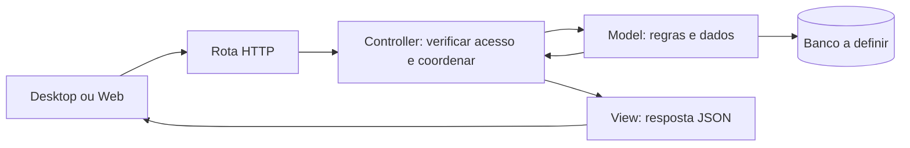

# Back-end Python com MVC

O Back-end usará MVC para facilitar a leitura e a divisão do trabalho de uma turma intermediária. Continua sendo um único servidor para Desktop, Web e futuras integrações. MVC organiza o código; não exige dividir o servidor em serviços.

## Quem faz o quê

| Pasta em `src/prontuario_backend/` | Competência | Exemplo |
| --- | --- | --- |
| `models/` | Dados, regras de negócio e persistência | Validar e salvar uma anotação |
| `controllers/` | Receber a operação, verificar acesso e coordenar | Solicitar ao Model a criação após autorizar o usuário |
| `views/` | Formatar respostas JSON e erros | Retornar apenas identificador e texto permitidos |
| `routes/` | Conectar URL/método ao Controller | Registrar `POST /api/v1/anotacoes` |
| `config/` | Inicialização, banco, autenticação e Swagger | Ler a URL do banco do ambiente |

Views do servidor são representações JSON. As telas ficam em Desktop e Web. Models não importam Controllers ou Views. Views recebem dados do Controller, sem consultar o banco. Controllers não devem virar um arquivo enorme com SQL e todas as regras.

## Fluxo de uma operação



## Exemplo prático: registrar uma anotação de demonstração

Exemplo fictício para ensinar a divisão; não é uma regra clínica aprovada nem uma API já disponível. Imagine que um usuário autorizado envia um texto para um registro e que texto vazio seja inválido.

1. A rota recebe `POST /api/v1/anotacoes` e encaminha ao Controller.
2. A autenticação identifica o usuário; o Controller valida formato, registro solicitado e permissão de escrita.
3. O Model verifica a regra do texto e grava na transação configurada.
4. O Controller entrega o resultado à View.
5. A View seleciona os campos públicos e retorna a resposta de sucesso documentada.

### Pseudocódigo por pasta

As funções abaixo são ilustrativas: tipos, dependências e tratamento completo de erros não foram implementados. Não são arquivos executáveis.

```python
# models/anotacao.py
class Anotacao:
    @classmethod
    def criar(cls, registro_id, autor_id, texto):
        if not texto.strip():
            raise TextoInvalido("O texto não pode ficar vazio")
        # O ORM e a transação serão definidos ao escolher o framework.
        return salvar_anotacao_em_transacao(
            registro_id=registro_id,
            autor_id=autor_id,
            texto=texto.strip(),
        )


# controllers/anotacoes.py
def criar_anotacao(requisicao):
    usuario = exigir_usuario_autenticado(requisicao)
    entrada = validar_entrada(requisicao.json)
    exigir_permissao_de_escrita(usuario, entrada.registro_id)
    anotacao = Anotacao.criar(
        registro_id=entrada.registro_id,
        autor_id=usuario.id,
        texto=entrada.texto,
    )
    return resposta_criada(anotacao)


# views/anotacoes.py
def resposta_criada(anotacao):
    return {"id": anotacao.id, "texto": anotacao.texto}, 201
```

`validar_entrada`, autenticação, autorização, persistência e as exceções são nomes conceituais. A implementação precisa limitar tamanho do texto, validar identificadores, tratar registro inexistente e garantir consistência entre autorização e gravação. A transação deve confirmar antes de responder sucesso e desfazer alterações em falhas. Erros conhecidos devem virar respostas documentadas, sem expor SQL ou rastros internos.

O autor vem da sessão validada, nunca de um campo confiado ao cliente. Os exemplos e os testes usam dados sintéticos. Auditoria, controle por registro, proteção de dados e política de concorrência devem ser definidos antes do uso real.

## Divisão de trabalho na turma

- Quem implementa Models cuida das regras, consultas e persistência com seus testes.
- Quem implementa Controllers cuida dos fluxos, entradas e acesso, combinando os métodos dos Models com a equipe.
- Quem implementa Views e rotas cuida do contrato JSON, erros e documentação OpenAPI.
- A equipe combina os formatos antes de trabalhar em paralelo e testa a operação completa no final.

Uma pessoa pode atuar em mais de uma frente. A separação orienta onde escrever; não exige uma pessoa para cada pasta. Evitar abstrações extras até surgir uma necessidade concreta.

## Swagger e testes

Rotas e esquemas de entrada/saída alimentam o OpenAPI, apresentado pelo Swagger UI. Views não devem serializar campos privados por padrão. Veja o [README principal](../README.md#swagger-no-back-end).

Em `tests/unit/`, validar texto vazio, coordenação e respostas. Em `tests/integration/`, verificar acesso negado sem gravação e persistência/transação no banco de teste. Em `tests/contract/`, verificar respostas e OpenAPI. A seção de ambiente descreve os testes iniciais implementados; os testes do exemplo clínico continuam futuros.

As instruções abaixo descrevem o ambiente inicial implementado com FastAPI, SQLAlchemy e SQLite. O provedor real de autenticação ainda precisa ser configurado.

## Ambiente de desenvolvimento implementado

Este guia substitui as indicações anteriores de que não havia ambiente executável. A API inicial já tem `/health`, `/docs`, `/openapi.json` e `/api/v1/me`. O exemplo de anotação acima continua sendo apenas pseudocódigo, sem rota clínica implementada.

### Dependências e escolhas

| Necessidade | Solução |
| --- | --- |
| API e Swagger UI | FastAPI, com OpenAPI e Swagger integrados |
| SQL | SQLAlchemy; SQLite local para começar sem instalar outro servidor |
| OAuth2/OIDC | Authorization Code com PKCE no Swagger; PyJWT e cryptography para validar tokens RS256 por JWKS |
| Servidor de desenvolvimento | Uvicorn com recarga automática |
| Ambiente virtual | `venv`, da biblioteca padrão do Python; não é pacote instalado por pip |
| Testes | pytest e httpx |

`requirements.txt` é o resultado real de `pip freeze` no venv Python 3.12, incluindo dependências transitivas e ferramentas de teste. Não existe pacote genérico obrigatório chamado `SQL`, `swagger`, `venv` ou `auth2` para instalar. Aqui, “auth2” foi interpretado como OAuth2. Essa imagem é para desenvolvimento, não uma distribuição de produção enxuta.

### 1. Instalar Python

Use Python 3.12 com pip e venv. No Ubuntu/Debian, os pacotes da distribuição são `python3`, `python3-venv` e `python3-pip`; confira `python3 --version` antes de continuar. No Windows, instale Python 3.12 e use `py -3.12` para criar o ambiente. No macOS, use uma instalação Python 3.12 que inclua venv.

### 2. Criar o venv e instalar dependências

Execute a partir da raiz do repositório, em Linux/macOS:

```bash
cd backend
python3.12 -m venv .venv
source .venv/bin/activate
python -m pip install -r requirements.txt
python -m pip check
cp .env.example .env
```

No Windows PowerShell, entre em `backend` e execute:

```powershell
py -3.12 -m venv .venv
.\.venv\Scripts\python.exe -m pip install -r requirements.txt
.\.venv\Scripts\python.exe -m pip check
Copy-Item .env.example .env
```

A ativação é uma conveniência: os comandos com caminho completo funcionam sem alterar políticas do PowerShell. A pasta `.venv` não vai para o Git nem para a imagem Docker.

### 3. Executar com o arquivo pronto

De dentro de `backend`, execute:

```bash
python scripts/dev.py --setup
```

Esse arquivo cria `.venv` se necessário, instala as versões fixadas e inicia Uvicorn com recarga automática. Depois da primeira instalação:

```bash
python scripts/dev.py
```

Sem ativar o venv, use o Python 3.12 do sistema para chamar o script. No Windows, substitua `python` por `py -3.12` quando necessário. Para mudar a porta: `python scripts/dev.py --port 8001`. Ctrl+C encerra o servidor.

O script não carrega `.env` automaticamente. SQLite funciona com o padrão. Para configurações locais no Linux/macOS, edite seu `.env` confiável e carregue suas variáveis antes de iniciar:

```bash
set -a
. ./.env
set +a
python scripts/dev.py
```

No PowerShell, configure as variáveis com `$env:NOME="valor"` antes de executar; não execute o conteúdo de um `.env` como script PowerShell. O Compose carrega `.env` por sua configuração `env_file`.

### 4. Conferir se funcionou

Com a API ativa, consulte os caminhos abaixo usando o endereço e a porta locais configurados:

| Caminho | Resultado esperado |
| --- | --- |
| `/health` | HTTP 200 com `{"status":"ok","database":"ok"}` após `SELECT 1` real |
| `/docs` | Swagger UI com as operações documentadas |
| `/openapi.json` | Contrato OpenAPI gerado |
| `/api/v1/me` sem token | HTTP 401 |
| `/api/v1/me` com token, sem provedor configurado | HTTP 503 |

O banco local é `backend/data/development.db`; não há tabelas clínicas criadas. A verificação atual prova acesso SQL, não implementa funcionalidades de prontuário.

### 5. Configurar OAuth2/OIDC

Use um provedor que emita access tokens JWT RS256 com `iss`, `aud`, `sub` e `exp`. Configure `OIDC_ISSUER`, `OIDC_AUDIENCE`, `OIDC_JWKS_URL`, `OIDC_AUTHORIZATION_URL` e `OIDC_TOKEN_URL` conforme `.env.example`. Issuer e JWKS devem usar HTTPS. O endereço JWKS é configuração confiável do servidor, nunca entrada do usuário.

O Back-end verifica assinatura, algoritmo, validade, emissor e audiência. Token inválido recebe 401; provedor indisponível ou não configurado recebe 503. Não há usuário/senha de demonstração, bypass de autenticação ou emissor de tokens dentro desta API. No Swagger, configure um cliente público do provedor, Authorization Code + PKCE e o redirect da interface (`/docs/oauth2-redirect` na origem da API). CORS, scopes e cadastro do cliente devem ser ajustados no provedor. Nunca embuta um client secret no navegador.

Sem provedor disponível, apenas os testes com chaves sintéticas verificam a validação criptográfica; o login ponta a ponta permanece dependente da configuração externa. `/api/v1/me` retorna somente o identificador autenticado e não implementa permissões clínicas.

### 6. Testar e atualizar o freeze

Com o venv ativo, dentro de `backend`:

```bash
python -m pytest -q
python -m pip check
```

Os testes exercitam SQL em banco temporário, Swagger/OpenAPI, ausência de credencial, provedor ausente, token assinado válido, expirado e com audiência incorreta. Não usam dados reais ou um provedor externo.

Somente ao alterar dependências intencionalmente, gere novamente o arquivo no venv isolado e revise o diff:

```bash
python -m pip freeze > requirements.txt
```

Não gere o freeze a partir do Python global. As versões foram verificadas em Python 3.12/Linux; outras plataformas podem resolver wheels diferentes e precisam de validação própria.

## Instalar Docker

Nesta máquina Docker Engine e Compose já estão instalados. Não é necessário instalá-los novamente para este ambiente.

### Windows e macOS

1. Instale Docker Desktop pela [documentação oficial](https://docs.docker.com/desktop/).
2. No Windows, siga os requisitos de virtualização e WSL 2 indicados pelo instalador.
3. Inicie Docker Desktop e aguarde o Engine ficar disponível.
4. Confirme com `docker version`, `docker compose version` e `docker info`.

### Ubuntu Linux

Siga o [repositório oficial do Docker para Ubuntu](https://docs.docker.com/engine/install/ubuntu/). Os comandos abaixo são para Ubuntu compatível, não para qualquer distribuição ou para substituir o Docker desta nuvem:

```bash
sudo apt-get update
sudo apt-get install -y ca-certificates curl
sudo install -m 0755 -d /etc/apt/keyrings
sudo curl -fsSL https://download.docker.com/linux/ubuntu/gpg -o /etc/apt/keyrings/docker.asc
sudo chmod a+r /etc/apt/keyrings/docker.asc
. /etc/os-release
printf 'Types: deb\nURIs: https://download.docker.com/linux/ubuntu\nSuites: %s\nComponents: stable\nSigned-By: /etc/apt/keyrings/docker.asc\n' "${UBUNTU_CODENAME:-$VERSION_CODENAME}" | sudo tee /etc/apt/sources.list.d/docker.sources >/dev/null
sudo apt-get update
sudo apt-get install -y docker-ce docker-ce-cli containerd.io docker-buildx-plugin docker-compose-plugin
sudo systemctl enable --now docker
sudo docker info
sudo docker compose version
```

Se já houver pacotes de contêiner conflitantes, consulte a etapa oficial de remoção antes de instalar; não remova serviços existentes cegamente. Em máquinas locais sem acesso ao socket, use `sudo` nos comandos Docker ou configure acesso conforme a política da máquina. Não use `chmod 666` no socket. Distribuições diferentes devem usar as instruções oficiais correspondentes.

## Containerizar e executar

O `Dockerfile` usa Python 3.12, instala o freeze e executa a aplicação com usuário sem privilégios. O `.dockerignore` evita enviar venv, banco local e segredos ao contexto.

### Caminho recomendado: Compose

De dentro de `backend`:

```bash
docker compose config --quiet
docker compose up --build -d --wait
docker compose ps
docker compose logs -f backend
```

O Compose monta o código somente para leitura, habilita reload, publica a porta 8000 apenas na interface local e guarda SQLite no volume `development-data`. O healthcheck faz uma requisição que verifica SQL. Alterações nas dependências exigem novo build. Para parar preservando os dados:

```bash
docker compose down
```

`docker compose down -v` também apaga o volume e o banco desse projeto; use somente quando quiser descartar os dados de desenvolvimento.

### Build e execução sem Compose

```bash
docker build -t prontuario-backend-dev .
docker run --rm -p 127.0.0.1:8000:8000 --env-file .env prontuario-backend-dev
```

Sem volume, os dados do contêiner são descartáveis. Essa execução usa o código da imagem; Compose oferece montagem do código e recarga para desenvolvimento.

### Ambientes com proxy e certificado corporativo

Mantenha TLS e o proxy configurado. O Dockerfile aceita uma CA opcional via segredo BuildKit, sem incorporá-la à imagem:

```bash
docker build --secret id=proxy_ca,src=/etc/ssl/certs/ca-certificates.crt -t prontuario-backend-dev .
docker compose up -d --no-build --wait
```

Esse caminho de certificado é o bundle da máquina Linux usada nesta validação. Use o bundle confiável correto em outras máquinas. Contêineres que precisarem consultar um provedor OIDC através de proxy corporativo também precisarão receber a CA de runtime por montagem somente leitura e configuração de confiança; o segredo de build não se mantém em runtime. Não desative a verificação TLS.

## Arquivos que não devem ir ao Git

`backend/.gitignore` cobre venv, bytecode, caches, cobertura, bancos, logs, arquivos `.env`, chaves, saídas de build e arquivos locais de editores. `.env.example`, requisitos, Dockerfile, Compose, código e futuras migrações devem ser versionados. Revise `git status --short` antes de cada commit; um ignore não remove segredos que já estejam rastreados.
