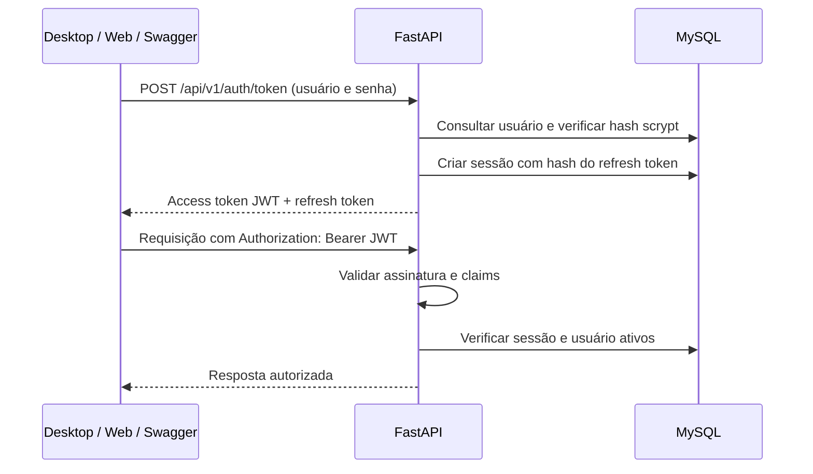

# Login local, JWT e sessões

A API autentica usuários do próprio MySQL. Não exige provedor OIDC. O fluxo usa os arquivos MVC já existentes: `config/auth.py` trata hash/JWT e a dependência de autenticação, `models/users.py` concentra SQL, `controllers/auth.py` coordena login e sessão, e Views/rotas definem os contratos.

## Configuração e uso

A criação da chave, do primeiro administrador e as duas opções de **Authorize** (login e token Bearer manual) estão no [roteiro único de execução](../README.md#2-preparar-a-configuração-privada). Não há senha padrão nem cadastro automático. O administrador usa perfil `ADMINISTRADOR` e concessão `USUARIO_GERENCIAR`, separados das credenciais de conexão MySQL.

| Variável | Padrão / finalidade |
| --- | --- |
| `AUTH_JWT_SECRET` | Chave aleatória privada de pelo menos 32 bytes, igual em todas as réplicas |
| `AUTH_JWT_ISSUER` | `prontuarioedu` |
| `AUTH_JWT_AUDIENCE` | `prontuario-api` |
| `AUTH_ACCESS_TOKEN_MINUTES` | 15, de 1 a 60 |
| `AUTH_REFRESH_TOKEN_DAYS` | 7, de 1 a 30; prazo fixo da sessão |
| `AUTH_REFRESH_WINDOW_SECONDS` | 60; antecedência para recomendar renovação |

Recrie a API após mudar configuração. Sem chave, login retorna 503 em desenvolvimento; produção exige chave configurada. Trocar a chave invalida os access tokens existentes. Login exige o schema de domínio: as migrations técnicas não criam `cadastro__usuarios` nem `cadastro__sessoes_usuario`.

O fluxo de senha serve aos clientes próprios; a API não é servidor OIDC/SSO para terceiros. O token fica somente no estado da página, sem persistência. Limpar o modal não revoga a sessão: use a rota de logout para isso, como explicado no [roteiro do Swagger](../README.md#5-abrir-e-usar-o-swagger).

## Administrador existente

O bootstrap usa a conexão do processo/contêiner onde é executado, com senha digitada duas vezes via `getpass` e somente hash scrypt enviado ao MySQL. Cria usuário, perfil, concessão e auditoria na mesma transação. Reexecutá-lo preserva a senha local, não reativa usuários nem refaz concessões revogadas.

Para converter um administrador externo antigo, use o mesmo comando de criação do [passo 4](../README.md#4-criar-o-administrador-da-aplicação), acrescentando `--convert-existing` após `scripts/create_admin.py`. A conversão preserva ID e concessões, mas recusa usuário inativo ou sem concessão administrativa ativa. Defina uma nova senha local no prompt. Nenhum volume deve ser apagado nem conta de outra pessoa assumida.

Preserve o nome de projeto Compose e o volume da instalação existente. Ao migrar da autenticação externa, configure a chave JWT e recrie o backend com os arquivos atuais; certificados e senhas antigos devem ser tratados com o responsável. A decisão está na [ADR 0010](../../docs/adr/0010-autenticacao-local.md).

## Contratos implementados

| Método e rota | Entrada / efeito |
| --- | --- |
| `POST /api/v1/auth/token` | Formulário de login; retorna `access_token`, `refresh_token`, `token_type=bearer`, `expires_in` e `scope` |
| `GET /api/v1/me` | Bearer com `identity:read`; retorna o ID do usuário |
| `GET /api/v1/auth/session` | Bearer; informa expiração e `refresh_required` |
| `POST /api/v1/auth/refresh` | JSON com `refresh_token` e `scope` opcional; retorna novos tokens |
| `POST /api/v1/auth/logout` | Bearer; revoga a sessão e responde 204 |
| `POST /api/v1/auth/password` | Bearer + JSON com `current_password` e `new_password`; troca senha, revoga todas as sessões e responde 204 |
| `GET /api/v1/admin/me` | Exige os dois escopos e concessões administrativas ativas |

As entradas recusam campos desconhecidos. O login aceita `username` de 1 a 150 caracteres, `password` de 1 a 128 e `scope` de até 512; os campos opcionais de cliente do Swagger devem ficar vazios. Formulário incompleto, repetido, UTF-8 inválido ou campo não suportado recebe 400; conteúdo JSON no login recebe 415. JSON inválido ou fora dos contratos de refresh/troca de senha recebe 422, sem devolver valores sensíveis. Credenciais com formato válido, mas incorretas, recebem 401. Consulte os [contratos HTTP](CONTRATOS.md) para limites e envelope de erro.

Cada renovação substitui o refresh token anterior; reutilizá-lo retorna `401`. A renovação não prolonga o prazo máximo da sessão. `scope` omitido na renovação solicita somente `identity:read`; solicite também `admin:access` quando necessário e autorizado. As permissões são calculadas pelo servidor, nunca concedidas por campos do cliente.

## Como validar acesso e sessão

`authenticate_request` executa antes do endpoint. Aceita apenas Bearer no header; tokens em query/body não autenticam. Verifica HS256, assinatura, emissor, audiência, expiração, emissão, tipo de token e IDs da sessão/usuário. O algoritmo é fixado pelo servidor. Depois de validar o JWT, consulta o MySQL para recusar sessão encerrada/expirada, usuário desativado ou bloqueado e concessão administrativa revogada.

Com a chave JWT configurada, credenciais ausentes ou inválidas recebem 401 antes de consultar SQL, inclusive durante indisponibilidade do banco. Um JWT válido ainda depende da sessão no MySQL: se não for possível consultá-la, `/api/v1/me` retorna 503. `/health` é público, verifica SQL e também retorna 503 quando o banco não responde; ele não revela usuários, tokens ou dados clínicos. Os cenários estão documentados na [etapa 4 do F01](../../docs/historico/F01.md#etapa-4--resultado).

A senha usa scrypt com salt aleatório; o banco recebe somente o hash. O refresh token tem segredo aleatório e seu hash SHA-256 é persistido. Access e refresh tokens não são senhas: devem ser mantidos fora de logs, URLs, Git e armazenamento inseguro dos clientes. Logout e troca de senha bloqueiam também os JWTs já emitidos por meio da sessão.

Cinco falhas de login bloqueiam a conta por 15 minutos. O limitador HTTP continua ativo, com Redis no Compose e exigido em produção. Usuário inexistente, senha errada e conta indisponível recebem a mesma resposta. Não há endpoint público de cadastro, recuperação de senha ou MFA nesta etapa.

`/auth/session` retorna `authenticated`, `subject`, `expires_at` em UTC, `expires_in_seconds` e `refresh_required`. Token expirado ou sessão inválida recebe `401`; escopo insuficiente recebe `403`; configuração/banco indisponível recebe `503`. Tente uma renovação com refresh válido ou solicite novo login, evitando repetição infinita.

## Proteger novos endpoints

Declare `Security(authenticate_request, scopes=["identity:read"])` como dependência antes da lógica da rota. O exemplo executável e a configuração de respostas/OpenAPI estão em [desenvolvimento](DESENVOLVIMENTO.md#criar-uma-rota-protegida). Para dados clínicos, exija também `require_record_access` e as regras aprovadas; ser administrador não libera prontuários automaticamente.

Os testes cobrem assinatura/claims, login real com MySQL descartável, bloqueio por tentativas, refresh de uso único, logout, troca de senha, revogação e Swagger na origem do Codespace. Nenhuma credencial ou dado de teste é inserido no banco da aplicação.
