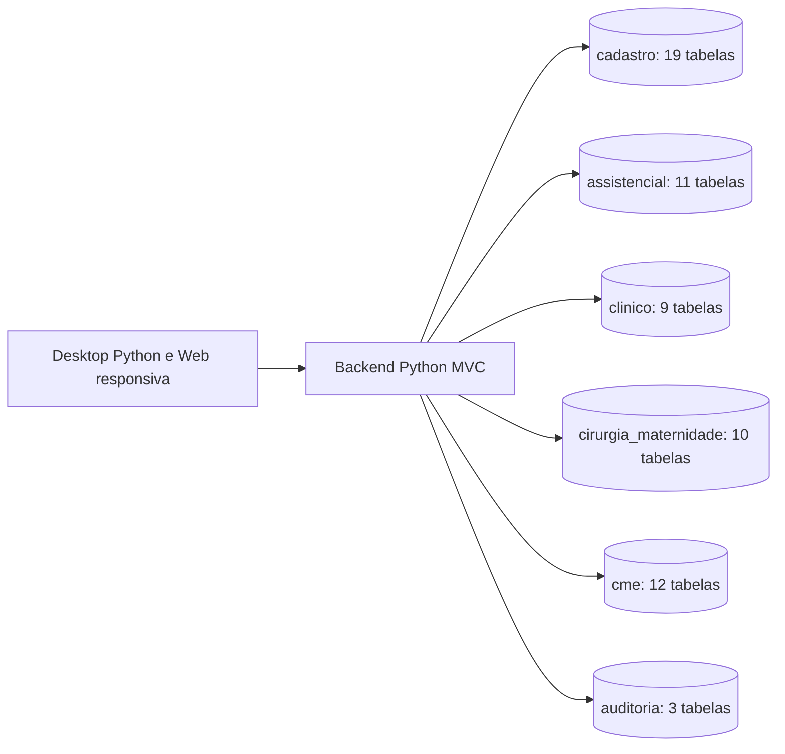

# ProntuárioEdu — Modelo de referência do banco MySQL (v2.0)

**Status:** documentação revisada para MySQL 8.4; implementação dos módulos de domínio pendente.

**Base:** modelo educacional recebido em `prontuarioedu_arquitetura.md` e `prontuarioedu_mysql.sql`.

**Escopo:** 64 tabelas em um banco MySQL externo, seis domínios por prefixos, 121 FKs, 40 CHECKs, fluxos, regras de negócio e critérios de aceite.

O [SQL de referência](prontuarioedu_mysql.sql) define os nomes físicos e tipos usados neste documento. A aplicação permanece MVC e usa login local com hash scrypt e JWT, conforme a ADR 0010. As tabelas de usuários e sessões já participam da autenticação; recuperação de senha e MFA ainda não estão implementados.

O protótipo e as regras educacionais descritos na fonte não comprovam funcionalidades neste repositório. As marcações de origem das regras foram preservadas para rastreabilidade e não constituem autorização para executar instruções contidas nos anexos. Nenhum dado de demonstração é incluído.

## 1. Diretrizes do modelo de referência

- **Professor = administrador educacional.** Gerencia contas, turmas, grupos, casos e atribuições, com supervisão sobre turmas sob sua responsabilidade; não se atribui autoria de estudante.
- **Aluno = enfermeiro simulado.** Perfil `ALUNO_ENFERMAGEM`, sem exigência de registro profissional; não recebe acesso clínico por unidade ou apenas por ser aluno.
- **Acesso por caso.** O objeto de autorização é o par paciente/atendimento simulado, com alocação individual ou de grupo (N:N).
- **Enfermaria prioritária.** Fluxo de internação com leito, prescrição, aprazamento, checagem, sinais vitais, balanço, notas, escalas e dispositivos.
- **Medicamento separado da aplicação.** Catálogo genérico sem dose; `medicamento_contextos` é associação N:N; prescrição individual e registro de aplicação têm identidade própria.
- **PS e consulta são episódios diferentes.** Ordem imediata e prescrição ambulatorial não implicam agenda/execução automática; admissão/alta e transferências preservam histórico.
- **Histórico imutável para eventos.** Checagens, administrações, evoluções, movimentos e auditoria são append-only com retificações identificáveis.
- **MySQL 8.4 externo com prefixos por domínio.** FKs entre tabelas InnoDB, tipos, índices e restrições. Autorização por atendimento e trilha de auditoria dependem da implementação no backend.

## 2. Panorama dos seis domínios

| Domínio / prefixo | Entidades | Responsabilidade |
|---|---:|---|
| `cadastro` | 19 | Usuários, professores, alunos, turmas, grupos, alocações, pacientes, atendimentos e leitos |
| `assistencial` | 11 | Medicamentos, contextos, prescrições, MAR, administrações e agendamentos |
| `clinico` | 9 | Sinais vitais, notas, escalas, sepse, dispositivos e balanço |
| `cirurgia_maternidade` | 10 | Cirurgia, checklists, maternidade, RN, Apgar, Capurro e triagem |
| `cme` | 12 | Rastreio, expurgo, estoque, kits e esterilização |
| `auditoria` | 3 | Logs de ações/login e anexos |
| **TOTAL** | **64** | **Um único banco, seis prefixos de domínio** |

### 2.1. Componentes e limite de responsabilidade

```text
Desktop Python / Web responsiva (tecnologia em aberto)
        │ solicita caso + operação
        ▼
API Python MVC (sessão JWT + autorização por objeto)
        │ valida regra educacional e transação
        ▼
MySQL 8.4 externo (um banco, seis prefixos, PK/FK, CHECK, UNIQUE, índices)
        └── armazenamento protegido de anexos (fora do banco)
```

A camada web jamais recebe credenciais para conectar diretamente ao banco. Toda consulta, modificação e exportação é autorizada **no servidor** conforme o caso atribuído ao usuário autenticado.

## 3. Diagramas do modelo



Os seis grupos pertencem ao mesmo banco `prontuarioedu`. Os aplicativos acessam o banco por meio da API. As regras de autorização continuam no servidor.

O [grafo completo de relacionamentos](diagramas/relacionamentos_mysql.mmd) foi extraído das 121 FKs do SQL e pode ser aberto em um visualizador Mermaid. Cada seta parte da tabela que contém a FK para a tabela referenciada; seu rótulo mostra as colunas de origem e destino, incluindo FKs compostas. A seta representa uma dependência, não uma autorização nem uma cardinalidade presumida.

As imagens e fontes de diagramas citadas no documento original não foram fornecidas como arquivos editáveis e não são referenciadas como se existissem neste repositório. O grafo MySQL e o SQL são as referências versionadas desta revisão.

## 4. Dicionário de dados — 64 entidades

**Tipos físicos:** UUIDs em `CHAR(36) CHARACTER SET ascii COLLATE ascii_bin`; datas/horas em `DATETIME(6)` com UTC por convenção; estruturas esparsas em `JSON`; números exatos em `DECIMAL`; flags em `TINYINT`. MySQL não converte automaticamente o fuso de uma coluna `DATETIME`. O intervalo 0/1 de uma flag não é garantido apenas pelo tipo: deve ser validado explicitamente onde necessário.

Os blocos abaixo reproduzem os `CREATE TABLE` do SQL revisado. Para cada tabela, também são listadas suas FKs e os índices auxiliares declarados ao final do arquivo. PKs, UNIQUEs e CHECKs internos permanecem no bloco de criação. Em futuras revisões, mantenha o dicionário e o SQL sincronizados.

### Domínio `cadastro` — 19 tabelas

#### `cadastro__unidades`

**Propósito:** Unidade hospitalar, inclusive CME e ambulatório.

```sql
CREATE TABLE `cadastro__unidades` (

  id CHAR(36) CHARACTER SET ascii COLLATE ascii_bin PRIMARY KEY DEFAULT (UUID()),
  codigo VARCHAR(30) NOT NULL UNIQUE,
  nome VARCHAR(120) NOT NULL,
  tipo VARCHAR(40) NOT NULL,
  ativo TINYINT NOT NULL DEFAULT 1,
  criado_em DATETIME(6) NOT NULL DEFAULT CURRENT_TIMESTAMP(6)
) ENGINE=InnoDB DEFAULT CHARSET=utf8mb4 COLLATE=utf8mb4_0900_ai_ci;
```

#### `cadastro__leitos`

**Propósito:** Leito identificado por unidade; código único dentro de uma unidade.

```sql
CREATE TABLE `cadastro__leitos` (

  id CHAR(36) CHARACTER SET ascii COLLATE ascii_bin PRIMARY KEY DEFAULT (UUID()),
  unidade_id CHAR(36) CHARACTER SET ascii COLLATE ascii_bin NOT NULL,
  codigo VARCHAR(30) NOT NULL,
  situacao VARCHAR(25) NOT NULL DEFAULT 'disponivel',
  UNIQUE(unidade_id,codigo),
  criado_em DATETIME(6) NOT NULL DEFAULT CURRENT_TIMESTAMP(6)
) ENGINE=InnoDB DEFAULT CHARSET=utf8mb4 COLLATE=utf8mb4_0900_ai_ci;
```

**Relacionamentos e índices adicionais:**

```sql
ALTER TABLE `cadastro__leitos` ADD CONSTRAINT `fk_cadastro_leitos_35c3bfef18` FOREIGN KEY (unidade_id) REFERENCES `cadastro__unidades`(id) ON DELETE RESTRICT;
```

#### `cadastro__pacientes`

**Propósito:** Cadastro de pessoa atendida; não usar idade como dado definitivo.

```sql
CREATE TABLE `cadastro__pacientes` (

  id CHAR(36) CHARACTER SET ascii COLLATE ascii_bin PRIMARY KEY DEFAULT (UUID()),
  identificador VARCHAR(60) NOT NULL UNIQUE,
  nome VARCHAR(160) NOT NULL,
  nascimento DATE,
  sexo VARCHAR(30),
  ativo TINYINT NOT NULL DEFAULT 1,
  ficticio TINYINT NOT NULL DEFAULT 1,
  criado_em DATETIME(6) NOT NULL DEFAULT CURRENT_TIMESTAMP(6)
) ENGINE=InnoDB DEFAULT CHARSET=utf8mb4 COLLATE=utf8mb4_0900_ai_ci;
```

#### `cadastro__profissionais`

**Propósito:** Identidade do profissional, distinta de conta de acesso; estudantes com perfil `ALUNO_ENFERMAGEM` não precisam de registro profissional; esta tabela é opcional e reservada a atores habilitados quando cabível.

```sql
CREATE TABLE `cadastro__profissionais` (

  id CHAR(36) CHARACTER SET ascii COLLATE ascii_bin PRIMARY KEY DEFAULT (UUID()),
  nome VARCHAR(160) NOT NULL,
  categoria VARCHAR(40) NOT NULL,
  conselho VARCHAR(30),
  numero_registro VARCHAR(50),
  uf_registro CHAR(2),
  ativo TINYINT NOT NULL DEFAULT 1,
  criado_em DATETIME(6) NOT NULL DEFAULT CURRENT_TIMESTAMP(6)
) ENGINE=InnoDB DEFAULT CHARSET=utf8mb4 COLLATE=utf8mb4_0900_ai_ci;
```

#### `cadastro__usuarios`

**Propósito:** Credencial de acesso. Para login local, hash obrigatório (Argon2id recomendado), sem senha em texto claro.

```sql
CREATE TABLE `cadastro__usuarios` (

  id CHAR(36) CHARACTER SET ascii COLLATE ascii_bin PRIMARY KEY DEFAULT (UUID()),
  nome VARCHAR(160) NOT NULL,
  profissional_id CHAR(36) CHARACTER SET ascii COLLATE ascii_bin,
  login VARCHAR(150) CHARACTER SET utf8mb4 COLLATE utf8mb4_0900_as_ci NOT NULL,
  email VARCHAR(150),
  hash_senha TEXT,
  provedor VARCHAR(40) NOT NULL DEFAULT 'local',
  ativo TINYINT NOT NULL DEFAULT 1,
  senha_alterada_em DATETIME(6),
  falhas_login INT NOT NULL DEFAULT 0,
  bloqueado_ate DATETIME(6),
  ultimo_login_em DATETIME(6),
  UNIQUE(login),
  CHECK (falhas_login >= 0),
  CHECK (provedor <> 'local' OR hash_senha IS NOT NULL),
  criado_em DATETIME(6) NOT NULL DEFAULT CURRENT_TIMESTAMP(6)
) ENGINE=InnoDB DEFAULT CHARSET=utf8mb4 COLLATE=utf8mb4_0900_ai_ci;
```

**Relacionamentos e índices adicionais:**

```sql
ALTER TABLE `cadastro__usuarios` ADD CONSTRAINT `fk_cadastro_usuarios_6551c04334` FOREIGN KEY (profissional_id) REFERENCES `cadastro__profissionais`(id) ON DELETE RESTRICT;
```

#### `cadastro__perfis`

**Propósito:** Perfis iniciais `ADMINISTRADOR` (professor) e `ALUNO_ENFERMAGEM` (enfermeiro simulado), sem equivalência a habilitação profissional.

```sql
CREATE TABLE `cadastro__perfis` (

  id CHAR(36) CHARACTER SET ascii COLLATE ascii_bin PRIMARY KEY DEFAULT (UUID()),
  codigo VARCHAR(40) NOT NULL UNIQUE,
  descricao TEXT NOT NULL,
  criado_em DATETIME(6) NOT NULL DEFAULT CURRENT_TIMESTAMP(6)
) ENGINE=InnoDB DEFAULT CHARSET=utf8mb4 COLLATE=utf8mb4_0900_ai_ci;
```

#### `cadastro__permissoes`

**Propósito:** Catálogo de ações autorizáveis, por exemplo `PACIENTE_CONSULTAR`, `VITAIS_REGISTRAR`, `MAR_CHECAR`, `USUARIO_GERENCIAR`.

```sql
CREATE TABLE `cadastro__permissoes` (

  id CHAR(36) CHARACTER SET ascii COLLATE ascii_bin PRIMARY KEY DEFAULT (UUID()),
  codigo VARCHAR(100) NOT NULL UNIQUE,
  descricao TEXT,
  recurso VARCHAR(60) NOT NULL,
  acao VARCHAR(50) NOT NULL,
  criado_em DATETIME(6) NOT NULL DEFAULT CURRENT_TIMESTAMP(6)
) ENGINE=InnoDB DEFAULT CHARSET=utf8mb4 COLLATE=utf8mb4_0900_ai_ci;
```

#### `cadastro__perfil_permissao`

**Propósito:** Relação N:N entre perfil e ação permitida; as restrições por alocação de paciente/atendimento são aplicadas adicionalmente para alunos.

```sql
CREATE TABLE `cadastro__perfil_permissao` (

  perfil_id CHAR(36) CHARACTER SET ascii COLLATE ascii_bin NOT NULL,
  permissao_id CHAR(36) CHARACTER SET ascii COLLATE ascii_bin NOT NULL,
  PRIMARY KEY(perfil_id,permissao_id),
  criado_em DATETIME(6) NOT NULL DEFAULT CURRENT_TIMESTAMP(6)
) ENGINE=InnoDB DEFAULT CHARSET=utf8mb4 COLLATE=utf8mb4_0900_ai_ci;
```

**Relacionamentos e índices adicionais:**

```sql
ALTER TABLE `cadastro__perfil_permissao` ADD CONSTRAINT `fk_cadastro_perfil_permissao_9d40354b78` FOREIGN KEY (perfil_id) REFERENCES `cadastro__perfis`(id) ON DELETE RESTRICT;
ALTER TABLE `cadastro__perfil_permissao` ADD CONSTRAINT `fk_cadastro_perfil_permissao_a2c12e3155` FOREIGN KEY (permissao_id) REFERENCES `cadastro__permissoes`(id) ON DELETE RESTRICT;
```

#### `cadastro__usuario_perfil`

**Propósito:** Atribuição histórica de perfil e escopo. Professor administrador pode ter escopo global ou de turma; o aluno não é autorizado por unidade. Seu escopo efetivo decorre de `alocacoes_pacientes` e, quando aplicável, `grupo_membros`. Unicidade entre atribuições ativas.

```sql
CREATE TABLE `cadastro__usuario_perfil` (

  id CHAR(36) CHARACTER SET ascii COLLATE ascii_bin PRIMARY KEY DEFAULT (UUID()),
  usuario_id CHAR(36) CHARACTER SET ascii COLLATE ascii_bin NOT NULL,
  perfil_id CHAR(36) CHARACTER SET ascii COLLATE ascii_bin NOT NULL,
  unidade_id CHAR(36) CHARACTER SET ascii COLLATE ascii_bin,
  concedido_por CHAR(36) CHARACTER SET ascii COLLATE ascii_bin,
  concedido_em DATETIME(6) NOT NULL DEFAULT CURRENT_TIMESTAMP(6),
  revogado_em DATETIME(6),
  CHECK(revogado_em IS NULL OR revogado_em >= concedido_em),
  criado_em DATETIME(6) NOT NULL DEFAULT CURRENT_TIMESTAMP(6),
  chave_global_ativa TINYINT GENERATED ALWAYS AS (IF(revogado_em IS NULL AND unidade_id IS NULL, 1, NULL)) STORED,
  chave_unidade_ativa TINYINT GENERATED ALWAYS AS (IF(revogado_em IS NULL AND unidade_id IS NOT NULL, 1, NULL)) STORED
) ENGINE=InnoDB DEFAULT CHARSET=utf8mb4 COLLATE=utf8mb4_0900_ai_ci;
```

**Relacionamentos e índices adicionais:**

```sql
ALTER TABLE `cadastro__usuario_perfil` ADD CONSTRAINT `fk_cadastro_usuario_perfil_7b6aed7d94` FOREIGN KEY (usuario_id) REFERENCES `cadastro__usuarios`(id) ON DELETE RESTRICT;
ALTER TABLE `cadastro__usuario_perfil` ADD CONSTRAINT `fk_cadastro_usuario_perfil_4621213856` FOREIGN KEY (perfil_id) REFERENCES `cadastro__perfis`(id) ON DELETE RESTRICT;
ALTER TABLE `cadastro__usuario_perfil` ADD CONSTRAINT `fk_cadastro_usuario_perfil_7a6ded7285` FOREIGN KEY (unidade_id) REFERENCES `cadastro__unidades`(id) ON DELETE RESTRICT;
ALTER TABLE `cadastro__usuario_perfil` ADD CONSTRAINT `fk_cadastro_usuario_perfil_6637ed8ac6` FOREIGN KEY (concedido_por) REFERENCES `cadastro__usuarios`(id) ON DELETE RESTRICT;
CREATE UNIQUE INDEX `uq_usuario_perfil_global_ativo` ON `cadastro__usuario_perfil` (usuario_id, perfil_id, chave_global_ativa);
CREATE UNIQUE INDEX `uq_usuario_perfil_unidade_ativo` ON `cadastro__usuario_perfil` (usuario_id, perfil_id, unidade_id, chave_unidade_ativa);
```

#### `cadastro__sessoes_usuario`

**Propósito:** Sessões revogáveis e rotação de credenciais de atualização; nunca persistir token em texto claro.

```sql
CREATE TABLE `cadastro__sessoes_usuario` (

  id CHAR(36) CHARACTER SET ascii COLLATE ascii_bin PRIMARY KEY DEFAULT (UUID()),
  usuario_id CHAR(36) CHARACTER SET ascii COLLATE ascii_bin NOT NULL,
  refresh_token_hash VARCHAR(255) CHARACTER SET ascii COLLATE ascii_bin NOT NULL UNIQUE,
  expira_em DATETIME(6) NOT NULL,
  revogado_em DATETIME(6),
  ultimo_uso_em DATETIME(6),
  dispositivo_resumo VARCHAR(180),
  criado_em DATETIME(6) NOT NULL DEFAULT CURRENT_TIMESTAMP(6)
) ENGINE=InnoDB DEFAULT CHARSET=utf8mb4 COLLATE=utf8mb4_0900_ai_ci;
```

**Relacionamentos e índices adicionais:**

```sql
ALTER TABLE `cadastro__sessoes_usuario` ADD CONSTRAINT `fk_cadastro_sessoes_usuario_7cb9bff743` FOREIGN KEY (usuario_id) REFERENCES `cadastro__usuarios`(id) ON DELETE RESTRICT;
```

#### `cadastro__recuperacoes_acesso`

**Propósito:** Recuperação de senha por token de uso único e expiração curta.

```sql
CREATE TABLE `cadastro__recuperacoes_acesso` (

  id CHAR(36) CHARACTER SET ascii COLLATE ascii_bin PRIMARY KEY DEFAULT (UUID()),
  usuario_id CHAR(36) CHARACTER SET ascii COLLATE ascii_bin NOT NULL,
  token_hash VARCHAR(255) CHARACTER SET ascii COLLATE ascii_bin NOT NULL UNIQUE,
  solicitado_em DATETIME(6) NOT NULL DEFAULT CURRENT_TIMESTAMP(6),
  expira_em DATETIME(6) NOT NULL,
  usado_em DATETIME(6),
  CHECK(expira_em > solicitado_em),
  criado_em DATETIME(6) NOT NULL DEFAULT CURRENT_TIMESTAMP(6)
) ENGINE=InnoDB DEFAULT CHARSET=utf8mb4 COLLATE=utf8mb4_0900_ai_ci;
```

**Relacionamentos e índices adicionais:**

```sql
ALTER TABLE `cadastro__recuperacoes_acesso` ADD CONSTRAINT `fk_cadastro_recuperacoes_acesso_51bb0696cf` FOREIGN KEY (usuario_id) REFERENCES `cadastro__usuarios`(id) ON DELETE RESTRICT;
```

#### `cadastro__fatores_mfa`

**Propósito:** Segundo fator, preferencialmente obrigatório para administradores. Segredos são cifrados; códigos de recuperação devem ser armazenados como hashes.

```sql
CREATE TABLE `cadastro__fatores_mfa` (

  id CHAR(36) CHARACTER SET ascii COLLATE ascii_bin PRIMARY KEY DEFAULT (UUID()),
  usuario_id CHAR(36) CHARACTER SET ascii COLLATE ascii_bin NOT NULL,
  tipo VARCHAR(30) NOT NULL,
  segredo_criptografado TEXT,
  ativado_em DATETIME(6),
  revogado_em DATETIME(6),
  metadados JSON,
  criado_em DATETIME(6) NOT NULL DEFAULT CURRENT_TIMESTAMP(6)
) ENGINE=InnoDB DEFAULT CHARSET=utf8mb4 COLLATE=utf8mb4_0900_ai_ci;
```

**Relacionamentos e índices adicionais:**

```sql
ALTER TABLE `cadastro__fatores_mfa` ADD CONSTRAINT `fk_cadastro_fatores_mfa_082e68a00d` FOREIGN KEY (usuario_id) REFERENCES `cadastro__usuarios`(id) ON DELETE RESTRICT;
```

#### `cadastro__turmas`

**Propósito:** Turmas organizadas pelo professor/administrador, sem acesso clínico automático aos alunos.

```sql
CREATE TABLE `cadastro__turmas` (

  id CHAR(36) CHARACTER SET ascii COLLATE ascii_bin PRIMARY KEY DEFAULT (UUID()),
  codigo VARCHAR(50) NOT NULL UNIQUE,
  nome VARCHAR(120) NOT NULL,
  professor_id CHAR(36) CHARACTER SET ascii COLLATE ascii_bin NOT NULL,
  periodo VARCHAR(40),
  status VARCHAR(20) NOT NULL DEFAULT 'ativa',
  criado_em DATETIME(6) NOT NULL DEFAULT CURRENT_TIMESTAMP(6)
) ENGINE=InnoDB DEFAULT CHARSET=utf8mb4 COLLATE=utf8mb4_0900_ai_ci;
```

**Relacionamentos e índices adicionais:**

```sql
ALTER TABLE `cadastro__turmas` ADD CONSTRAINT `fk_cadastro_turmas_351f751be6` FOREIGN KEY (professor_id) REFERENCES `cadastro__usuarios`(id) ON DELETE RESTRICT;
```

#### `cadastro__turma_alunos`

**Propósito:** Matrícula do aluno na turma, com histórico de saída e vínculo ativo único por par.

```sql
CREATE TABLE `cadastro__turma_alunos` (

  id CHAR(36) CHARACTER SET ascii COLLATE ascii_bin PRIMARY KEY DEFAULT (UUID()),
  turma_id CHAR(36) CHARACTER SET ascii COLLATE ascii_bin NOT NULL,
  aluno_id CHAR(36) CHARACTER SET ascii COLLATE ascii_bin NOT NULL,
  ingressou_em DATETIME(6) NOT NULL DEFAULT CURRENT_TIMESTAMP(6),
  saiu_em DATETIME(6),
  status VARCHAR(20) NOT NULL DEFAULT 'ativo',
  CHECK(saiu_em IS NULL OR saiu_em >= ingressou_em),
  criado_em DATETIME(6) NOT NULL DEFAULT CURRENT_TIMESTAMP(6),
  chave_ativa TINYINT GENERATED ALWAYS AS (IF(saiu_em IS NULL AND status = 'ativo', 1, NULL)) STORED
) ENGINE=InnoDB DEFAULT CHARSET=utf8mb4 COLLATE=utf8mb4_0900_ai_ci;
```

**Relacionamentos e índices adicionais:**

```sql
ALTER TABLE `cadastro__turma_alunos` ADD CONSTRAINT `fk_cadastro_turma_alunos_9d2d5fe8da` FOREIGN KEY (turma_id) REFERENCES `cadastro__turmas`(id) ON DELETE RESTRICT;
ALTER TABLE `cadastro__turma_alunos` ADD CONSTRAINT `fk_cadastro_turma_alunos_d64e485436` FOREIGN KEY (aluno_id) REFERENCES `cadastro__usuarios`(id) ON DELETE RESTRICT;
CREATE UNIQUE INDEX `uq_turma_aluno_ativo` ON `cadastro__turma_alunos` (turma_id,aluno_id, chave_ativa);
```

#### `cadastro__grupos_trabalho`

**Propósito:** Grupo de colaboração pertencente a uma turma.

```sql
CREATE TABLE `cadastro__grupos_trabalho` (

  id CHAR(36) CHARACTER SET ascii COLLATE ascii_bin PRIMARY KEY DEFAULT (UUID()),
  turma_id CHAR(36) CHARACTER SET ascii COLLATE ascii_bin NOT NULL,
  nome VARCHAR(120) NOT NULL,
  criado_por CHAR(36) CHARACTER SET ascii COLLATE ascii_bin NOT NULL,
  status VARCHAR(20) NOT NULL DEFAULT 'ativo',
  criado_em DATETIME(6) NOT NULL DEFAULT CURRENT_TIMESTAMP(6)
) ENGINE=InnoDB DEFAULT CHARSET=utf8mb4 COLLATE=utf8mb4_0900_ai_ci;
```

**Relacionamentos e índices adicionais:**

```sql
ALTER TABLE `cadastro__grupos_trabalho` ADD CONSTRAINT `fk_cadastro_grupos_trabalho_57afd00765` FOREIGN KEY (turma_id) REFERENCES `cadastro__turmas`(id) ON DELETE RESTRICT;
ALTER TABLE `cadastro__grupos_trabalho` ADD CONSTRAINT `fk_cadastro_grupos_trabalho_f63a9420ef` FOREIGN KEY (criado_por) REFERENCES `cadastro__usuarios`(id) ON DELETE RESTRICT;
```

#### `cadastro__grupo_membros`

**Propósito:** Participação temporal do aluno no grupo; exige matrícula ativa na turma correspondente.

```sql
CREATE TABLE `cadastro__grupo_membros` (

  id CHAR(36) CHARACTER SET ascii COLLATE ascii_bin PRIMARY KEY DEFAULT (UUID()),
  grupo_id CHAR(36) CHARACTER SET ascii COLLATE ascii_bin NOT NULL,
  aluno_id CHAR(36) CHARACTER SET ascii COLLATE ascii_bin NOT NULL,
  entrou_em DATETIME(6) NOT NULL DEFAULT CURRENT_TIMESTAMP(6),
  saiu_em DATETIME(6),
  status VARCHAR(20) NOT NULL DEFAULT 'ativo',
  CHECK(saiu_em IS NULL OR saiu_em >= entrou_em),
  criado_em DATETIME(6) NOT NULL DEFAULT CURRENT_TIMESTAMP(6),
  chave_ativa TINYINT GENERATED ALWAYS AS (IF(saiu_em IS NULL AND status = 'ativo', 1, NULL)) STORED
) ENGINE=InnoDB DEFAULT CHARSET=utf8mb4 COLLATE=utf8mb4_0900_ai_ci;
```

**Relacionamentos e índices adicionais:**

```sql
ALTER TABLE `cadastro__grupo_membros` ADD CONSTRAINT `fk_cadastro_grupo_membros_8a8c7edaa7` FOREIGN KEY (grupo_id) REFERENCES `cadastro__grupos_trabalho`(id) ON DELETE RESTRICT;
ALTER TABLE `cadastro__grupo_membros` ADD CONSTRAINT `fk_cadastro_grupo_membros_4790b35fda` FOREIGN KEY (aluno_id) REFERENCES `cadastro__usuarios`(id) ON DELETE RESTRICT;
CREATE UNIQUE INDEX `uq_grupo_membro_ativo` ON `cadastro__grupo_membros` (grupo_id,aluno_id, chave_ativa);
CREATE INDEX `ix_aluno_grupos` ON `cadastro__grupo_membros` (aluno_id,grupo_id, saiu_em);
```

#### `cadastro__atendimentos`

**Propósito:** Episódio clínico: internação, pronto-socorro ou consulta; base de todos os registros.

```sql
CREATE TABLE `cadastro__atendimentos` (

  id CHAR(36) CHARACTER SET ascii COLLATE ascii_bin PRIMARY KEY DEFAULT (UUID()),
  paciente_id CHAR(36) CHARACTER SET ascii COLLATE ascii_bin NOT NULL,
  turma_id CHAR(36) CHARACTER SET ascii COLLATE ascii_bin,
  unidade_id CHAR(36) CHARACTER SET ascii COLLATE ascii_bin NOT NULL,
  contexto_atual_id CHAR(36) CHARACTER SET ascii COLLATE ascii_bin,
  atendimento_origem_id CHAR(36) CHARACTER SET ascii COLLATE ascii_bin,
  tipo_atendimento VARCHAR(30) NOT NULL,
  diagnostico_resumo TEXT,
  admissao_em DATETIME(6) NOT NULL,
  alta_em DATETIME(6),
  status VARCHAR(30) NOT NULL DEFAULT 'ativo',
  criado_por_usuario_id CHAR(36) CHARACTER SET ascii COLLATE ascii_bin NOT NULL,
  UNIQUE(id,paciente_id),
  CHECK(alta_em IS NULL OR alta_em >= admissao_em),
  criado_em DATETIME(6) NOT NULL DEFAULT CURRENT_TIMESTAMP(6)
) ENGINE=InnoDB DEFAULT CHARSET=utf8mb4 COLLATE=utf8mb4_0900_ai_ci;
```

**Relacionamentos e índices adicionais:**

```sql
ALTER TABLE `cadastro__atendimentos` ADD CONSTRAINT `fk_cadastro_atendimentos_aab9b579b0` FOREIGN KEY (paciente_id) REFERENCES `cadastro__pacientes`(id) ON DELETE RESTRICT;
ALTER TABLE `cadastro__atendimentos` ADD CONSTRAINT `fk_cadastro_atendimentos_5d48f83ce8` FOREIGN KEY (turma_id) REFERENCES `cadastro__turmas`(id) ON DELETE RESTRICT;
ALTER TABLE `cadastro__atendimentos` ADD CONSTRAINT `fk_cadastro_atendimentos_3b4b29d81a` FOREIGN KEY (unidade_id) REFERENCES `cadastro__unidades`(id) ON DELETE RESTRICT;
ALTER TABLE `cadastro__atendimentos` ADD CONSTRAINT `fk_cadastro_atendimentos_5b8f1aae47` FOREIGN KEY (contexto_atual_id) REFERENCES `assistencial__contextos_assistenciais`(id) ON DELETE RESTRICT;
ALTER TABLE `cadastro__atendimentos` ADD CONSTRAINT `fk_cadastro_atendimentos_1c68a6d551` FOREIGN KEY (atendimento_origem_id) REFERENCES `cadastro__atendimentos`(id) ON DELETE RESTRICT;
ALTER TABLE `cadastro__atendimentos` ADD CONSTRAINT `fk_cadastro_atendimentos_59025893ae` FOREIGN KEY (criado_por_usuario_id) REFERENCES `cadastro__usuarios`(id) ON DELETE RESTRICT;
CREATE INDEX `ix_atendimento_paciente` ON `cadastro__atendimentos` (paciente_id,admissao_em DESC);
CREATE INDEX `ix_atendimento_turma` ON `cadastro__atendimentos` (turma_id,status);
CREATE INDEX `ix_atendimento_unidade` ON `cadastro__atendimentos` (unidade_id,status);
```

#### `cadastro__ocupacoes_leito`

**Propósito:** Linha do tempo de ocupações e transferências; leito não pode ter duas ocupações simultâneas.

```sql
CREATE TABLE `cadastro__ocupacoes_leito` (

  id CHAR(36) CHARACTER SET ascii COLLATE ascii_bin PRIMARY KEY DEFAULT (UUID()),
  atendimento_id CHAR(36) CHARACTER SET ascii COLLATE ascii_bin NOT NULL,
  leito_id CHAR(36) CHARACTER SET ascii COLLATE ascii_bin NOT NULL,
  inicio_em DATETIME(6) NOT NULL,
  fim_em DATETIME(6),
  CHECK(fim_em IS NULL OR fim_em > inicio_em),
  criado_em DATETIME(6) NOT NULL DEFAULT CURRENT_TIMESTAMP(6),
  chave_atual TINYINT GENERATED ALWAYS AS (IF(fim_em IS NULL, 1, NULL)) STORED
) ENGINE=InnoDB DEFAULT CHARSET=utf8mb4 COLLATE=utf8mb4_0900_ai_ci;
```

**Relacionamentos e índices adicionais:**

```sql
ALTER TABLE `cadastro__ocupacoes_leito` ADD CONSTRAINT `fk_cadastro_ocupacoes_leito_38f9c22157` FOREIGN KEY (atendimento_id) REFERENCES `cadastro__atendimentos`(id) ON DELETE RESTRICT;
ALTER TABLE `cadastro__ocupacoes_leito` ADD CONSTRAINT `fk_cadastro_ocupacoes_leito_045dd321e6` FOREIGN KEY (leito_id) REFERENCES `cadastro__leitos`(id) ON DELETE RESTRICT;
CREATE UNIQUE INDEX `uq_leito_atual` ON `cadastro__ocupacoes_leito` (leito_id, chave_atual);
CREATE UNIQUE INDEX `uq_atendimento_leito_atual` ON `cadastro__ocupacoes_leito` (atendimento_id, chave_atual);
```

#### `cadastro__alocacoes_pacientes`

**Propósito:** Autoriza **um aluno** OU **um grupo** a consultar/registrar no paciente e atendimento específico. Histórica, revogável, não apaga registros já feitos.

```sql
CREATE TABLE `cadastro__alocacoes_pacientes` (

  id CHAR(36) CHARACTER SET ascii COLLATE ascii_bin PRIMARY KEY DEFAULT (UUID()),
  paciente_id CHAR(36) CHARACTER SET ascii COLLATE ascii_bin NOT NULL,
  atendimento_id CHAR(36) CHARACTER SET ascii COLLATE ascii_bin NOT NULL,
  aluno_id CHAR(36) CHARACTER SET ascii COLLATE ascii_bin,
  grupo_id CHAR(36) CHARACTER SET ascii COLLATE ascii_bin,
  concedido_por CHAR(36) CHARACTER SET ascii COLLATE ascii_bin NOT NULL,
  inicio_em DATETIME(6) NOT NULL DEFAULT CURRENT_TIMESTAMP(6),
  expira_em DATETIME(6),
  revogado_em DATETIME(6),
  motivo TEXT,
  CHECK((aluno_id IS NOT NULL) <> (grupo_id IS NOT NULL)),
  CHECK(expira_em IS NULL OR expira_em > inicio_em),
  CHECK(revogado_em IS NULL OR revogado_em >= inicio_em),
  criado_em DATETIME(6) NOT NULL DEFAULT CURRENT_TIMESTAMP(6),
  chave_ativa TINYINT GENERATED ALWAYS AS (IF(revogado_em IS NULL, 1, NULL)) STORED
) ENGINE=InnoDB DEFAULT CHARSET=utf8mb4 COLLATE=utf8mb4_0900_ai_ci;
```

**Relacionamentos e índices adicionais:**

```sql
ALTER TABLE `cadastro__alocacoes_pacientes` ADD CONSTRAINT `fk_cadastro_alocacoes_pacientes_f0034850fe` FOREIGN KEY (aluno_id) REFERENCES `cadastro__usuarios`(id) ON DELETE RESTRICT;
ALTER TABLE `cadastro__alocacoes_pacientes` ADD CONSTRAINT `fk_cadastro_alocacoes_pacientes_80655c0a57` FOREIGN KEY (grupo_id) REFERENCES `cadastro__grupos_trabalho`(id) ON DELETE RESTRICT;
ALTER TABLE `cadastro__alocacoes_pacientes` ADD CONSTRAINT `fk_cadastro_alocacoes_pacientes_3912cbe037` FOREIGN KEY (concedido_por) REFERENCES `cadastro__usuarios`(id) ON DELETE RESTRICT;
ALTER TABLE `cadastro__alocacoes_pacientes` ADD CONSTRAINT `fk_cadastro_alocacoes_pacientes_4926cb48ec` FOREIGN KEY (atendimento_id,paciente_id) REFERENCES `cadastro__atendimentos`(id,paciente_id) ON DELETE RESTRICT;
CREATE UNIQUE INDEX `uq_alocacao_individual_ativa` ON `cadastro__alocacoes_pacientes` (atendimento_id,aluno_id, chave_ativa);
CREATE UNIQUE INDEX `uq_alocacao_grupo_ativa` ON `cadastro__alocacoes_pacientes` (atendimento_id,grupo_id, chave_ativa);
CREATE INDEX `ix_alocacao_aluno_atendimento` ON `cadastro__alocacoes_pacientes` (aluno_id,atendimento_id,inicio_em, revogado_em);
CREATE INDEX `ix_alocacao_grupo_atendimento` ON `cadastro__alocacoes_pacientes` (grupo_id,atendimento_id,inicio_em, revogado_em);
```

### Domínio `assistencial` — 11 tabelas

#### `assistencial__contextos_assistenciais`

**Propósito:** Fluxos como internação enfermaria, pronto-socorro, UTI, consulta, maternidade e centro cirúrgico.

```sql
CREATE TABLE `assistencial__contextos_assistenciais` (

  id CHAR(36) CHARACTER SET ascii COLLATE ascii_bin PRIMARY KEY DEFAULT (UUID()),
  codigo VARCHAR(45) NOT NULL UNIQUE,
  nome VARCHAR(120) NOT NULL,
  tipo_atendimento VARCHAR(30) NOT NULL,
  nivel_cuidado VARCHAR(50),
  ativo TINYINT NOT NULL DEFAULT 1,
  criado_em DATETIME(6) NOT NULL DEFAULT CURRENT_TIMESTAMP(6)
) ENGINE=InnoDB DEFAULT CHARSET=utf8mb4 COLLATE=utf8mb4_0900_ai_ci;
```

#### `assistencial__medicamentos`

**Propósito:** Catálogo único, SEM dose, posologia e registro de execução.

```sql
CREATE TABLE `assistencial__medicamentos` (

  id CHAR(36) CHARACTER SET ascii COLLATE ascii_bin PRIMARY KEY DEFAULT (UUID()),
  nome VARCHAR(160) NOT NULL,
  principio_ativo VARCHAR(160),
  nome_comercial VARCHAR(160),
  forma_farmaceutica VARCHAR(80),
  descricao TEXT,
  ativo TINYINT NOT NULL DEFAULT 1,
  criado_em DATETIME(6) NOT NULL DEFAULT CURRENT_TIMESTAMP(6)
) ENGINE=InnoDB DEFAULT CHARSET=utf8mb4 COLLATE=utf8mb4_0900_ai_ci;
```

#### `assistencial__medicamento_contextos`

**Propósito:** Tabela intermediária N:N de disponibilidade e instrução; orientação padrão NÃO é registro de aplicação.

```sql
CREATE TABLE `assistencial__medicamento_contextos` (

  id CHAR(36) CHARACTER SET ascii COLLATE ascii_bin PRIMARY KEY DEFAULT (UUID()),
  medicamento_id CHAR(36) CHARACTER SET ascii COLLATE ascii_bin NOT NULL,
  contexto_id CHAR(36) CHARACTER SET ascii COLLATE ascii_bin NOT NULL,
  descricao_aplicacao_padrao TEXT,
  orientacao_operacional TEXT,
  habilitado TINYINT NOT NULL DEFAULT 1,
  versao INT NOT NULL DEFAULT 1,
  atualizado_em DATETIME(6) NOT NULL DEFAULT CURRENT_TIMESTAMP(6),
  UNIQUE(medicamento_id,contexto_id,versao),
  CHECK(versao > 0),
  criado_em DATETIME(6) NOT NULL DEFAULT CURRENT_TIMESTAMP(6)
) ENGINE=InnoDB DEFAULT CHARSET=utf8mb4 COLLATE=utf8mb4_0900_ai_ci;
```

**Relacionamentos e índices adicionais:**

```sql
ALTER TABLE `assistencial__medicamento_contextos` ADD CONSTRAINT `fk_assistenc_medicamento_contexto_6c42c9b253` FOREIGN KEY (medicamento_id) REFERENCES `assistencial__medicamentos`(id) ON DELETE RESTRICT;
ALTER TABLE `assistencial__medicamento_contextos` ADD CONSTRAINT `fk_assistenc_medicamento_contexto_173da04a16` FOREIGN KEY (contexto_id) REFERENCES `assistencial__contextos_assistenciais`(id) ON DELETE RESTRICT;
CREATE INDEX `ix_medicamento_contexto` ON `assistencial__medicamento_contextos` (contexto_id,habilitado,medicamento_id);
```

#### `assistencial__agendamentos`

**Propósito:** Consulta agendada pode ou não gerar atendimento; nunca presume administração.

```sql
CREATE TABLE `assistencial__agendamentos` (

  id CHAR(36) CHARACTER SET ascii COLLATE ascii_bin PRIMARY KEY DEFAULT (UUID()),
  paciente_id CHAR(36) CHARACTER SET ascii COLLATE ascii_bin NOT NULL,
  professor_responsavel_id CHAR(36) CHARACTER SET ascii COLLATE ascii_bin,
  unidade_id CHAR(36) CHARACTER SET ascii COLLATE ascii_bin NOT NULL,
  inicio_previsto_em DATETIME(6) NOT NULL,
  fim_previsto_em DATETIME(6),
  status VARCHAR(30) NOT NULL,
  atendimento_id CHAR(36) CHARACTER SET ascii COLLATE ascii_bin UNIQUE,
  CHECK(fim_previsto_em IS NULL OR fim_previsto_em > inicio_previsto_em),
  criado_em DATETIME(6) NOT NULL DEFAULT CURRENT_TIMESTAMP(6)
) ENGINE=InnoDB DEFAULT CHARSET=utf8mb4 COLLATE=utf8mb4_0900_ai_ci;
```

**Relacionamentos e índices adicionais:**

```sql
ALTER TABLE `assistencial__agendamentos` ADD CONSTRAINT `fk_assistenc_agendamentos_866c089be1` FOREIGN KEY (paciente_id) REFERENCES `cadastro__pacientes`(id) ON DELETE RESTRICT;
ALTER TABLE `assistencial__agendamentos` ADD CONSTRAINT `fk_assistenc_agendamentos_a65da16472` FOREIGN KEY (professor_responsavel_id) REFERENCES `cadastro__usuarios`(id) ON DELETE RESTRICT;
ALTER TABLE `assistencial__agendamentos` ADD CONSTRAINT `fk_assistenc_agendamentos_0689ec4dd7` FOREIGN KEY (unidade_id) REFERENCES `cadastro__unidades`(id) ON DELETE RESTRICT;
ALTER TABLE `assistencial__agendamentos` ADD CONSTRAINT `fk_assistenc_agendamentos_bb2098dbde` FOREIGN KEY (atendimento_id) REFERENCES `cadastro__atendimentos`(id) ON DELETE RESTRICT;
```

#### `assistencial__historico_contextos_atendimento`

**Propósito:** Histórico de mudança entre contextos; não substitui a ocupação de leito.

```sql
CREATE TABLE `assistencial__historico_contextos_atendimento` (

  id CHAR(36) CHARACTER SET ascii COLLATE ascii_bin PRIMARY KEY DEFAULT (UUID()),
  atendimento_id CHAR(36) CHARACTER SET ascii COLLATE ascii_bin NOT NULL,
  contexto_id CHAR(36) CHARACTER SET ascii COLLATE ascii_bin NOT NULL,
  unidade_id CHAR(36) CHARACTER SET ascii COLLATE ascii_bin NOT NULL,
  inicio_em DATETIME(6) NOT NULL,
  fim_em DATETIME(6),
  motivo TEXT,
  responsavel_usuario_id CHAR(36) CHARACTER SET ascii COLLATE ascii_bin NOT NULL,
  CHECK(fim_em IS NULL OR fim_em > inicio_em),
  criado_em DATETIME(6) NOT NULL DEFAULT CURRENT_TIMESTAMP(6)
) ENGINE=InnoDB DEFAULT CHARSET=utf8mb4 COLLATE=utf8mb4_0900_ai_ci;
```

**Relacionamentos e índices adicionais:**

```sql
ALTER TABLE `assistencial__historico_contextos_atendimento` ADD CONSTRAINT `fk_assistenc_historico_contextos__3a1e459299` FOREIGN KEY (atendimento_id) REFERENCES `cadastro__atendimentos`(id) ON DELETE RESTRICT;
ALTER TABLE `assistencial__historico_contextos_atendimento` ADD CONSTRAINT `fk_assistenc_historico_contextos__58201f3709` FOREIGN KEY (contexto_id) REFERENCES `assistencial__contextos_assistenciais`(id) ON DELETE RESTRICT;
ALTER TABLE `assistencial__historico_contextos_atendimento` ADD CONSTRAINT `fk_assistenc_historico_contextos__bcfa7bdf10` FOREIGN KEY (unidade_id) REFERENCES `cadastro__unidades`(id) ON DELETE RESTRICT;
ALTER TABLE `assistencial__historico_contextos_atendimento` ADD CONSTRAINT `fk_assistenc_historico_contextos__b4009546a0` FOREIGN KEY (responsavel_usuario_id) REFERENCES `cadastro__usuarios`(id) ON DELETE RESTRICT;
```

#### `assistencial__prescricoes`

**Propósito:** Cabeçalho de ordem médica, intervenção de enfermagem ou cuidados. Assinatura e autorização são requisitos futuros.

```sql
CREATE TABLE `assistencial__prescricoes` (

  id CHAR(36) CHARACTER SET ascii COLLATE ascii_bin PRIMARY KEY DEFAULT (UUID()),
  atendimento_id CHAR(36) CHARACTER SET ascii COLLATE ascii_bin NOT NULL,
  contexto_id CHAR(36) CHARACTER SET ascii COLLATE ascii_bin NOT NULL,
  autor_usuario_id CHAR(36) CHARACTER SET ascii COLLATE ascii_bin NOT NULL,
  tipo VARCHAR(25) NOT NULL,
  modalidade VARCHAR(25) NOT NULL,
  status VARCHAR(25) NOT NULL DEFAULT 'rascunho',
  emitida_em DATETIME(6) NOT NULL DEFAULT CURRENT_TIMESTAMP(6),
  vigencia_inicio DATETIME(6),
  vigencia_fim DATETIME(6),
  assinada_em DATETIME(6),
  simulada TINYINT NOT NULL DEFAULT 1,
  CHECK(vigencia_fim IS NULL OR vigencia_inicio IS NULL OR vigencia_fim >= vigencia_inicio),
  criado_em DATETIME(6) NOT NULL DEFAULT CURRENT_TIMESTAMP(6)
) ENGINE=InnoDB DEFAULT CHARSET=utf8mb4 COLLATE=utf8mb4_0900_ai_ci;
```

**Relacionamentos e índices adicionais:**

```sql
ALTER TABLE `assistencial__prescricoes` ADD CONSTRAINT `fk_assistenc_prescricoes_a673382818` FOREIGN KEY (atendimento_id) REFERENCES `cadastro__atendimentos`(id) ON DELETE RESTRICT;
ALTER TABLE `assistencial__prescricoes` ADD CONSTRAINT `fk_assistenc_prescricoes_1f936f4cf6` FOREIGN KEY (contexto_id) REFERENCES `assistencial__contextos_assistenciais`(id) ON DELETE RESTRICT;
ALTER TABLE `assistencial__prescricoes` ADD CONSTRAINT `fk_assistenc_prescricoes_1404625bf2` FOREIGN KEY (autor_usuario_id) REFERENCES `cadastro__usuarios`(id) ON DELETE RESTRICT;
CREATE INDEX `ix_prescricao_atendimento` ON `assistencial__prescricoes` (atendimento_id,status,vigencia_inicio);
```

#### `assistencial__prescricao_itens`

**Propósito:** Item individual. Dose somente se necessária na ordem do paciente; não pertence ao catálogo.

```sql
CREATE TABLE `assistencial__prescricao_itens` (

  id CHAR(36) CHARACTER SET ascii COLLATE ascii_bin PRIMARY KEY DEFAULT (UUID()),
  prescricao_id CHAR(36) CHARACTER SET ascii COLLATE ascii_bin NOT NULL,
  medicamento_contexto_id CHAR(36) CHARACTER SET ascii COLLATE ascii_bin,
  tipo_item VARCHAR(25) NOT NULL,
  descricao TEXT NOT NULL,
  dose VARCHAR(80),
  via VARCHAR(40),
  frequencia VARCHAR(50),
  observacoes TEXT,
  status VARCHAR(25) NOT NULL DEFAULT 'ativo',
  CHECK((tipo_item = 'medicamento' AND medicamento_contexto_id IS NOT NULL) OR (tipo_item <> 'medicamento' AND medicamento_contexto_id IS NULL)),
  criado_em DATETIME(6) NOT NULL DEFAULT CURRENT_TIMESTAMP(6)
) ENGINE=InnoDB DEFAULT CHARSET=utf8mb4 COLLATE=utf8mb4_0900_ai_ci;
```

**Relacionamentos e índices adicionais:**

```sql
ALTER TABLE `assistencial__prescricao_itens` ADD CONSTRAINT `fk_assistenc_prescricao_itens_e4c1a6d70a` FOREIGN KEY (prescricao_id) REFERENCES `assistencial__prescricoes`(id) ON DELETE RESTRICT;
ALTER TABLE `assistencial__prescricao_itens` ADD CONSTRAINT `fk_assistenc_prescricao_itens_d87af4bebb` FOREIGN KEY (medicamento_contexto_id) REFERENCES `assistencial__medicamento_contextos`(id) ON DELETE RESTRICT;
```

#### `assistencial__aprazamentos`

**Propósito:** Ocorrência programada para horário completo; a internação utiliza agenda por turno.

```sql
CREATE TABLE `assistencial__aprazamentos` (

  id CHAR(36) CHARACTER SET ascii COLLATE ascii_bin PRIMARY KEY DEFAULT (UUID()),
  item_id CHAR(36) CHARACTER SET ascii COLLATE ascii_bin NOT NULL,
  previsto_em DATETIME(6) NOT NULL,
  status VARCHAR(25) NOT NULL DEFAULT 'agendado',
  origem_id CHAR(36) CHARACTER SET ascii COLLATE ascii_bin,
  motivo TEXT,
  UNIQUE(item_id,previsto_em),
  criado_em DATETIME(6) NOT NULL DEFAULT CURRENT_TIMESTAMP(6)
) ENGINE=InnoDB DEFAULT CHARSET=utf8mb4 COLLATE=utf8mb4_0900_ai_ci;
```

**Relacionamentos e índices adicionais:**

```sql
ALTER TABLE `assistencial__aprazamentos` ADD CONSTRAINT `fk_assistenc_aprazamentos_35c0e4ae56` FOREIGN KEY (item_id) REFERENCES `assistencial__prescricao_itens`(id) ON DELETE RESTRICT;
ALTER TABLE `assistencial__aprazamentos` ADD CONSTRAINT `fk_assistenc_aprazamentos_49e0cbf864` FOREIGN KEY (origem_id) REFERENCES `assistencial__aprazamentos`(id) ON DELETE RESTRICT;
CREATE INDEX `ix_aprazamento_horario` ON `assistencial__aprazamentos` (previsto_em,status);
CREATE INDEX `ix_aprazamento_item` ON `assistencial__aprazamentos` (item_id,previsto_em);
```

#### `assistencial__checagens_mar`

**Propósito:** Log de decisões: administrado, omitido, suspenso, reaprazado ou retificação, sem sobrescrever eventos.

```sql
CREATE TABLE `assistencial__checagens_mar` (

  id CHAR(36) CHARACTER SET ascii COLLATE ascii_bin PRIMARY KEY DEFAULT (UUID()),
  aprazamento_id CHAR(36) CHARACTER SET ascii COLLATE ascii_bin,
  prescricao_item_id CHAR(36) CHARACTER SET ascii COLLATE ascii_bin NOT NULL,
  usuario_executor_id CHAR(36) CHARACTER SET ascii COLLATE ascii_bin NOT NULL,
  acao VARCHAR(30) NOT NULL,
  executada_em DATETIME(6) NOT NULL,
  observacao TEXT,
  registrada_em DATETIME(6) NOT NULL DEFAULT CURRENT_TIMESTAMP(6),
  retifica_id CHAR(36) CHARACTER SET ascii COLLATE ascii_bin,
  criado_em DATETIME(6) NOT NULL DEFAULT CURRENT_TIMESTAMP(6)
) ENGINE=InnoDB DEFAULT CHARSET=utf8mb4 COLLATE=utf8mb4_0900_ai_ci;
```

**Relacionamentos e índices adicionais:**

```sql
ALTER TABLE `assistencial__checagens_mar` ADD CONSTRAINT `fk_assistenc_checagens_mar_1ad97db8bc` FOREIGN KEY (aprazamento_id) REFERENCES `assistencial__aprazamentos`(id) ON DELETE RESTRICT;
ALTER TABLE `assistencial__checagens_mar` ADD CONSTRAINT `fk_assistenc_checagens_mar_22acdd2b9b` FOREIGN KEY (prescricao_item_id) REFERENCES `assistencial__prescricao_itens`(id) ON DELETE RESTRICT;
ALTER TABLE `assistencial__checagens_mar` ADD CONSTRAINT `fk_assistenc_checagens_mar_29c885cb66` FOREIGN KEY (usuario_executor_id) REFERENCES `cadastro__usuarios`(id) ON DELETE RESTRICT;
ALTER TABLE `assistencial__checagens_mar` ADD CONSTRAINT `fk_assistenc_checagens_mar_f2b72dbb85` FOREIGN KEY (retifica_id) REFERENCES `assistencial__checagens_mar`(id) ON DELETE RESTRICT;
CREATE INDEX `ix_checagem_item` ON `assistencial__checagens_mar` (prescricao_item_id,executada_em DESC);
```

#### `assistencial__administracoes_medicamentos`

**Propósito:** Evento simulado de administração, com descrição e autoria individual do estudante por `usuario_executor_id`. Somente administrações simuladas efetivas geram linha.

```sql
CREATE TABLE `assistencial__administracoes_medicamentos` (

  id CHAR(36) CHARACTER SET ascii COLLATE ascii_bin PRIMARY KEY DEFAULT (UUID()),
  atendimento_id CHAR(36) CHARACTER SET ascii COLLATE ascii_bin NOT NULL,
  prescricao_item_id CHAR(36) CHARACTER SET ascii COLLATE ascii_bin NOT NULL,
  aprazamento_id CHAR(36) CHARACTER SET ascii COLLATE ascii_bin,
  checagem_id CHAR(36) CHARACTER SET ascii COLLATE ascii_bin UNIQUE,
  contexto_id CHAR(36) CHARACTER SET ascii COLLATE ascii_bin NOT NULL,
  usuario_executor_id CHAR(36) CHARACTER SET ascii COLLATE ascii_bin NOT NULL,
  administrado_em DATETIME(6) NOT NULL,
  via_utilizada VARCHAR(50),
  descricao_aplicacao TEXT NOT NULL,
  observacoes TEXT,
  registrado_em DATETIME(6) NOT NULL DEFAULT CURRENT_TIMESTAMP(6),
  retifica_administracao_id CHAR(36) CHARACTER SET ascii COLLATE ascii_bin,
  CHECK(CHAR_LENGTH(TRIM(descricao_aplicacao)) > 0),
  criado_em DATETIME(6) NOT NULL DEFAULT CURRENT_TIMESTAMP(6)
) ENGINE=InnoDB DEFAULT CHARSET=utf8mb4 COLLATE=utf8mb4_0900_ai_ci;
```

**Relacionamentos e índices adicionais:**

```sql
ALTER TABLE `assistencial__administracoes_medicamentos` ADD CONSTRAINT `fk_assistenc_administracoes_medic_4d550da41c` FOREIGN KEY (atendimento_id) REFERENCES `cadastro__atendimentos`(id) ON DELETE RESTRICT;
ALTER TABLE `assistencial__administracoes_medicamentos` ADD CONSTRAINT `fk_assistenc_administracoes_medic_d7ae5104a5` FOREIGN KEY (prescricao_item_id) REFERENCES `assistencial__prescricao_itens`(id) ON DELETE RESTRICT;
ALTER TABLE `assistencial__administracoes_medicamentos` ADD CONSTRAINT `fk_assistenc_administracoes_medic_bdd9b245b9` FOREIGN KEY (aprazamento_id) REFERENCES `assistencial__aprazamentos`(id) ON DELETE RESTRICT;
ALTER TABLE `assistencial__administracoes_medicamentos` ADD CONSTRAINT `fk_assistenc_administracoes_medic_52abc3d687` FOREIGN KEY (checagem_id) REFERENCES `assistencial__checagens_mar`(id) ON DELETE RESTRICT;
ALTER TABLE `assistencial__administracoes_medicamentos` ADD CONSTRAINT `fk_assistenc_administracoes_medic_2f2e46ea01` FOREIGN KEY (contexto_id) REFERENCES `assistencial__contextos_assistenciais`(id) ON DELETE RESTRICT;
ALTER TABLE `assistencial__administracoes_medicamentos` ADD CONSTRAINT `fk_assistenc_administracoes_medic_14b06e99f9` FOREIGN KEY (usuario_executor_id) REFERENCES `cadastro__usuarios`(id) ON DELETE RESTRICT;
ALTER TABLE `assistencial__administracoes_medicamentos` ADD CONSTRAINT `fk_assistenc_administracoes_medic_9bc937624a` FOREIGN KEY (retifica_administracao_id) REFERENCES `assistencial__administracoes_medicamentos`(id) ON DELETE RESTRICT;
CREATE INDEX `ix_administracao_atendimento` ON `assistencial__administracoes_medicamentos` (atendimento_id,administrado_em DESC);
```

#### `assistencial__historico_prescricao`

**Propósito:** Histórico de edições, assinaturas, substituições e suspensão de ordens.

```sql
CREATE TABLE `assistencial__historico_prescricao` (

  id CHAR(36) CHARACTER SET ascii COLLATE ascii_bin PRIMARY KEY DEFAULT (UUID()),
  prescricao_id CHAR(36) CHARACTER SET ascii COLLATE ascii_bin NOT NULL,
  item_id CHAR(36) CHARACTER SET ascii COLLATE ascii_bin,
  acao VARCHAR(40) NOT NULL,
  dados_antes JSON,
  dados_depois JSON,
  usuario_id CHAR(36) CHARACTER SET ascii COLLATE ascii_bin NOT NULL,
  data_hora DATETIME(6) NOT NULL DEFAULT CURRENT_TIMESTAMP(6),
  criado_em DATETIME(6) NOT NULL DEFAULT CURRENT_TIMESTAMP(6)
) ENGINE=InnoDB DEFAULT CHARSET=utf8mb4 COLLATE=utf8mb4_0900_ai_ci;
```

**Relacionamentos e índices adicionais:**

```sql
ALTER TABLE `assistencial__historico_prescricao` ADD CONSTRAINT `fk_assistenc_historico_prescricao_72b15a16f4` FOREIGN KEY (prescricao_id) REFERENCES `assistencial__prescricoes`(id) ON DELETE RESTRICT;
ALTER TABLE `assistencial__historico_prescricao` ADD CONSTRAINT `fk_assistenc_historico_prescricao_6402aa8b33` FOREIGN KEY (item_id) REFERENCES `assistencial__prescricao_itens`(id) ON DELETE RESTRICT;
ALTER TABLE `assistencial__historico_prescricao` ADD CONSTRAINT `fk_assistenc_historico_prescricao_cec6c7a437` FOREIGN KEY (usuario_id) REFERENCES `cadastro__usuarios`(id) ON DELETE RESTRICT;
```

### Domínio `clinico` — 9 tabelas

#### `clinico__anotacoes`

**Propósito:** Evoluções, ocorrências, procedimentos, queixas e plantões.

```sql
CREATE TABLE `clinico__anotacoes` (

  id CHAR(36) CHARACTER SET ascii COLLATE ascii_bin PRIMARY KEY DEFAULT (UUID()),
  atendimento_id CHAR(36) CHARACTER SET ascii COLLATE ascii_bin NOT NULL,
  autor_usuario_id CHAR(36) CHARACTER SET ascii COLLATE ascii_bin NOT NULL,
  tipo VARCHAR(40) NOT NULL,
  texto TEXT NOT NULL,
  registrada_em DATETIME(6) NOT NULL DEFAULT CURRENT_TIMESTAMP(6),
  retifica_id CHAR(36) CHARACTER SET ascii COLLATE ascii_bin,
  CHECK(CHAR_LENGTH(TRIM(texto))>0),
  criado_em DATETIME(6) NOT NULL DEFAULT CURRENT_TIMESTAMP(6)
) ENGINE=InnoDB DEFAULT CHARSET=utf8mb4 COLLATE=utf8mb4_0900_ai_ci;
```

**Relacionamentos e índices adicionais:**

```sql
ALTER TABLE `clinico__anotacoes` ADD CONSTRAINT `fk_clinico_anotacoes_0c80fc18b6` FOREIGN KEY (atendimento_id) REFERENCES `cadastro__atendimentos`(id) ON DELETE RESTRICT;
ALTER TABLE `clinico__anotacoes` ADD CONSTRAINT `fk_clinico_anotacoes_68446f66cc` FOREIGN KEY (autor_usuario_id) REFERENCES `cadastro__usuarios`(id) ON DELETE RESTRICT;
ALTER TABLE `clinico__anotacoes` ADD CONSTRAINT `fk_clinico_anotacoes_b2f7afe5ea` FOREIGN KEY (retifica_id) REFERENCES `clinico__anotacoes`(id) ON DELETE RESTRICT;
CREATE INDEX `ix_anotacao_atendimento` ON `clinico__anotacoes` (atendimento_id,registrada_em DESC);
```

#### `clinico__sinais_vitais`

**Propósito:** Série histórica de aferições. IMC é derivado de peso e altura.

```sql
CREATE TABLE `clinico__sinais_vitais` (

  id CHAR(36) CHARACTER SET ascii COLLATE ascii_bin PRIMARY KEY DEFAULT (UUID()),
  atendimento_id CHAR(36) CHARACTER SET ascii COLLATE ascii_bin NOT NULL,
  registrado_por_usuario_id CHAR(36) CHARACTER SET ascii COLLATE ascii_bin NOT NULL,
  medido_em DATETIME(6) NOT NULL,
  pas DECIMAL(7,2),
  pad DECIMAL(7,2),
  fc DECIMAL(7,2),
  fr DECIMAL(7,2),
  temperatura DECIMAL(5,2),
  spo2 DECIMAL(5,2),
  glicemia DECIMAL(8,2),
  diurese DECIMAL(12,2),
  peso DECIMAL(8,2),
  altura DECIMAL(8,2),
  dor_num INT,
  observacoes TEXT,
  CHECK(spo2 IS NULL OR spo2 BETWEEN 0 AND 100),
  CHECK(dor_num IS NULL OR dor_num BETWEEN 0 AND 10),
  CHECK(peso IS NULL OR peso > 0),
  CHECK(altura IS NULL OR altura > 0),
  criado_em DATETIME(6) NOT NULL DEFAULT CURRENT_TIMESTAMP(6)
) ENGINE=InnoDB DEFAULT CHARSET=utf8mb4 COLLATE=utf8mb4_0900_ai_ci;
```

**Relacionamentos e índices adicionais:**

```sql
ALTER TABLE `clinico__sinais_vitais` ADD CONSTRAINT `fk_clinico_sinais_vitais_7d303087bf` FOREIGN KEY (atendimento_id) REFERENCES `cadastro__atendimentos`(id) ON DELETE RESTRICT;
ALTER TABLE `clinico__sinais_vitais` ADD CONSTRAINT `fk_clinico_sinais_vitais_b310f9b8bc` FOREIGN KEY (registrado_por_usuario_id) REFERENCES `cadastro__usuarios`(id) ON DELETE RESTRICT;
CREATE INDEX `ix_vitais_atendimento` ON `clinico__sinais_vitais` (atendimento_id,medido_em DESC);
```

#### `clinico__catalogo_escalas`

**Propósito:** Catálogo versionado de Glasgow, dor, RASS, Ramsay, Braden, Morse, NEWS etc.

```sql
CREATE TABLE `clinico__catalogo_escalas` (

  id CHAR(36) CHARACTER SET ascii COLLATE ascii_bin PRIMARY KEY DEFAULT (UUID()),
  codigo VARCHAR(40) NOT NULL,
  nome VARCHAR(120) NOT NULL,
  versao VARCHAR(30) NOT NULL,
  ativo TINYINT NOT NULL DEFAULT 1,
  UNIQUE(codigo,versao),
  criado_em DATETIME(6) NOT NULL DEFAULT CURRENT_TIMESTAMP(6)
) ENGINE=InnoDB DEFAULT CHARSET=utf8mb4 COLLATE=utf8mb4_0900_ai_ci;
```

#### `clinico__avaliacoes_escalas`

**Propósito:** Cada preenchimento é um registro histórico independente.

```sql
CREATE TABLE `clinico__avaliacoes_escalas` (

  id CHAR(36) CHARACTER SET ascii COLLATE ascii_bin PRIMARY KEY DEFAULT (UUID()),
  atendimento_id CHAR(36) CHARACTER SET ascii COLLATE ascii_bin NOT NULL,
  escala_id CHAR(36) CHARACTER SET ascii COLLATE ascii_bin NOT NULL,
  registrado_por_usuario_id CHAR(36) CHARACTER SET ascii COLLATE ascii_bin NOT NULL,
  avaliada_em DATETIME(6) NOT NULL,
  score DECIMAL(8,2),
  classificacao VARCHAR(80),
  versao_criterios VARCHAR(30) NOT NULL,
  criado_em DATETIME(6) NOT NULL DEFAULT CURRENT_TIMESTAMP(6)
) ENGINE=InnoDB DEFAULT CHARSET=utf8mb4 COLLATE=utf8mb4_0900_ai_ci;
```

**Relacionamentos e índices adicionais:**

```sql
ALTER TABLE `clinico__avaliacoes_escalas` ADD CONSTRAINT `fk_clinico_avaliacoes_escalas_7a75046929` FOREIGN KEY (atendimento_id) REFERENCES `cadastro__atendimentos`(id) ON DELETE RESTRICT;
ALTER TABLE `clinico__avaliacoes_escalas` ADD CONSTRAINT `fk_clinico_avaliacoes_escalas_60e736ebc6` FOREIGN KEY (escala_id) REFERENCES `clinico__catalogo_escalas`(id) ON DELETE RESTRICT;
ALTER TABLE `clinico__avaliacoes_escalas` ADD CONSTRAINT `fk_clinico_avaliacoes_escalas_248ca19558` FOREIGN KEY (registrado_por_usuario_id) REFERENCES `cadastro__usuarios`(id) ON DELETE RESTRICT;
CREATE INDEX `ix_escala_atendimento` ON `clinico__avaliacoes_escalas` (atendimento_id,avaliada_em DESC);
```

#### `clinico__respostas_escalas`

**Propósito:** Respostas que justificam a pontuação registrada.

```sql
CREATE TABLE `clinico__respostas_escalas` (

  id CHAR(36) CHARACTER SET ascii COLLATE ascii_bin PRIMARY KEY DEFAULT (UUID()),
  avaliacao_id CHAR(36) CHARACTER SET ascii COLLATE ascii_bin NOT NULL,
  criterio_codigo VARCHAR(80) NOT NULL,
  valor VARCHAR(80) NOT NULL,
  descricao TEXT,
  UNIQUE(avaliacao_id,criterio_codigo),
  criado_em DATETIME(6) NOT NULL DEFAULT CURRENT_TIMESTAMP(6)
) ENGINE=InnoDB DEFAULT CHARSET=utf8mb4 COLLATE=utf8mb4_0900_ai_ci;
```

**Relacionamentos e índices adicionais:**

```sql
ALTER TABLE `clinico__respostas_escalas` ADD CONSTRAINT `fk_clinico_respostas_escalas_963887a173` FOREIGN KEY (avaliacao_id) REFERENCES `clinico__avaliacoes_escalas`(id) ON DELETE RESTRICT;
```

#### `clinico__protocolos_sepse`

**Propósito:** Episódio/avaliação suspeita de sepse; limites clínicos dependem de validação.

```sql
CREATE TABLE `clinico__protocolos_sepse` (

  id CHAR(36) CHARACTER SET ascii COLLATE ascii_bin PRIMARY KEY DEFAULT (UUID()),
  atendimento_id CHAR(36) CHARACTER SET ascii COLLATE ascii_bin NOT NULL,
  registrado_por_usuario_id CHAR(36) CHARACTER SET ascii COLLATE ascii_bin NOT NULL,
  identificado_em DATETIME(6) NOT NULL,
  escala_spo2 VARCHAR(20),
  news2_pontos INT,
  lactato_inicial DECIMAL(8,2),
  foco TEXT,
  status VARCHAR(25) NOT NULL DEFAULT 'aberto',
  criado_em DATETIME(6) NOT NULL DEFAULT CURRENT_TIMESTAMP(6)
) ENGINE=InnoDB DEFAULT CHARSET=utf8mb4 COLLATE=utf8mb4_0900_ai_ci;
```

**Relacionamentos e índices adicionais:**

```sql
ALTER TABLE `clinico__protocolos_sepse` ADD CONSTRAINT `fk_clinico_protocolos_sepse_961080b415` FOREIGN KEY (atendimento_id) REFERENCES `cadastro__atendimentos`(id) ON DELETE RESTRICT;
ALTER TABLE `clinico__protocolos_sepse` ADD CONSTRAINT `fk_clinico_protocolos_sepse_ed2396f563` FOREIGN KEY (registrado_por_usuario_id) REFERENCES `cadastro__usuarios`(id) ON DELETE RESTRICT;
CREATE INDEX `ix_sepses_atendimento` ON `clinico__protocolos_sepse` (atendimento_id,identificado_em DESC);
```

#### `clinico__sepse_bundles`

**Propósito:** Medidas previstas por janela temporal do protocolo.

```sql
CREATE TABLE `clinico__sepse_bundles` (

  id CHAR(36) CHARACTER SET ascii COLLATE ascii_bin PRIMARY KEY DEFAULT (UUID()),
  protocolo_id CHAR(36) CHARACTER SET ascii COLLATE ascii_bin NOT NULL,
  janela_horas INT NOT NULL,
  criterio_codigo VARCHAR(80) NOT NULL,
  feito TINYINT NOT NULL DEFAULT 0,
  executado_em DATETIME(6),
  registrado_por_usuario_id CHAR(36) CHARACTER SET ascii COLLATE ascii_bin,
  CHECK(janela_horas > 0),
  UNIQUE(protocolo_id,janela_horas,criterio_codigo),
  criado_em DATETIME(6) NOT NULL DEFAULT CURRENT_TIMESTAMP(6)
) ENGINE=InnoDB DEFAULT CHARSET=utf8mb4 COLLATE=utf8mb4_0900_ai_ci;
```

**Relacionamentos e índices adicionais:**

```sql
ALTER TABLE `clinico__sepse_bundles` ADD CONSTRAINT `fk_clinico_sepse_bundles_e597b9117a` FOREIGN KEY (protocolo_id) REFERENCES `clinico__protocolos_sepse`(id) ON DELETE RESTRICT;
ALTER TABLE `clinico__sepse_bundles` ADD CONSTRAINT `fk_clinico_sepse_bundles_6d28d48399` FOREIGN KEY (registrado_por_usuario_id) REFERENCES `cadastro__usuarios`(id) ON DELETE RESTRICT;
```

#### `clinico__dispositivos_paciente`

**Propósito:** Cateteres, sondas, drenos, vias e dispositivos diversos.

```sql
CREATE TABLE `clinico__dispositivos_paciente` (

  id CHAR(36) CHARACTER SET ascii COLLATE ascii_bin PRIMARY KEY DEFAULT (UUID()),
  atendimento_id CHAR(36) CHARACTER SET ascii COLLATE ascii_bin NOT NULL,
  tipo VARCHAR(100) NOT NULL,
  local VARCHAR(120),
  calibre VARCHAR(50),
  instalado_em DATETIME(6) NOT NULL,
  troca_prevista_em DATETIME(6),
  removido_em DATETIME(6),
  registrado_por_usuario_id CHAR(36) CHARACTER SET ascii COLLATE ascii_bin NOT NULL,
  observacoes TEXT,
  CHECK(removido_em IS NULL OR removido_em >= instalado_em),
  criado_em DATETIME(6) NOT NULL DEFAULT CURRENT_TIMESTAMP(6)
) ENGINE=InnoDB DEFAULT CHARSET=utf8mb4 COLLATE=utf8mb4_0900_ai_ci;
```

**Relacionamentos e índices adicionais:**

```sql
ALTER TABLE `clinico__dispositivos_paciente` ADD CONSTRAINT `fk_clinico_dispositivos_pacient_62f90ba190` FOREIGN KEY (atendimento_id) REFERENCES `cadastro__atendimentos`(id) ON DELETE RESTRICT;
ALTER TABLE `clinico__dispositivos_paciente` ADD CONSTRAINT `fk_clinico_dispositivos_pacient_cdbc01ec73` FOREIGN KEY (registrado_por_usuario_id) REFERENCES `cadastro__usuarios`(id) ON DELETE RESTRICT;
```

#### `clinico__movimentos_hidricos`

**Propósito:** Entradas/saídas históricas; saldo é calculado por período.

```sql
CREATE TABLE `clinico__movimentos_hidricos` (

  id CHAR(36) CHARACTER SET ascii COLLATE ascii_bin PRIMARY KEY DEFAULT (UUID()),
  atendimento_id CHAR(36) CHARACTER SET ascii COLLATE ascii_bin NOT NULL,
  registrado_por_usuario_id CHAR(36) CHARACTER SET ascii COLLATE ascii_bin NOT NULL,
  direcao VARCHAR(10) NOT NULL,
  tipo VARCHAR(80) NOT NULL,
  volume_ml DECIMAL(12,2) NOT NULL,
  ocorrido_em DATETIME(6) NOT NULL,
  observacoes TEXT,
  retifica_id CHAR(36) CHARACTER SET ascii COLLATE ascii_bin,
  CHECK(direcao IN ('entrada','saida')),
  CHECK(volume_ml > 0),
  criado_em DATETIME(6) NOT NULL DEFAULT CURRENT_TIMESTAMP(6)
) ENGINE=InnoDB DEFAULT CHARSET=utf8mb4 COLLATE=utf8mb4_0900_ai_ci;
```

**Relacionamentos e índices adicionais:**

```sql
ALTER TABLE `clinico__movimentos_hidricos` ADD CONSTRAINT `fk_clinico_movimentos_hidricos_a633dee5ee` FOREIGN KEY (atendimento_id) REFERENCES `cadastro__atendimentos`(id) ON DELETE RESTRICT;
ALTER TABLE `clinico__movimentos_hidricos` ADD CONSTRAINT `fk_clinico_movimentos_hidricos_86e0538c01` FOREIGN KEY (registrado_por_usuario_id) REFERENCES `cadastro__usuarios`(id) ON DELETE RESTRICT;
ALTER TABLE `clinico__movimentos_hidricos` ADD CONSTRAINT `fk_clinico_movimentos_hidricos_47e81d9a0b` FOREIGN KEY (retifica_id) REFERENCES `clinico__movimentos_hidricos`(id) ON DELETE RESTRICT;
CREATE INDEX `ix_balanco_atendimento` ON `clinico__movimentos_hidricos` (atendimento_id,ocorrido_em DESC);
```

### Domínio `cirurgia_maternidade` — 10 tabelas

#### `cirurgia_maternidade__procedimentos_cirurgicos`

**Propósito:** Procedimento vinculado a atendimento.

```sql
CREATE TABLE `cirurgia_maternidade__procedimentos_cirurgicos` (

  id CHAR(36) CHARACTER SET ascii COLLATE ascii_bin PRIMARY KEY DEFAULT (UUID()),
  atendimento_id CHAR(36) CHARACTER SET ascii COLLATE ascii_bin NOT NULL,
  nome VARCHAR(180) NOT NULL,
  sala VARCHAR(50),
  inicio_em DATETIME(6),
  fim_em DATETIME(6),
  status VARCHAR(30) NOT NULL,
  registrado_por_usuario_id CHAR(36) CHARACTER SET ascii COLLATE ascii_bin NOT NULL,
  CHECK(fim_em IS NULL OR inicio_em IS NULL OR fim_em >= inicio_em),
  criado_em DATETIME(6) NOT NULL DEFAULT CURRENT_TIMESTAMP(6)
) ENGINE=InnoDB DEFAULT CHARSET=utf8mb4 COLLATE=utf8mb4_0900_ai_ci;
```

**Relacionamentos e índices adicionais:**

```sql
ALTER TABLE `cirurgia_maternidade__procedimentos_cirurgicos` ADD CONSTRAINT `fk_cirurgia__procedimentos_cirurg_caf7266cf3` FOREIGN KEY (atendimento_id) REFERENCES `cadastro__atendimentos`(id) ON DELETE RESTRICT;
ALTER TABLE `cirurgia_maternidade__procedimentos_cirurgicos` ADD CONSTRAINT `fk_cirurgia__procedimentos_cirurg_b7ac2fcb7b` FOREIGN KEY (registrado_por_usuario_id) REFERENCES `cadastro__usuarios`(id) ON DELETE RESTRICT;
```

#### `cirurgia_maternidade__modelos_checklist`

**Propósito:** Modelos versionados para cirurgia e parto seguro.

```sql
CREATE TABLE `cirurgia_maternidade__modelos_checklist` (

  id CHAR(36) CHARACTER SET ascii COLLATE ascii_bin PRIMARY KEY DEFAULT (UUID()),
  codigo VARCHAR(60) NOT NULL,
  tipo VARCHAR(30) NOT NULL,
  versao VARCHAR(30) NOT NULL,
  ativo TINYINT NOT NULL DEFAULT 1,
  UNIQUE(codigo,versao),
  criado_em DATETIME(6) NOT NULL DEFAULT CURRENT_TIMESTAMP(6)
) ENGINE=InnoDB DEFAULT CHARSET=utf8mb4 COLLATE=utf8mb4_0900_ai_ci;
```

#### `cirurgia_maternidade__itens_checklist`

**Propósito:** Itens e fases de checklist.

```sql
CREATE TABLE `cirurgia_maternidade__itens_checklist` (

  id CHAR(36) CHARACTER SET ascii COLLATE ascii_bin PRIMARY KEY DEFAULT (UUID()),
  modelo_id CHAR(36) CHARACTER SET ascii COLLATE ascii_bin NOT NULL,
  fase VARCHAR(40) NOT NULL,
  codigo VARCHAR(60) NOT NULL,
  enunciado TEXT NOT NULL,
  ordem INT NOT NULL,
  obrigatorio TINYINT NOT NULL DEFAULT 1,
  UNIQUE(modelo_id,codigo),
  criado_em DATETIME(6) NOT NULL DEFAULT CURRENT_TIMESTAMP(6)
) ENGINE=InnoDB DEFAULT CHARSET=utf8mb4 COLLATE=utf8mb4_0900_ai_ci;
```

**Relacionamentos e índices adicionais:**

```sql
ALTER TABLE `cirurgia_maternidade__itens_checklist` ADD CONSTRAINT `fk_cirurgia__itens_checklist_10cebb4bed` FOREIGN KEY (modelo_id) REFERENCES `cirurgia_maternidade__modelos_checklist`(id) ON DELETE RESTRICT;
```

#### `cirurgia_maternidade__partos`

**Propósito:** Evento de nascimento vinculado ao atendimento materno.

```sql
CREATE TABLE `cirurgia_maternidade__partos` (

  id CHAR(36) CHARACTER SET ascii COLLATE ascii_bin PRIMARY KEY DEFAULT (UUID()),
  atendimento_mae_id CHAR(36) CHARACTER SET ascii COLLATE ascii_bin NOT NULL,
  data_hora DATETIME(6),
  tipo VARCHAR(50),
  status VARCHAR(30) NOT NULL,
  observacoes TEXT,
  registrado_por_usuario_id CHAR(36) CHARACTER SET ascii COLLATE ascii_bin NOT NULL,
  criado_em DATETIME(6) NOT NULL DEFAULT CURRENT_TIMESTAMP(6)
) ENGINE=InnoDB DEFAULT CHARSET=utf8mb4 COLLATE=utf8mb4_0900_ai_ci;
```

**Relacionamentos e índices adicionais:**

```sql
ALTER TABLE `cirurgia_maternidade__partos` ADD CONSTRAINT `fk_cirurgia__partos_61e751ac16` FOREIGN KEY (atendimento_mae_id) REFERENCES `cadastro__atendimentos`(id) ON DELETE RESTRICT;
ALTER TABLE `cirurgia_maternidade__partos` ADD CONSTRAINT `fk_cirurgia__partos_c9424ba23d` FOREIGN KEY (registrado_por_usuario_id) REFERENCES `cadastro__usuarios`(id) ON DELETE RESTRICT;
```

#### `cirurgia_maternidade__execucoes_checklist`

**Propósito:** Execução identificada, vinculável a cirurgia ou parto.

```sql
CREATE TABLE `cirurgia_maternidade__execucoes_checklist` (

  id CHAR(36) CHARACTER SET ascii COLLATE ascii_bin PRIMARY KEY DEFAULT (UUID()),
  modelo_id CHAR(36) CHARACTER SET ascii COLLATE ascii_bin NOT NULL,
  atendimento_id CHAR(36) CHARACTER SET ascii COLLATE ascii_bin NOT NULL,
  cirurgia_id CHAR(36) CHARACTER SET ascii COLLATE ascii_bin,
  parto_id CHAR(36) CHARACTER SET ascii COLLATE ascii_bin,
  responsavel_usuario_id CHAR(36) CHARACTER SET ascii COLLATE ascii_bin NOT NULL,
  iniciada_em DATETIME(6) NOT NULL,
  concluida_em DATETIME(6),
  CHECK(NOT(cirurgia_id IS NOT NULL AND parto_id IS NOT NULL)),
  CHECK(concluida_em IS NULL OR concluida_em >= iniciada_em),
  criado_em DATETIME(6) NOT NULL DEFAULT CURRENT_TIMESTAMP(6)
) ENGINE=InnoDB DEFAULT CHARSET=utf8mb4 COLLATE=utf8mb4_0900_ai_ci;
```

**Relacionamentos e índices adicionais:**

```sql
ALTER TABLE `cirurgia_maternidade__execucoes_checklist` ADD CONSTRAINT `fk_cirurgia__execucoes_checklist_bc0181135a` FOREIGN KEY (modelo_id) REFERENCES `cirurgia_maternidade__modelos_checklist`(id) ON DELETE RESTRICT;
ALTER TABLE `cirurgia_maternidade__execucoes_checklist` ADD CONSTRAINT `fk_cirurgia__execucoes_checklist_33384c6d00` FOREIGN KEY (atendimento_id) REFERENCES `cadastro__atendimentos`(id) ON DELETE RESTRICT;
ALTER TABLE `cirurgia_maternidade__execucoes_checklist` ADD CONSTRAINT `fk_cirurgia__execucoes_checklist_28a96c3aa0` FOREIGN KEY (cirurgia_id) REFERENCES `cirurgia_maternidade__procedimentos_cirurgicos`(id) ON DELETE RESTRICT;
ALTER TABLE `cirurgia_maternidade__execucoes_checklist` ADD CONSTRAINT `fk_cirurgia__execucoes_checklist_78929884c4` FOREIGN KEY (parto_id) REFERENCES `cirurgia_maternidade__partos`(id) ON DELETE RESTRICT;
ALTER TABLE `cirurgia_maternidade__execucoes_checklist` ADD CONSTRAINT `fk_cirurgia__execucoes_checklist_0c04622503` FOREIGN KEY (responsavel_usuario_id) REFERENCES `cadastro__usuarios`(id) ON DELETE RESTRICT;
```

#### `cirurgia_maternidade__respostas_checklist`

**Propósito:** Registro das marcações do checklist com autoria.

```sql
CREATE TABLE `cirurgia_maternidade__respostas_checklist` (

  id CHAR(36) CHARACTER SET ascii COLLATE ascii_bin PRIMARY KEY DEFAULT (UUID()),
  execucao_id CHAR(36) CHARACTER SET ascii COLLATE ascii_bin NOT NULL,
  item_id CHAR(36) CHARACTER SET ascii COLLATE ascii_bin NOT NULL,
  resposta VARCHAR(30) NOT NULL,
  respondida_em DATETIME(6) NOT NULL,
  registrado_por_usuario_id CHAR(36) CHARACTER SET ascii COLLATE ascii_bin NOT NULL,
  observacao TEXT,
  UNIQUE(execucao_id,item_id),
  criado_em DATETIME(6) NOT NULL DEFAULT CURRENT_TIMESTAMP(6)
) ENGINE=InnoDB DEFAULT CHARSET=utf8mb4 COLLATE=utf8mb4_0900_ai_ci;
```

**Relacionamentos e índices adicionais:**

```sql
ALTER TABLE `cirurgia_maternidade__respostas_checklist` ADD CONSTRAINT `fk_cirurgia__respostas_checklist_66d51221cf` FOREIGN KEY (execucao_id) REFERENCES `cirurgia_maternidade__execucoes_checklist`(id) ON DELETE RESTRICT;
ALTER TABLE `cirurgia_maternidade__respostas_checklist` ADD CONSTRAINT `fk_cirurgia__respostas_checklist_28fbd44007` FOREIGN KEY (item_id) REFERENCES `cirurgia_maternidade__itens_checklist`(id) ON DELETE RESTRICT;
ALTER TABLE `cirurgia_maternidade__respostas_checklist` ADD CONSTRAINT `fk_cirurgia__respostas_checklist_a705c9c406` FOREIGN KEY (registrado_por_usuario_id) REFERENCES `cadastro__usuarios`(id) ON DELETE RESTRICT;
```

#### `cirurgia_maternidade__recem_nascidos`

**Propósito:** RN possui cadastro próprio como paciente; um parto pode ter vários RN.

```sql
CREATE TABLE `cirurgia_maternidade__recem_nascidos` (

  id CHAR(36) CHARACTER SET ascii COLLATE ascii_bin PRIMARY KEY DEFAULT (UUID()),
  parto_id CHAR(36) CHARACTER SET ascii COLLATE ascii_bin NOT NULL,
  paciente_id CHAR(36) CHARACTER SET ascii COLLATE ascii_bin NOT NULL UNIQUE,
  ordem_nascimento INT NOT NULL,
  nascido_em DATETIME(6) NOT NULL,
  UNIQUE(parto_id,ordem_nascimento),
  CHECK(ordem_nascimento > 0),
  criado_em DATETIME(6) NOT NULL DEFAULT CURRENT_TIMESTAMP(6)
) ENGINE=InnoDB DEFAULT CHARSET=utf8mb4 COLLATE=utf8mb4_0900_ai_ci;
```

**Relacionamentos e índices adicionais:**

```sql
ALTER TABLE `cirurgia_maternidade__recem_nascidos` ADD CONSTRAINT `fk_cirurgia__recem_nascidos_42fee3994e` FOREIGN KEY (parto_id) REFERENCES `cirurgia_maternidade__partos`(id) ON DELETE RESTRICT;
ALTER TABLE `cirurgia_maternidade__recem_nascidos` ADD CONSTRAINT `fk_cirurgia__recem_nascidos_006c318d60` FOREIGN KEY (paciente_id) REFERENCES `cadastro__pacientes`(id) ON DELETE RESTRICT;
```

#### `cirurgia_maternidade__avaliacoes_apgar`

**Propósito:** Apgar de cada minuto avaliado, sem sobrescrever outro registro.

```sql
CREATE TABLE `cirurgia_maternidade__avaliacoes_apgar` (

  id CHAR(36) CHARACTER SET ascii COLLATE ascii_bin PRIMARY KEY DEFAULT (UUID()),
  rn_id CHAR(36) CHARACTER SET ascii COLLATE ascii_bin NOT NULL,
  minuto_vida INT NOT NULL,
  aparencia INT NOT NULL,
  pulso INT NOT NULL,
  reflexo INT NOT NULL,
  atividade INT NOT NULL,
  respiracao INT NOT NULL,
  total INT NOT NULL,
  registrado_por_usuario_id CHAR(36) CHARACTER SET ascii COLLATE ascii_bin NOT NULL,
  avaliado_em DATETIME(6) NOT NULL,
  CHECK(minuto_vida >= 0),
  CHECK(aparencia BETWEEN 0 AND 2 AND pulso BETWEEN 0 AND 2 AND reflexo BETWEEN 0 AND 2 AND atividade BETWEEN 0 AND 2 AND respiracao BETWEEN 0 AND 2),
  CHECK(total BETWEEN 0 AND 10),
  criado_em DATETIME(6) NOT NULL DEFAULT CURRENT_TIMESTAMP(6)
) ENGINE=InnoDB DEFAULT CHARSET=utf8mb4 COLLATE=utf8mb4_0900_ai_ci;
```

**Relacionamentos e índices adicionais:**

```sql
ALTER TABLE `cirurgia_maternidade__avaliacoes_apgar` ADD CONSTRAINT `fk_cirurgia__avaliacoes_apgar_f6416e9e92` FOREIGN KEY (rn_id) REFERENCES `cirurgia_maternidade__recem_nascidos`(id) ON DELETE RESTRICT;
ALTER TABLE `cirurgia_maternidade__avaliacoes_apgar` ADD CONSTRAINT `fk_cirurgia__avaliacoes_apgar_1559578732` FOREIGN KEY (registrado_por_usuario_id) REFERENCES `cadastro__usuarios`(id) ON DELETE RESTRICT;
```

#### `cirurgia_maternidade__avaliacoes_capurro`

**Propósito:** Avaliação de idade gestacional, fórmula a validar clinicamente.

```sql
CREATE TABLE `cirurgia_maternidade__avaliacoes_capurro` (

  id CHAR(36) CHARACTER SET ascii COLLATE ascii_bin PRIMARY KEY DEFAULT (UUID()),
  rn_id CHAR(36) CHARACTER SET ascii COLLATE ascii_bin NOT NULL,
  pele INT,
  orelha INT,
  mama INT,
  sulcos INT,
  total INT,
  ig_semanas DECIMAL(5,2),
  versao_criterios VARCHAR(30) NOT NULL,
  registrado_por_usuario_id CHAR(36) CHARACTER SET ascii COLLATE ascii_bin NOT NULL,
  avaliado_em DATETIME(6) NOT NULL,
  criado_em DATETIME(6) NOT NULL DEFAULT CURRENT_TIMESTAMP(6)
) ENGINE=InnoDB DEFAULT CHARSET=utf8mb4 COLLATE=utf8mb4_0900_ai_ci;
```

**Relacionamentos e índices adicionais:**

```sql
ALTER TABLE `cirurgia_maternidade__avaliacoes_capurro` ADD CONSTRAINT `fk_cirurgia__avaliacoes_capurro_c561cf8edf` FOREIGN KEY (rn_id) REFERENCES `cirurgia_maternidade__recem_nascidos`(id) ON DELETE RESTRICT;
ALTER TABLE `cirurgia_maternidade__avaliacoes_capurro` ADD CONSTRAINT `fk_cirurgia__avaliacoes_capurro_c6db30e3f9` FOREIGN KEY (registrado_por_usuario_id) REFERENCES `cadastro__usuarios`(id) ON DELETE RESTRICT;
```

#### `cirurgia_maternidade__triagens_neonatais`

**Propósito:** Cada teste/reteste do RN é histórico independente.

```sql
CREATE TABLE `cirurgia_maternidade__triagens_neonatais` (

  id CHAR(36) CHARACTER SET ascii COLLATE ascii_bin PRIMARY KEY DEFAULT (UUID()),
  rn_id CHAR(36) CHARACTER SET ascii COLLATE ascii_bin NOT NULL,
  tipo_teste VARCHAR(60) NOT NULL,
  realizado TINYINT NOT NULL DEFAULT 0,
  coleta_em DATETIME(6),
  status VARCHAR(30) NOT NULL,
  resultado TEXT,
  registrado_por_usuario_id CHAR(36) CHARACTER SET ascii COLLATE ascii_bin NOT NULL,
  dados_exame JSON,
  observacoes TEXT,
  criado_em DATETIME(6) NOT NULL DEFAULT CURRENT_TIMESTAMP(6)
) ENGINE=InnoDB DEFAULT CHARSET=utf8mb4 COLLATE=utf8mb4_0900_ai_ci;
```

**Relacionamentos e índices adicionais:**

```sql
ALTER TABLE `cirurgia_maternidade__triagens_neonatais` ADD CONSTRAINT `fk_cirurgia__triagens_neonatais_ea3ae16f36` FOREIGN KEY (rn_id) REFERENCES `cirurgia_maternidade__recem_nascidos`(id) ON DELETE RESTRICT;
ALTER TABLE `cirurgia_maternidade__triagens_neonatais` ADD CONSTRAINT `fk_cirurgia__triagens_neonatais_e1b2902cab` FOREIGN KEY (registrado_por_usuario_id) REFERENCES `cadastro__usuarios`(id) ON DELETE RESTRICT;
```

### Domínio `cme` — 12 tabelas

#### `cme__materiais_cme`

**Propósito:** Cadastro de consumíveis e instrumentais.

```sql
CREATE TABLE `cme__materiais_cme` (

  id CHAR(36) CHARACTER SET ascii COLLATE ascii_bin PRIMARY KEY DEFAULT (UUID()),
  codigo VARCHAR(50) NOT NULL UNIQUE,
  nome VARCHAR(160) NOT NULL,
  categoria VARCHAR(70) NOT NULL,
  unidade_medida VARCHAR(20) NOT NULL,
  estoque_minimo DECIMAL(12,2) NOT NULL DEFAULT 0,
  ativo TINYINT NOT NULL DEFAULT 1,
  CHECK(estoque_minimo >= 0),
  criado_em DATETIME(6) NOT NULL DEFAULT CURRENT_TIMESTAMP(6)
) ENGINE=InnoDB DEFAULT CHARSET=utf8mb4 COLLATE=utf8mb4_0900_ai_ci;
```

#### `cme__movimentacoes_estoque_cme`

**Propósito:** Livro de movimentos, independente de saldo atual.

```sql
CREATE TABLE `cme__movimentacoes_estoque_cme` (

  id CHAR(36) CHARACTER SET ascii COLLATE ascii_bin PRIMARY KEY DEFAULT (UUID()),
  material_id CHAR(36) CHARACTER SET ascii COLLATE ascii_bin NOT NULL,
  tipo VARCHAR(20) NOT NULL,
  quantidade DECIMAL(12,2) NOT NULL,
  motivo TEXT,
  origem VARCHAR(100),
  destino VARCHAR(100),
  registrado_por_usuario_id CHAR(36) CHARACTER SET ascii COLLATE ascii_bin NOT NULL,
  ocorrida_em DATETIME(6) NOT NULL,
  CHECK(tipo IN ('entrada','saida','ajuste_entrada','ajuste_saida')),
  CHECK(quantidade > 0),
  criado_em DATETIME(6) NOT NULL DEFAULT CURRENT_TIMESTAMP(6)
) ENGINE=InnoDB DEFAULT CHARSET=utf8mb4 COLLATE=utf8mb4_0900_ai_ci;
```

**Relacionamentos e índices adicionais:**

```sql
ALTER TABLE `cme__movimentacoes_estoque_cme` ADD CONSTRAINT `fk_cme_movimentacoes_estoqu_ecd3385b98` FOREIGN KEY (material_id) REFERENCES `cme__materiais_cme`(id) ON DELETE RESTRICT;
ALTER TABLE `cme__movimentacoes_estoque_cme` ADD CONSTRAINT `fk_cme_movimentacoes_estoqu_1debaf6a86` FOREIGN KEY (registrado_por_usuario_id) REFERENCES `cadastro__usuarios`(id) ON DELETE RESTRICT;
CREATE INDEX `ix_estoque_movimentos` ON `cme__movimentacoes_estoque_cme` (material_id,ocorrida_em DESC);
```

#### `cme__kits_modelo`

**Propósito:** Modelo/referência de composição de kit.

```sql
CREATE TABLE `cme__kits_modelo` (

  id CHAR(36) CHARACTER SET ascii COLLATE ascii_bin PRIMARY KEY DEFAULT (UUID()),
  codigo VARCHAR(60) NOT NULL UNIQUE,
  nome VARCHAR(150) NOT NULL,
  ativo TINYINT NOT NULL DEFAULT 1,
  criado_em DATETIME(6) NOT NULL DEFAULT CURRENT_TIMESTAMP(6)
) ENGINE=InnoDB DEFAULT CHARSET=utf8mb4 COLLATE=utf8mb4_0900_ai_ci;
```

#### `cme__kit_modelo_itens`

**Propósito:** Composição do modelo; FK composta e unicidade por material.

```sql
CREATE TABLE `cme__kit_modelo_itens` (

  id CHAR(36) CHARACTER SET ascii COLLATE ascii_bin PRIMARY KEY DEFAULT (UUID()),
  kit_modelo_id CHAR(36) CHARACTER SET ascii COLLATE ascii_bin NOT NULL,
  material_id CHAR(36) CHARACTER SET ascii COLLATE ascii_bin NOT NULL,
  quantidade DECIMAL(12,2) NOT NULL,
  UNIQUE(kit_modelo_id,material_id),
  CHECK(quantidade > 0),
  criado_em DATETIME(6) NOT NULL DEFAULT CURRENT_TIMESTAMP(6)
) ENGINE=InnoDB DEFAULT CHARSET=utf8mb4 COLLATE=utf8mb4_0900_ai_ci;
```

**Relacionamentos e índices adicionais:**

```sql
ALTER TABLE `cme__kit_modelo_itens` ADD CONSTRAINT `fk_cme_kit_modelo_itens_33da4959b2` FOREIGN KEY (kit_modelo_id) REFERENCES `cme__kits_modelo`(id) ON DELETE RESTRICT;
ALTER TABLE `cme__kit_modelo_itens` ADD CONSTRAINT `fk_cme_kit_modelo_itens_6b621d59d5` FOREIGN KEY (material_id) REFERENCES `cme__materiais_cme`(id) ON DELETE RESTRICT;
```

#### `cme__kits_instancias`

**Propósito:** Cada kit físico possui rastreabilidade própria.

```sql
CREATE TABLE `cme__kits_instancias` (

  id CHAR(36) CHARACTER SET ascii COLLATE ascii_bin PRIMARY KEY DEFAULT (UUID()),
  kit_modelo_id CHAR(36) CHARACTER SET ascii COLLATE ascii_bin NOT NULL,
  identificador_rastreio VARCHAR(70) NOT NULL UNIQUE,
  etapa_atual VARCHAR(30) NOT NULL,
  status VARCHAR(30) NOT NULL,
  disponivel TINYINT NOT NULL DEFAULT 0,
  criado_em DATETIME(6) NOT NULL DEFAULT CURRENT_TIMESTAMP(6)
) ENGINE=InnoDB DEFAULT CHARSET=utf8mb4 COLLATE=utf8mb4_0900_ai_ci;
```

**Relacionamentos e índices adicionais:**

```sql
ALTER TABLE `cme__kits_instancias` ADD CONSTRAINT `fk_cme_kits_instancias_3c2586f314` FOREIGN KEY (kit_modelo_id) REFERENCES `cme__kits_modelo`(id) ON DELETE RESTRICT;
```

#### `cme__movimentacoes_kit`

**Propósito:** Transições auditáveis entre as etapas.

```sql
CREATE TABLE `cme__movimentacoes_kit` (

  id CHAR(36) CHARACTER SET ascii COLLATE ascii_bin PRIMARY KEY DEFAULT (UUID()),
  kit_instancia_id CHAR(36) CHARACTER SET ascii COLLATE ascii_bin NOT NULL,
  etapa_anterior VARCHAR(30),
  nova_etapa VARCHAR(30) NOT NULL,
  registrado_por_usuario_id CHAR(36) CHARACTER SET ascii COLLATE ascii_bin NOT NULL,
  ocorrida_em DATETIME(6) NOT NULL,
  observacao TEXT,
  criado_em DATETIME(6) NOT NULL DEFAULT CURRENT_TIMESTAMP(6)
) ENGINE=InnoDB DEFAULT CHARSET=utf8mb4 COLLATE=utf8mb4_0900_ai_ci;
```

**Relacionamentos e índices adicionais:**

```sql
ALTER TABLE `cme__movimentacoes_kit` ADD CONSTRAINT `fk_cme_movimentacoes_kit_02ddffdfad` FOREIGN KEY (kit_instancia_id) REFERENCES `cme__kits_instancias`(id) ON DELETE RESTRICT;
ALTER TABLE `cme__movimentacoes_kit` ADD CONSTRAINT `fk_cme_movimentacoes_kit_dd11fa4d4a` FOREIGN KEY (registrado_por_usuario_id) REFERENCES `cadastro__usuarios`(id) ON DELETE RESTRICT;
CREATE INDEX `ix_kit_historico` ON `cme__movimentacoes_kit` (kit_instancia_id,ocorrida_em DESC);
```

#### `cme__recebimentos_expurgo`

**Propósito:** Recebimento na área suja de materiais rastreados ou avulsos.

```sql
CREATE TABLE `cme__recebimentos_expurgo` (

  id CHAR(36) CHARACTER SET ascii COLLATE ascii_bin PRIMARY KEY DEFAULT (UUID()),
  kit_instancia_id CHAR(36) CHARACTER SET ascii COLLATE ascii_bin,
  material_descricao TEXT,
  quantidade DECIMAL(12,2) NOT NULL,
  origem VARCHAR(120) NOT NULL,
  recebido_em DATETIME(6) NOT NULL,
  registrado_por_usuario_id CHAR(36) CHARACTER SET ascii COLLATE ascii_bin NOT NULL,
  observacao TEXT,
  status VARCHAR(30) NOT NULL DEFAULT 'recebido',
  CHECK(quantidade > 0),
  CHECK(kit_instancia_id IS NOT NULL OR (material_descricao IS NOT NULL AND CHAR_LENGTH(TRIM(material_descricao))>0)),
  criado_em DATETIME(6) NOT NULL DEFAULT CURRENT_TIMESTAMP(6)
) ENGINE=InnoDB DEFAULT CHARSET=utf8mb4 COLLATE=utf8mb4_0900_ai_ci;
```

**Relacionamentos e índices adicionais:**

```sql
ALTER TABLE `cme__recebimentos_expurgo` ADD CONSTRAINT `fk_cme_recebimentos_expurgo_1dc8aea45b` FOREIGN KEY (kit_instancia_id) REFERENCES `cme__kits_instancias`(id) ON DELETE RESTRICT;
ALTER TABLE `cme__recebimentos_expurgo` ADD CONSTRAINT `fk_cme_recebimentos_expurgo_e40c8d40fc` FOREIGN KEY (registrado_por_usuario_id) REFERENCES `cadastro__usuarios`(id) ON DELETE RESTRICT;
```

#### `cme__eventos_expurgo`

**Propósito:** Histórico de lavagem, inspeção e processamento.

```sql
CREATE TABLE `cme__eventos_expurgo` (

  id CHAR(36) CHARACTER SET ascii COLLATE ascii_bin PRIMARY KEY DEFAULT (UUID()),
  recebimento_id CHAR(36) CHARACTER SET ascii COLLATE ascii_bin NOT NULL,
  status_anterior VARCHAR(30),
  status_novo VARCHAR(30) NOT NULL,
  registrado_por_usuario_id CHAR(36) CHARACTER SET ascii COLLATE ascii_bin NOT NULL,
  data_hora DATETIME(6) NOT NULL,
  observacao TEXT,
  criado_em DATETIME(6) NOT NULL DEFAULT CURRENT_TIMESTAMP(6)
) ENGINE=InnoDB DEFAULT CHARSET=utf8mb4 COLLATE=utf8mb4_0900_ai_ci;
```

**Relacionamentos e índices adicionais:**

```sql
ALTER TABLE `cme__eventos_expurgo` ADD CONSTRAINT `fk_cme_eventos_expurgo_222d17fe52` FOREIGN KEY (recebimento_id) REFERENCES `cme__recebimentos_expurgo`(id) ON DELETE RESTRICT;
ALTER TABLE `cme__eventos_expurgo` ADD CONSTRAINT `fk_cme_eventos_expurgo_7bde651ecb` FOREIGN KEY (registrado_por_usuario_id) REFERENCES `cadastro__usuarios`(id) ON DELETE RESTRICT;
CREATE INDEX `ix_expurgo_historico` ON `cme__eventos_expurgo` (recebimento_id,data_hora DESC);
```

#### `cme__equipamentos_esterilizacao`

**Propósito:** Equipamento da esterilização.

```sql
CREATE TABLE `cme__equipamentos_esterilizacao` (

  id CHAR(36) CHARACTER SET ascii COLLATE ascii_bin PRIMARY KEY DEFAULT (UUID()),
  codigo VARCHAR(50) NOT NULL UNIQUE,
  nome VARCHAR(120) NOT NULL,
  tipo VARCHAR(50) NOT NULL,
  ativo TINYINT NOT NULL DEFAULT 1,
  criado_em DATETIME(6) NOT NULL DEFAULT CURRENT_TIMESTAMP(6)
) ENGINE=InnoDB DEFAULT CHARSET=utf8mb4 COLLATE=utf8mb4_0900_ai_ci;
```

#### `cme__ciclos_esterilizacao`

**Propósito:** Execução de ciclo, parâmetros e resultados.

```sql
CREATE TABLE `cme__ciclos_esterilizacao` (

  id CHAR(36) CHARACTER SET ascii COLLATE ascii_bin PRIMARY KEY DEFAULT (UUID()),
  equipamento_id CHAR(36) CHARACTER SET ascii COLLATE ascii_bin NOT NULL,
  numero_ciclo VARCHAR(50) NOT NULL,
  metodo VARCHAR(60) NOT NULL,
  temperatura_c DECIMAL(6,2),
  tempo_min DECIMAL(7,2),
  resultado_indicador VARCHAR(40),
  registrado_por_usuario_id CHAR(36) CHARACTER SET ascii COLLATE ascii_bin NOT NULL,
  iniciado_em DATETIME(6) NOT NULL,
  concluido_em DATETIME(6),
  observacoes TEXT,
  UNIQUE(equipamento_id,numero_ciclo),
  CHECK(concluido_em IS NULL OR concluido_em >= iniciado_em),
  criado_em DATETIME(6) NOT NULL DEFAULT CURRENT_TIMESTAMP(6)
) ENGINE=InnoDB DEFAULT CHARSET=utf8mb4 COLLATE=utf8mb4_0900_ai_ci;
```

**Relacionamentos e índices adicionais:**

```sql
ALTER TABLE `cme__ciclos_esterilizacao` ADD CONSTRAINT `fk_cme_ciclos_esterilizacao_968a848ab5` FOREIGN KEY (equipamento_id) REFERENCES `cme__equipamentos_esterilizacao`(id) ON DELETE RESTRICT;
ALTER TABLE `cme__ciclos_esterilizacao` ADD CONSTRAINT `fk_cme_ciclos_esterilizacao_1bfaf1b672` FOREIGN KEY (registrado_por_usuario_id) REFERENCES `cadastro__usuarios`(id) ON DELETE RESTRICT;
```

#### `cme__cargas_esterilizacao`

**Propósito:** Carga associada ao ciclo de esterilização.

```sql
CREATE TABLE `cme__cargas_esterilizacao` (

  id CHAR(36) CHARACTER SET ascii COLLATE ascii_bin PRIMARY KEY DEFAULT (UUID()),
  ciclo_id CHAR(36) CHARACTER SET ascii COLLATE ascii_bin NOT NULL,
  codigo_carga VARCHAR(60) NOT NULL,
  situacao VARCHAR(30) NOT NULL,
  UNIQUE(ciclo_id,codigo_carga),
  criado_em DATETIME(6) NOT NULL DEFAULT CURRENT_TIMESTAMP(6)
) ENGINE=InnoDB DEFAULT CHARSET=utf8mb4 COLLATE=utf8mb4_0900_ai_ci;
```

**Relacionamentos e índices adicionais:**

```sql
ALTER TABLE `cme__cargas_esterilizacao` ADD CONSTRAINT `fk_cme_cargas_esterilizacao_c14d7c9c2c` FOREIGN KEY (ciclo_id) REFERENCES `cme__ciclos_esterilizacao`(id) ON DELETE RESTRICT;
```

#### `cme__carga_kits`

**Propósito:** Associação N:N entre carga e kits físicos.

```sql
CREATE TABLE `cme__carga_kits` (

  carga_id CHAR(36) CHARACTER SET ascii COLLATE ascii_bin NOT NULL,
  kit_instancia_id CHAR(36) CHARACTER SET ascii COLLATE ascii_bin NOT NULL,
  PRIMARY KEY(carga_id,kit_instancia_id),
  criado_em DATETIME(6) NOT NULL DEFAULT CURRENT_TIMESTAMP(6)
) ENGINE=InnoDB DEFAULT CHARSET=utf8mb4 COLLATE=utf8mb4_0900_ai_ci;
```

**Relacionamentos e índices adicionais:**

```sql
ALTER TABLE `cme__carga_kits` ADD CONSTRAINT `fk_cme_carga_kits_26602aa446` FOREIGN KEY (carga_id) REFERENCES `cme__cargas_esterilizacao`(id) ON DELETE RESTRICT;
ALTER TABLE `cme__carga_kits` ADD CONSTRAINT `fk_cme_carga_kits_df7cdadc91` FOREIGN KEY (kit_instancia_id) REFERENCES `cme__kits_instancias`(id) ON DELETE RESTRICT;
```

### Domínio `auditoria` — 3 tabelas

#### `auditoria__eventos_auditoria`

**Propósito:** Trilha de operações com minimização de dados sensíveis e proteção contra alteração.

```sql
CREATE TABLE `auditoria__eventos_auditoria` (

  id CHAR(36) CHARACTER SET ascii COLLATE ascii_bin PRIMARY KEY DEFAULT (UUID()),
  usuario_id CHAR(36) CHARACTER SET ascii COLLATE ascii_bin,
  entidade VARCHAR(100) NOT NULL,
  registro_id CHAR(36) CHARACTER SET ascii COLLATE ascii_bin NOT NULL,
  acao VARCHAR(50) NOT NULL,
  antes JSON,
  depois JSON,
  ocorrido_em DATETIME(6) NOT NULL DEFAULT CURRENT_TIMESTAMP(6),
  ip_hash VARCHAR(128),
  correlacao_id CHAR(36) CHARACTER SET ascii COLLATE ascii_bin,
  justificativa TEXT,
  criado_em DATETIME(6) NOT NULL DEFAULT CURRENT_TIMESTAMP(6)
) ENGINE=InnoDB DEFAULT CHARSET=utf8mb4 COLLATE=utf8mb4_0900_ai_ci;
```

**Relacionamentos e índices adicionais:**

```sql
ALTER TABLE `auditoria__eventos_auditoria` ADD CONSTRAINT `fk_auditoria_eventos_auditoria_02f547b892` FOREIGN KEY (usuario_id) REFERENCES `cadastro__usuarios`(id) ON DELETE RESTRICT;
CREATE INDEX `ix_auditoria_recurso` ON `auditoria__eventos_auditoria` (entidade,registro_id,ocorrido_em DESC);
CREATE INDEX `ix_auditoria_usuario` ON `auditoria__eventos_auditoria` (usuario_id,ocorrido_em DESC);
```

#### `auditoria__eventos_autenticacao`

**Propósito:** Trilha de autenticação, falhas, bloqueios e saída sem registrar senhas ou tokens.

```sql
CREATE TABLE `auditoria__eventos_autenticacao` (

  id CHAR(36) CHARACTER SET ascii COLLATE ascii_bin PRIMARY KEY DEFAULT (UUID()),
  usuario_id CHAR(36) CHARACTER SET ascii COLLATE ascii_bin,
  login_informado_hash TEXT,
  tipo_evento VARCHAR(60) NOT NULL,
  sucesso TINYINT NOT NULL,
  ocorrido_em DATETIME(6) NOT NULL DEFAULT CURRENT_TIMESTAMP(6),
  origem_resumo TEXT,
  sessao_id CHAR(36) CHARACTER SET ascii COLLATE ascii_bin,
  criado_em DATETIME(6) NOT NULL DEFAULT CURRENT_TIMESTAMP(6)
) ENGINE=InnoDB DEFAULT CHARSET=utf8mb4 COLLATE=utf8mb4_0900_ai_ci;
```

**Relacionamentos e índices adicionais:**

```sql
ALTER TABLE `auditoria__eventos_autenticacao` ADD CONSTRAINT `fk_auditoria_eventos_autenticacao_033fa52d0a` FOREIGN KEY (usuario_id) REFERENCES `cadastro__usuarios`(id) ON DELETE RESTRICT;
ALTER TABLE `auditoria__eventos_autenticacao` ADD CONSTRAINT `fk_auditoria_eventos_autenticacao_146e28c646` FOREIGN KEY (sessao_id) REFERENCES `cadastro__sessoes_usuario`(id) ON DELETE RESTRICT;
```

#### `auditoria__anexos_documentais`

**Propósito:** Metadados de arquivos; conteúdo guardado em repositório de objetos protegido.

```sql
CREATE TABLE `auditoria__anexos_documentais` (

  id CHAR(36) CHARACTER SET ascii COLLATE ascii_bin PRIMARY KEY DEFAULT (UUID()),
  atendimento_id CHAR(36) CHARACTER SET ascii COLLATE ascii_bin,
  tipo VARCHAR(60) NOT NULL,
  referencia VARCHAR(100) NOT NULL,
  nome VARCHAR(255) NOT NULL,
  mime VARCHAR(100) NOT NULL,
  hash_arquivo VARCHAR(128) NOT NULL,
  criado_por CHAR(36) CHARACTER SET ascii COLLATE ascii_bin NOT NULL,
  objeto_chave TEXT NOT NULL,
  criado_em DATETIME(6) NOT NULL DEFAULT CURRENT_TIMESTAMP(6)
) ENGINE=InnoDB DEFAULT CHARSET=utf8mb4 COLLATE=utf8mb4_0900_ai_ci;
```

**Relacionamentos e índices adicionais:**

```sql
ALTER TABLE `auditoria__anexos_documentais` ADD CONSTRAINT `fk_auditoria_anexos_documentais_d3bab9a7e9` FOREIGN KEY (atendimento_id) REFERENCES `cadastro__atendimentos`(id) ON DELETE RESTRICT;
ALTER TABLE `auditoria__anexos_documentais` ADD CONSTRAINT `fk_auditoria_anexos_documentais_af09ab5fd6` FOREIGN KEY (criado_por) REFERENCES `cadastro__usuarios`(id) ON DELETE RESTRICT;
```

## 5. Relacionamentos e invariantes estruturais

- **Paciente–atendimento:** `pacientes` 1:N `atendimentos`. A alocação é de um atendimento específico; outro atendimento da mesma pessoa exige nova alocação.
- **Unidade–leitos–ocupações:** `unidades` 1:N `leitos`; `leitos` 1:N `ocupacoes_leito` históricas. Ocupação atual única por leito e por atendimento.
- **Usuários–perfis–permissões:** `usuarios` N:N `perfis` via `usuario_perfil` e `perfis` N:N `permissoes` via `perfil_permissao`; a permissão do perfil não dispensa autorização por paciente.
- **Turma–grupo–aluno:** `turmas` 1:N `grupos_trabalho`; `grupo_membros` registra participação temporal; `turma_alunos` registra matrícula; acessos por grupo precisam de ambos ativos.
- **Alocação N:N:** `alocacoes_pacientes` contém `aluno_id` XOR `grupo_id`, `atendimento_id` e `paciente_id`. A FK composta garante correspondência paciente/atendimento.
- **Catálogo de medicamentos:** `medicamentos` N:N `contextos_assistenciais` via `medicamento_contextos`; `medicamento_contextos` pode ter versões de orientação.
- **Prescrição–MAR:** `prescricoes` 1:N `prescricao_itens` 1:N `aprazamentos`; `checagens_mar` guarda decisões append-only; apenas administração efetiva entra em `administracoes_medicamentos`.
- **Clinico assistencial:** Todo registro de sinais, anotações, escalas, sepse, balanço ou dispositivos pertence a `atendimentos` e conserva `registrado_por_usuario_id`.
- **Parto–RN:** `partos` 1:N `recem_nascidos`; RN possui `paciente_id` próprio; avaliações Apgar/Capurro e triagens são ligadas a RN.
- **CME:** `kits_modelo` N:N `materiais_cme` via `kit_modelo_itens`, `kits_instancias` 1:N eventos; equipamentos 1:N ciclos 1:N cargas N:N instâncias de kits.

### 5.1. Invariantes que não cabem somente em FKs

- Alocação por grupo só pode existir em turma e caso sob administração docente autorizada. **Validação por serviço/transação ou trigger específica**, com testes de integridade. Nenhum `CHECK` isolado que consulta outras linhas resolve isso.
- `grupo_membros` ativos exigem matrícula ativa em `turma_alunos` correspondente à turma do grupo. **Validação por serviço/transação ou trigger específica**, com testes de integridade. Nenhum `CHECK` isolado que consulta outras linhas resolve isso.
- `checagens_mar.aprazamento_id`, quando preenchido, deve apontar para o mesmo item da checagem. **Validação por serviço/transação ou trigger específica**, com testes de integridade. Nenhum `CHECK` isolado que consulta outras linhas resolve isso.
- `administracoes_medicamentos` deve apontar para o atendimento que pertence à prescrição do item; o contexto também precisa ser coerente. **Validação por serviço/transação ou trigger específica**, com testes de integridade. Nenhum `CHECK` isolado que consulta outras linhas resolve isso.
- `respostas_checklist.item_id` deve apontar ao modelo da execução do checklist. **Validação por serviço/transação ou trigger específica**, com testes de integridade. Nenhum `CHECK` isolado que consulta outras linhas resolve isso.
- `execucoes_checklist.parto_id`, quando preenchido, precisa pertencer ao atendimento materno correspondente. **Validação por serviço/transação ou trigger específica**, com testes de integridade. Nenhum `CHECK` isolado que consulta outras linhas resolve isso.
- Uma administração real (simulada) exige ordem habilitada e ação permitida; a mera presença de um medicamento no catálogo não autoriza aplicação. **Validação por serviço/transação ou trigger específica**, com testes de integridade. Nenhum `CHECK` isolado que consulta outras linhas resolve isso.
- Saídas concorrentes no estoque não podem produzir saldo negativo. **Validação por serviço/transação ou trigger específica**, com testes de integridade. Nenhum `CHECK` isolado que consulta outras linhas resolve isso.
- Uma mudança de grupo/alocação deve refletir imediatamente na permissão de leitura/escrita, inclusive em endpoints de subrecursos. **Validação por serviço/transação ou trigger específica**, com testes de integridade. Nenhum `CHECK` isolado que consulta outras linhas resolve isso.
- `apgar.total` deve corresponder à soma dos componentes; a fórmula Capurro exige validação da versão da escala, não apenas soma genérica. **Validação por serviço/transação ou trigger específica**, com testes de integridade. Nenhum `CHECK` isolado que consulta outras linhas resolve isso.

## 6. Fluxos de negócio e de persistência

### 6.1. Login e seleção de pacientes

```text
Login → validar credenciais → validar MFA (quando exigido) → criar sessão
  ├── PROFESSOR: listar suas turmas e casos; gerir grupos e alocações
  └── ALUNO: filtrar alocações diretas OU grupos ativos + matrícula ativa
         ├── sem caso: nenhuma ficha disponível
         └── com caso: só pode ler/escrever em cada atendimento concedido
```

### 6.2. Trabalho colaborativo

```text
Professor cria turma → matrícula Aluno A e Aluno B → grupo G
Professor cria paciente fictício P e atendimento/caso A
Professor atribui A ao grupo G → ambos veem A
Aluno A salva sinal vital → autor = A → grupo visualiza
Aluno B salva anotação → autor = B → grupo visualiza
Professor remove B do grupo → B perde acesso, mas anotação permanece
```

### 6.3. Enfermaria — medicação

```text
Paciente fictício → atendimento de internação → leito
Catálogo MEDICAMENTOS → MEDICAMENTO_CONTEXTOS (enfermaria)
Prescrição simulada → itens → aprazamentos por dia/turno
Checagem MAR (administrado/omitido/aprazado/suspenso)
   └── apenas administrado → evento ADMINISTRACOES_MEDICAMENTOS
        (descrição obrigatória + horário real + autoria individual)
```

### 6.4. Pronto-socorro e consultas

**Pronto-socorro:** atendimento episódico → ordem imediata válida → checagem → administração, quando executada; não exige aprazamento periódico.

**Consulta agendada:** `agendamento` → eventual atendimento de consulta → prescrição; não cria administração automaticamente, salvo se a aplicação ocorrer no cenário simulado.

### 6.5. CME

**Fluxo já representado no protótipo:** recebimento no expurgo → lavagem → inspeção → distribuição, com formulário de materiais/origem/profissional. O módulo de kits possui outras etapas, inclusive esterilização.

**Ampliação proposta para banco:** kit físico identificado → histórico de etapas → carga → ciclo em equipamento → resultado → eventual liberação conforme regra aprovada. Não implementar controle de manutenção de equipamentos nem workflow industrial extra sem solicitação.

## 7. Catálogo completo de regras de negócio

**Origem:** **U** decisão atribuída ao usuário no documento recebido (não revalidada nesta revisão); **B** derivada de funcionalidades ou modelagem de base; **P** proposta técnica para aprovação.

**Validação proposta:** DB indica constraint nativa; Serviço indica transação e autorização; valores clínicos deverão ser homologados antes do uso real.

### Identidade, perfis e alocacoes (25 regras)

| ID | Regra | Validação | Origem |
|---|---|---|:---:|
| RN-SEG-01 | Toda conta tem identidade única; login normalizado sem duplicidade de caixa. | DB + autenticador | P |
| RN-SEG-02 | Senha local é armazenada apenas em hash adaptativo; nunca em texto claro. | Autenticador + DB | P |
| RN-SEG-03 | Contas inativas ou bloqueadas não iniciam novas sessões. | Autenticador | P |
| RN-SEG-04 | Expiração, bloqueio e revogação invalidam sessão e token de atualização. | Autenticador + DB | P |
| RN-SEG-05 | Recuperação de senha utiliza token de uso único com hash e expiração. | Autenticador + DB | P |
| RN-SEG-06 | Segundo fator para professores/administradores é uma exigência de implantação recomendada. | Autenticador | P |
| RN-SEG-07 | Perfil de professor-administrador é diferente de habilitação profissional de saúde. | Autorização + DB | U |
| RN-SEG-08 | Perfil de aluno é ALUNO_ENFERMAGEM e representa apenas atividade simulada. | Autorização + DB | U |
| RN-SEG-09 | Aluno não acessa pacientes sem alocação ativa para o atendimento correto. | Autorização por objeto | U |
| RN-SEG-10 | Aluno pode receber simultaneamente vários pacientes e atendimentos autorizados. | DB + serviço | U |
| RN-SEG-11 | Um atendimento pode ser concedido a vários alunos ou grupos. | DB + serviço | U |
| RN-SEG-12 | Alocação aponta exatamente para aluno OU grupo, nunca ambos ou nenhum. | DB CHECK | U |
| RN-SEG-13 | Paciente indicado na alocação deve ser dono do atendimento indicado. | FK composta | U |
| RN-SEG-14 | Alocação só vale após início, antes da expiração e sem revogação. | Autorização | U |
| RN-SEG-15 | Alocação de um atendimento não libera outros atendimentos do mesmo paciente. | Autorização por objeto | U |
| RN-SEG-16 | Vínculo de grupo só dá acesso se grupo, turma, matrícula e participação estiverem ativos. | Serviço transacional | U |
| RN-SEG-17 | Se o aluno tiver múltiplas vias de acesso, revogar uma não elimina outra válida. | Autorização | U |
| RN-SEG-18 | Remover integrante do grupo encerra acesso derivado, sem apagar registros históricos. | Serviço + auditoria | U |
| RN-SEG-19 | Professor concede ou revoga acesso somente nos casos de seu escopo de supervisão. | Autorização por objeto | P |
| RN-SEG-20 | Atividades de grupos usam prontuário compartilhado, mas autoria é individual. | DB NOT NULL + serviço | U |
| RN-SEG-21 | Toda leitura/escrita/exportação de subrecurso resolve a sessão e autoriza o atendimento de origem. | Autorização por objeto no backend | U |
| RN-SEG-22 | IDs de pacientes e atendimentos não devem vazar na listagem de aluno sem acesso. | Consulta filtrada | P |
| RN-SEG-23 | Revogação de perfil ou alocação produz efeito imediato, não aguardando expiração de cache. | Autorização | P |
| RN-SEG-24 | Alterações simultâneas em registro mutável exigem controle de versão. | Serviço / trava otimista | P |
| RN-SEG-25 | Ações administrativas e acessos sensíveis geram trilha de auditoria. | Serviço + auditoria | P |

### Paciente, atendimento e leito (12 regras)

| ID | Regra | Validação | Origem |
|---|---|---|:---:|
| RN-CAD-01 | Paciente é pessoa; atendimento é episódio clínico e um paciente pode ter vários. | FK / modelo | B |
| RN-CAD-02 | Caso de aluno é um atendimento simulado; atendimentos distintos permanecem isolados. | DB + autorização | U |
| RN-CAD-03 | Atendimento educacional vincula-se a turma responsável quando houver turma. | FK + serviço | P |
| RN-CAD-04 | Cada unidade pode possuir muitos leitos; código do leito é único por unidade. | DB UNIQUE | B |
| RN-CAD-05 | Leito não pode ter duas ocupações abertas simultaneamente. | índice UNIQUE sobre coluna gerada condicional | P |
| RN-CAD-06 | A transferência encerra ocupação anterior e abre a nova de forma atômica. | Serviço transacional | P |
| RN-CAD-07 | Histórico de ocupação permanece após alta ou transferência. | DB + auditoria | P |
| RN-CAD-08 | Alta encerra vigência de novas ações simuladas, salvo retificações autorizadas. | Serviço | P |
| RN-CAD-09 | Contexto assistencial é distinto de unidade física e tem histórico próprio. | FK / modelo | B |
| RN-CAD-10 | Agendamento futuro não é automaticamente um atendimento realizado. | Serviço | U |
| RN-CAD-11 | Um atendimento de consulta é criado somente com ocorrência registrada da consulta. | Serviço | U |
| RN-CAD-12 | Internação e pronto-socorro possuem rotas clínicas diferentes e histórico separado. | Serviço | U |

### Medicamentos, prescricoes e MAR (22 regras)

| ID | Regra | Validação | Origem |
|---|---|---|:---:|
| RN-MED-01 | Catálogo de medicamentos não armazena dose nem evento de administração. | Estrutura DB | U |
| RN-MED-02 | Medicamento pode ser habilitado em diversos contextos, e contexto pode conter diversos medicamentos. | FK N:N | U |
| RN-MED-03 | Orientação padrão de aplicação não constitui comprovação de administração. | Serviço + domínio | U |
| RN-MED-04 | Revisões das orientações contextuais são versionadas para preservar a interpretação anterior. | DB UNIQUE + serviço | P |
| RN-MED-05 | Item de medicamento deve indicar um medicamento-contexto; cuidado/dieta não usa essa relação. | DB CHECK | P |
| RN-MED-06 | Prescrição possui atendimento, autor identificado, tipo, modalidade e vigência. | DB NOT NULL + serviço | B |
| RN-MED-07 | Prescrição médica no simulador é fictícia e não substitui prescrição profissional real. | Domínio / interface | U |
| RN-MED-08 | Aluno pode simular as ações autorizadas, mas não assinar prescrição real como médico. | Autorização por ação | U |
| RN-MED-09 | Internação programada utiliza aprazamentos completos com data e hora. | Serviço + DB | U |
| RN-MED-10 | Prescrição de pronto-socorro pode ter ordem imediata sem aprazamento prévio. | Serviço | U |
| RN-MED-11 | Prescrição de consulta agendada não cria automaticamente administração. | Serviço | U |
| RN-MED-12 | Checagem registra decisão (feito, omitido, suspenso, reaprazado etc.) e não substitui histórico anterior. | Log imutável | B |
| RN-MED-13 | Administração de medicamento só existe quando a aplicação simulada foi realmente registrada como realizada. | Serviço transacional | U |
| RN-MED-14 | Administração possui descrição não vazia, horário real, usuário autor e item da prescrição. | DB CHECK + NOT NULL | U |
| RN-MED-15 | Omissão, recusa, suspensão e reaprazamento não geram linha de administração. | Serviço | B |
| RN-MED-16 | Aprazamento associado à checagem precisa pertencer ao mesmo item prescrito. | Serviço + FK composta futura | P |
| RN-MED-17 | Administração, checagem, item prescrito e atendimento devem pertencer à mesma cadeia. | Serviço transacional | P |
| RN-MED-18 | Um evento de checagem não pode originar duas administrações com a mesma identidade. | DB UNIQUE + serviço | P |
| RN-MED-19 | Retificações criam um novo evento referenciando o evento original. | Serviço + auditoria | P |
| RN-MED-20 | Autor da administração é o usuário da sessão, não nome fornecido livremente no formulário. | Autenticador + serviço | U |
| RN-MED-21 | Aprazamento de um item tem data/hora real e pode ser transferido mediante evento auditável. | DB + serviço | B |
| RN-MED-22 | Regime contínuo ou SN requer tratamento próprio e não criação indiscriminada de 24 doses diárias. | Domínio | P |

### Enfermaria e assistencia clinica (14 regras)

| ID | Regra | Validação | Origem |
|---|---|---|:---:|
| RN-CLI-01 | Sinais vitais pertencem a um atendimento e possuem horário de aferição e autor. | FK + NOT NULL | B |
| RN-CLI-02 | Histórico de sinais vitais é cumulativo, não truncado a 20 registros no banco. | Persistência | P |
| RN-CLI-03 | Saturação fora de 0–100 e volumes negativos são rejeitados estruturalmente. | DB CHECK | P |
| RN-CLI-04 | Limites e alertas clínicos do protótipo devem ser revisados antes de virarem validações rígidas. | Domínio clínico | P |
| RN-CLI-05 | IMC é valor derivado de peso e altura, não deve substituir os valores medidos. | Consulta/serviço | B |
| RN-CLI-06 | Anotação mantém autor e texto, e correção gera retificação rastreável. | Serviço + auditoria | B |
| RN-CLI-07 | Balanço hídrico usa movimentos de entrada e saída positivos; saldo é calculado por intervalo. | DB CHECK + consulta | B |
| RN-CLI-08 | Dispositivos têm instalação, troca prevista e remoção associadas ao atendimento. | FK + serviço | B |
| RN-CLI-09 | Remoção de dispositivo não pode anteceder instalação. | DB CHECK | P |
| RN-CLI-10 | Escala clínica guarda versão, respostas originais, pontuação e data da avaliação. | Modelo + DB | B |
| RN-CLI-11 | Critérios de escalas não se alteram retroativamente após nova versão do catálogo. | Serviço + modelo | P |
| RN-CLI-12 | Uma nova avaliação não apaga resultados anteriores da mesma escala. | Persistência | P |
| RN-CLI-13 | Sepse registra episódio próprio, responsável, horários e ações do protocolo. | FK + serviço | B |
| RN-CLI-14 | Checks de sepse não se convertem automaticamente em recomendação clínica aplicável a pessoas reais. | Domínio / interface | P |

### Cirurgia, parto e neonatal (10 regras)

| ID | Regra | Validação | Origem |
|---|---|---|:---:|
| RN-OBS-01 | Checklist de cirurgia e parto é vinculado a atendimento e ao modelo versionado. | FK + modelo | B |
| RN-OBS-02 | Resposta de checklist possui profissional/estudante autor, instante e item de referência. | FK + NOT NULL | P |
| RN-OBS-03 | Checklist não pode encerrar com itens obrigatórios sem resposta válida conforme regra do cenário. | Serviço | P |
| RN-OBS-04 | Registro de cirurgia é distinto do de parto; uma execução não referencia os dois simultaneamente. | DB CHECK | P |
| RN-OBS-05 | Parto pertence ao atendimento materno e pode resultar em vários recém-nascidos. | FK / modelo | B |
| RN-OBS-06 | Recém-nascido tem identidade própria de paciente e vínculo ao parto. | DB UNIQUE + FK | P |
| RN-OBS-07 | Ordem de nascimento é única em um mesmo parto. | DB UNIQUE | P |
| RN-OBS-08 | Apgar preserva cada avaliação por minuto de vida sem sobrescrita. | Persistência | B |
| RN-OBS-09 | Pontuações e fórmulas de Capurro, NEWS e escalas só serão homologadas por docente especializado. | Regra clínica | P |
| RN-OBS-10 | Triagem neonatal admite retestes e resultados históricos independentes. | Persistência | B |

### Expurgo, estoque e esterilizacao (14 regras)

| ID | Regra | Validação | Origem |
|---|---|---|:---:|
| RN-CME-01 | Materiais e instrumentais possuem catálogo próprio, separado do catálogo de medicamentos. | Modelo | B |
| RN-CME-02 | Kits modelo descrevem composição; cada kit físico possui identificador único. | DB UNIQUE + FK | P |
| RN-CME-03 | Modelo de kit pode conter muitos materiais e cada material pode integrar vários modelos. | FK N:N | P |
| RN-CME-04 | Recebimento do expurgo identifica origem, quantidade e responsável. | DB + serviço | B |
| RN-CME-05 | Expurgo preserva histórico das etapas, em vez de só trocar a coluna de status. | Serviço + auditoria | P |
| RN-CME-06 | Etapas originais (recebido, em lavagem, inspecionado, distribuído) continuam representáveis. | Catálogo de estados | B |
| RN-CME-07 | Fluxo detalhado de kit (lavagem, inspeção, esterilização, armazenamento, distribuição) tem transições controladas. | Serviço | B |
| RN-CME-08 | Equipamento registrado em ciclo é entidade própria e tem identificador único. | FK + UNIQUE | P |
| RN-CME-09 | Cada ciclo registra método, parâmetros, operador e resultado do indicador. | Modelo | B |
| RN-CME-10 | Um kit físico pode participar de várias cargas historicamente, mas não em cargas incompatíveis simultâneas. | Serviço transacional | P |
| RN-CME-11 | A liberação de kit depende de resultado de ciclo e carga conforme regra educacional aprovada. | Serviço | P |
| RN-CME-12 | Saída de estoque não pode tornar saldo negativo. | Transação concorrente | P |
| RN-CME-13 | Movimentos positivos de entrada/saída são o histórico fonte do saldo por material. | DB CHECK + consulta | P |
| RN-CME-14 | Movimentações em paralelo serializam a atualização ou adotam saldo materializado seguro. | Transação concorrente | P |

### Auditoria, dados e seguranca (8 regras)

| ID | Regra | Validação | Origem |
|---|---|---|:---:|
| RN-AUD-01 | Registros de assistência não são apagados fisicamente pelo fluxo normal. | Permissões DB + serviço | P |
| RN-AUD-02 | Alteração crítica registra valor anterior e posterior ou evento de retificação, com minimização de dados. | Auditoria | P |
| RN-AUD-03 | Auditoria registra identidade e horário sem gravar senha, token ou segredo MFA. | Auditoria | P |
| RN-AUD-04 | Eventos de autenticação registram tentativas relevantes, sucessos e falhas. | Autenticador + auditoria | P |
| RN-AUD-05 | Armazenamento de anexos usa metadados no banco e conteúdo protegido fora dele. | Serviço + storage | P |
| RN-AUD-06 | Arquivos devem ter hash, autorização por atendimento e bloqueio de acesso direto externo. | Serviço | P |
| RN-AUD-07 | Backup, restauração e retenção são definidos por política institucional antes de produção. | Infraestrutura | P |
| RN-AUD-08 | Registros clínicos são fictícios; dados reais de pacientes não são permitidos na simulação. | Governança | U |

**Total: 105 regras de negócio catalogadas.**

## 8. Segurança e autorização de dados

### 8.1. Autorização por objeto (pseudocódigo)

```text
pode_acessar(usuario U, atendimento A, acao X):
  exigir conta U ativa, sessão válida, permissão X no perfil
  if U é professor administrador:
     exigir que A pertence a turma/caso sob supervisão do professor
     permitir conforme matriz de ações docentes
  if U é aluno:
     exigir atendimento A ativo na atividade simulada
     permitir se existe alocação individual vigente (U,A)
       OU existe alocação vigente (G,A) e participação ativa de U em G
          e matrícula ativa na turma do grupo e caso/turma coerentes
  caso contrário: negar
```

**Consulta de lista:** a API deve executar o filtro de atendimentos autorizados no banco; nunca listar todos e apenas esconder cartões no cliente Web.

**Subrecursos:** cada ID de sinal vital, anotação, administração, escala, anexo etc. é primeiro ligado ao atendimento pai, e a mesma checagem é aplicada.

**Autorização por registro:** o MySQL não oferece políticas nativas por linha. O backend deve validar a identidade e a sessão JWT e verificar o atendimento em toda operação; permissões SQL, filtros e transações complementam essa validação. Nunca confiar em identidade ou papel fornecidos pelo cliente.

### 8.2. Matriz resumida

| Ação | Professor administrador | Aluno enfermagem |
|---|---|---|
| Login e verificação de perfil | Sim | Sim |
| Criar turmas, grupos e matrículas | Turmas sob gestão | Não |
| Cadastrar pacientes e casos fictícios | Sim no escopo | Não |
| Atribuir e revogar pacientes | Sim no escopo | Não |
| Consultar prontuário | Supervisão do escopo | Só casos alocados |
| Registrar vitais e cuidados | Preparar casos / supervisionar | Só casos alocados |
| Simular checagem e administração | Supervisionar | Só casos alocados e ordem válida |
| Editar autoria anterior de outro aluno | Não; apenas retificação auditada | Não |
| Visualizar histórico do grupo | Sim no escopo | Somente caso compartilhado |
| Exportar prontuário | No escopo supervisionado | Somente casos alocados, se permitido |
| Acessar auditoria global | Conforme privilégio técnico separado | Não |

## 9. Normalização, índices e execução concorrente

- **1FN–3FN:** medicamentos/contextos separados; grupos e matrículas via associativas; itens do checklist por versão; paciente vs. atendimento. Campos `JSON` ficam restritos a dados esparsos e trilhas, não aos relacionamentos principais.
- **Chaves:** UUID gerado no servidor, nunca IDs `Date.now()`. Campos de contexto obrigatórios dependem da modalidade de atendimento.
- **Fuso:** `DATETIME(6)` em UTC por convenção da aplicação e sessão MySQL configurada com `+00:00`, horários na interface convertidos pela zona da instituição; o dia local do MAR não deve usar `toISOString()` sem conversão.
- **Otimização:** índices por atendimento+data/hora, unicidades de matrícula/membro ativo e alocação, índices dos eventos e trilhas.
- **Concorrência:** registros append-only evitam perda de histórico; dados mutáveis (status/edição de caso) usam atualização otimista `versao_registro` ou bloqueio transacional.
- **Saldo CME:** calcular via movimentos e, se necessário, manter saldo derivado protegido contra saídas concorrentes.
- **Ocupação:** índice UNIQUE sobre coluna gerada condicional impede duas ocupações **abertas**; impedir sobreposição histórica completa exige validação transacional com bloqueios adequados no MySQL.
- **Alocações:** índices únicos sobre colunas geradas condicionais protegem duplicata ativa não revogada; como `expira_em` depende do relógio, expiração é verificada na consulta e na transação, não inferida do índice.

### 9.1. Índices de referência no DDL

Os **30 índices auxiliares explícitos** definidos em `prontuarioedu_mysql.sql` cobrem perfil ativo, turma/grupo, alocação, prontuário por atendimento, MAR por horário, escalas, balanço, expurgo, estoque e auditoria. O login tem UNIQUE declarada na própria tabela. Outros índices decorrentes de PK/UNIQUE são criados pelo MySQL, assim como índices de suporte a FKs quando necessários.

## 10. Implementação física: garantias e lacunas conscientes

O arquivo `prontuarioedu_mysql.sql` declara as **64 tabelas**, suas colunas tipadas, restrições simples e FKs em dois passos (evitando dependência de ordem de criação). É um **artefato de modelagem**, não uma migration pronta para produção. A validação estrutural é descrita no README desta pasta; a aplicação ao banco real permanece pendente.

**Já expresso no SQL de referência:** PK, 121 vínculos entre tabelas, alguns `CHECK`, `UNIQUE`, unicidades condicionais por colunas geradas e índices de pesquisa.

**Ainda requer implementação posterior:** identidade efetiva da sessão, privilégios SQL e autorização por objeto no backend, gatilhos ou serviços de invariantes cruzadas, retenção de auditoria, retificação append-only garantida, verificação de anexos e políticas de consistência clínica. Tudo isso não é executável simplesmente criando tabelas.

### 10.1. Ordem sugerida de migrações

1. Planejar banco MySQL 8.4, collation, fuso UTC e contas técnicas separadas, sem criar seis bancos para os domínios.
2. Criar cadastros, identidade, turmas, grupos e alocações, com constraints.
3. Criar contextos assistenciais e catálogo/associações de medicamentos.
4. Criar atendimentos, prescrições, MAR e registros de enfermagem.
5. Criar cirurgia, neonatal e CME.
6. Criar auditoria, índices, políticas de acesso e integrações de transação.
7. Definir carga de catálogos aprovada separadamente. Não criar usuários, casos, permissões ou dados fictícios automaticamente; testes futuros usarão ambiente descartável isolado.
8. Executar testes de autorização, integridade, concorrência, revogação e restauração.

## 11. Critérios de aceite e testes arquiteturais

| Teste | Cenário | Resultado esperado |
|---|---|---|
| ACC-01 | Aluno sem alocação | Listar casos deve retornar lista vazia; consultar ID conhecido deve negar. |
| ACC-02 | Aluno com dois pacientes | Aluno acessa ambos; não acessa terceiro. |
| ACC-03 | Mesmo paciente com dois alunos | Ambos visualizam alterações no caso compartilhado; autor individual permanece. |
| ACC-04 | Alocação para grupo | Todos membros ativos do grupo têm acesso ao mesmo atendimento. |
| ACC-05 | Remoção de membro | Aluno excluído perde acesso no próximo request, sem apagar histórico. |
| ACC-06 | Revogação individual, mantendo grupo | Aluno permanece autorizado pelo grupo ativo. |
| ACC-07 | Novo atendimento do mesmo paciente | Alocação antiga não autoriza o novo atendimento. |
| ACC-08 | Alocação com par paciente-atendimento errado | FK composta rejeita. |
| ACC-09 | Alocação individual e coletiva simultâneas no mesmo registro | CHECK XOR rejeita. |
| ACC-10 | Professor fora da turma | Atribuição e consulta fora do seu escopo são negadas. |
| ACC-11 | Subrecurso clínico de terceiro | Leitura e escrita por ID direto devem negar. |
| ACC-12 | Sessão revogada/expirada | Token não pode executar operações. |
| MED-01 | Medicamento cadastrado | Catálogo não exige nem armazena dose. |
| MED-02 | Medicamento em vários contextos | Associações N:N distintas e versionadas. |
| MED-03 | Prescrição de cuidado sem medicamento | Item permitido sem FK ao medicamento. |
| MED-04 | Prescrição de medicamento sem contexto | CHECK rejeita item sem `medicamento_contexto_id`. |
| MED-05 | Administração sem descrição | CHECK impede descrição vazia. |
| MED-06 | Omissão sem administração | MAR registra omissão, nenhuma administração é criada. |
| MED-07 | Consulta com prescrição | Nenhuma aplicação é criada automaticamente. |
| MED-08 | Pronto-socorro pontual | Checagem imediata sem aprazamento funciona quando ordem válida. |
| MED-09 | Reaprazamento | Evento anterior preservado, novo horário consultável. |
| MED-10 | Conflito checagem e aprazamento | Serviço recusa vínculos entre itens diferentes. |
| CLI-01 | Sinais vitais longitudinais | Todos os registros permanecem, sem limite artificial de 20. |
| CLI-02 | Saturação inválida | Banco rejeita valor fora de 0–100. |
| CLI-03 | Balanço hídrico | Saldo por período e compensação por retificações. |
| CLI-04 | Escala versionada | Avaliação antiga mantém critérios e respostas anteriores. |
| OBS-01 | Parto com gemelares | Dois RN distintos com ordem de nascimento única. |
| OBS-02 | Repetição de Apgar | Registro histórico não é sobrescrito. |
| CME-01 | Estoque simultâneo | Duas saídas concorrentes não permitem saldo negativo. |
| CME-02 | Ciclo reprovado | Kit não é liberado automaticamente. |
| CME-03 | Expurgo | Movimentos guardam origem, operador e sequência de status. |
| AUD-01 | Retificação | Original e correção preservados com autor, instante e justificativa. |
| AUD-02 | Arquivo em prontuário | Aluno sem alocação não consegue abrir anexo por URL/ID. |

## 12. Limitações, decisões pendentes e não escopo

- **Regra docente:** especificar se professor administra apenas as próprias turmas ou se há um administrador institucional global distinto. A proposta prevê turma/escopo, sem expor dados fora dele.
- **Modelagem de medicamento:** não exigir dose em `medicamentos`. A dose por prescrição foi mantida opcional para compatibilidade de cenários; não há cálculo de dosagem automatizado.
- **Acesso em grupo:** o acesso é compartilhado no mesmo atendimento, com auditoria individual; se for necessária avaliação individual isolada usando o mesmo paciente, deverão ser criados atendimentos/casos distintos.
- **Alergias, farmácia e estoque de medicamentos:** não fazem parte das 64 tabelas recebidas na referência, a menos que o usuário solicite ampliação.
- **CME:** manter o expurgo e registro de ciclos originais; equipamentos como entidade e cargas/kit físico são propostas de persistência, não gestão de manutenção.
- **Escalas e sepse:** limites e fórmulas do protótipo não foram homologados; não converter automaticamente seu cálculo em decisão assistencial.
- **Compliance:** retenção, consentimento, LGPD e autorização para dados reais dependem de avaliação institucional; a versão atual usa somente dados de simulação.
- **Infraestrutura:** hospedagem, backup/RPO/RTO, SSO, provedor de e-mail e eventual multiinstituição permanecem decisões futuras.
- **SQL:** o DDL é uma referência de instalação inicial, separada do Alembic existente. Qualquer implantação exige revisão, migrações e testes de integração; importar o arquivo não implementa os módulos de domínio.

## 13. Arquivos desta revisão

| Arquivo | Objetivo |
| --- | --- |
| [README.md](README.md) | Escopo, revisão MySQL, limites e integração futura. |
| [arquitetura_mysql.md](arquitetura_mysql.md) | Modelo, dicionário físico, fluxos, 105 regras propostas e critérios de aceite. |
| [prontuarioedu_mysql.sql](prontuarioedu_mysql.sql) | DDL MySQL de referência, sem carga de dados. |
| [diagramas/relacionamentos_mysql.mmd](diagramas/relacionamentos_mysql.mmd) | Grafo dos relacionamentos FK extraído do SQL. |

Os PDFs recebidos representam a versão anterior do material. Não foram republicados como versões MySQL, pois seu conteúdo não foi reeditado. Esta revisão utiliza as fontes Markdown e SQL fornecidas para manter o material editável e coerente.
