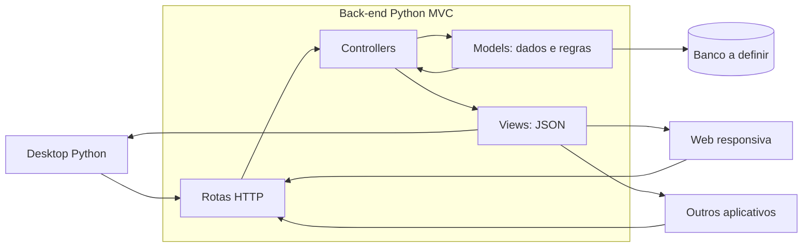

# Arquitetura MVC

A [ADR 0001](adr/0001-arquitetura-inicial.md) registra a simplificação solicitada.

Controllers coordenam; Models cuidam das regras e dos dados; Views apresentam respostas. Models não importam Controllers/Views. Views não acessam banco. Os clientes constroem suas próprias telas e consomem o contrato OpenAPI. Configuração e rotas conectam a aplicação sem camadas extras de abstração.

Veja o [exemplo do Back-end](../backend/README.md) e o [plano de desenvolvimento](../README.md#passos-de-desenvolvimento).
