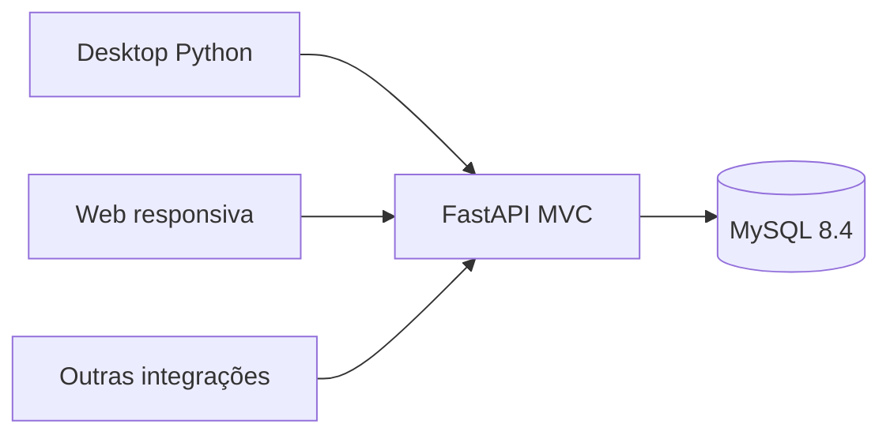
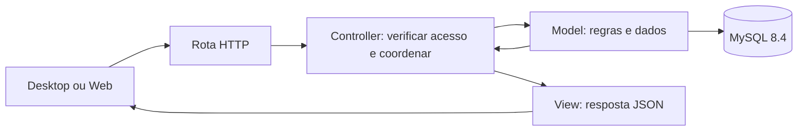

# Arquitetura e divisão do trabalho

Desktop Python, Web responsiva e outras integrações consomem a mesma API HTTP/JSON. O backend centraliza autenticação, autorização, regras e persistência. Clientes não importam Models internos nem acessam o MySQL diretamente.



| Decisão | Estado atual |
| --- | --- |
| Organização do backend | MVC, aplicação única; ADR 0001 |
| HTTP, banco e migrations | FastAPI, SQLAlchemy/PyMySQL síncrono, MySQL 8.4 e Alembic |
| Login | Usuário/senha no próprio banco, hash scrypt, JWT e sessões; ADR 0010 |
| Desktop | Python; toolkit ainda não escolhido |
| Web | Responsiva para computador/celular; tecnologia ainda não escolhida |
| Offline/PWA e módulos clínicos | Exigem definição e aprovação específicas |

MVC significa Model, View e Controller. A View da API é JSON, não uma tela. A estrutura permite trabalho em equipe sem camadas hexagonais adicionais ou microsserviços.

## Quem faz o quê

| Pasta em `src/prontuario_backend/` | Competência | Exemplo |
| --- | --- | --- |
| `models/` | Dados, regras de negócio e persistência | Validar e salvar uma anotação |
| `controllers/` | Receber a operação, verificar acesso e coordenar | Solicitar ao Model a criação após autorizar o usuário |
| `views/` | Formatar respostas JSON e erros | Retornar apenas identificador e texto permitidos |
| `routes/` | Conectar URL/método ao Controller | Registrar `POST /api/v1/anotacoes` |
| `config/` | Inicialização, banco, autenticação e Swagger | Ler a URL do banco do ambiente |

Views do servidor são representações JSON. As telas ficam em Desktop e Web. Models não importam Controllers ou Views. Views recebem dados do Controller, sem consultar o banco. Controllers não devem virar um arquivo enorme com SQL e todas as regras.

## Fluxo de uma operação



## Exemplo prático: registrar uma anotação de demonstração

Exemplo fictício para ensinar a divisão; não é uma regra clínica aprovada nem uma API já disponível. Imagine que um usuário autorizado envia um texto para um registro e que texto vazio seja inválido.

1. A rota recebe `POST /api/v1/anotacoes` e encaminha ao Controller.
2. A autenticação identifica o usuário; o Controller valida formato, registro solicitado e permissão de escrita.
3. O Model verifica a regra do texto e grava na transação configurada.
4. O Controller entrega o resultado à View.
5. A View seleciona os campos públicos e retorna a resposta de sucesso documentada.

### Pseudocódigo por pasta

As funções abaixo são ilustrativas: tipos, dependências e tratamento completo de erros não foram implementados. Não são arquivos executáveis.

```python
# models/anotacao.py
class Anotacao:
    @classmethod
    def criar(cls, registro_id, autor_id, texto):
        if not texto.strip():
            raise TextoInvalido("O texto não pode ficar vazio")
        # Pseudocódigo: a persistência real usa SQLAlchemy/MySQL.
        return salvar_anotacao_em_transacao(
            registro_id=registro_id,
            autor_id=autor_id,
            texto=texto.strip(),
        )


# controllers/anotacoes.py
def criar_anotacao(requisicao):
    usuario = exigir_usuario_autenticado(requisicao)
    entrada = validar_entrada(requisicao.json)
    exigir_permissao_de_escrita(usuario, entrada.registro_id)
    anotacao = Anotacao.criar(
        registro_id=entrada.registro_id,
        autor_id=usuario.id,
        texto=entrada.texto,
    )
    return resposta_criada(anotacao)


# views/anotacoes.py
def resposta_criada(anotacao):
    return {"id": anotacao.id, "texto": anotacao.texto}, 201
```

`validar_entrada`, autenticação, autorização, persistência e as exceções são nomes conceituais. A implementação precisa limitar tamanho do texto, validar identificadores, tratar registro inexistente e garantir consistência entre autorização e gravação. A transação deve confirmar antes de responder sucesso e desfazer alterações em falhas. Erros conhecidos devem virar respostas documentadas, sem expor SQL ou rastros internos.

O autor vem da sessão validada, nunca de um campo confiado ao cliente. Os exemplos e os testes usam dados sintéticos. Auditoria, controle por registro, proteção de dados e política de concorrência devem ser definidos antes do uso real.

## Divisão de trabalho na turma

- Quem implementa Models cuida das regras, consultas e persistência com seus testes.
- Quem implementa Controllers cuida dos fluxos, entradas e acesso, combinando os métodos dos Models com a equipe.
- Quem implementa Views e rotas cuida do contrato JSON, erros e documentação OpenAPI.
- A equipe combina os formatos antes de trabalhar em paralelo e testa a operação completa no final.

Uma pessoa pode atuar em mais de uma frente. A separação orienta onde escrever; não exige uma pessoa para cada pasta. Evitar abstrações extras até surgir uma necessidade concreta.

## Planejar uma funcionalidade

Produto/domínio define regras e critérios de aceite; o responsável pela arquitetura valida impactos; as equipes da API e dos clientes combinam o contrato antes de implementar. Qualidade verifica as fronteiras e infraestrutura cuida da execução e recuperação. São competências, não cargos obrigatórios para pessoas diferentes.

1. Defina operação, identidade, permissões e critérios de aceite.
2. Combine entradas, respostas e erros públicos; confira impactos nos clientes.
3. Implemente Model, Controller, View e rota, com transação e autorização.
4. Teste sucesso, entrada inválida, acesso negado e rollback.
5. Integre o cliente, cobrindo carregamento, falhas de rede e acessibilidade.

O exemplo acima é didático e não cria dados na aplicação. As regras clínicas ainda precisam de aprovação própria. Consulte o [desenvolvimento do backend](../backend/docs/DESENVOLVIMENTO.md), os READMEs de [Desktop](../desktop/README.md) e [Web](../web/README.md), e o [registro das decisões](adr/README.md).
