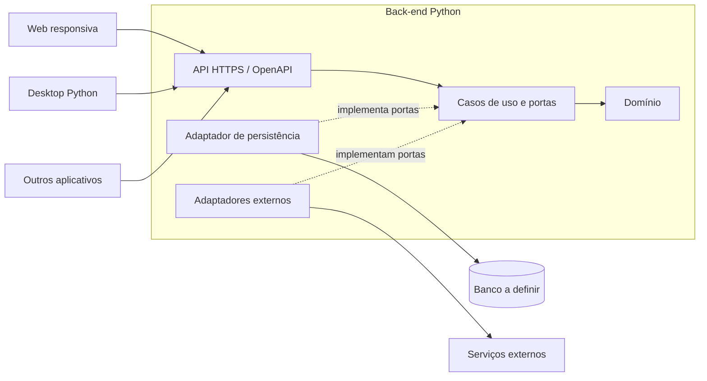

# Visão da arquitetura proposta

A decisão está registrada na [ADR 0001](adr/0001-arquitetura-inicial.md), ainda pendente de aprovação.

As setas contínuas mostram comunicação ou dependência. Os adaptadores de saída implementam portas definidas pela aplicação; o domínio não importa os adaptadores. O bootstrap conecta implementações e casos de uso.

Consulte os READMEs de cada componente para responsabilidades e os [critérios de validação](architecture-options.md) antes de iniciar a implementação.
